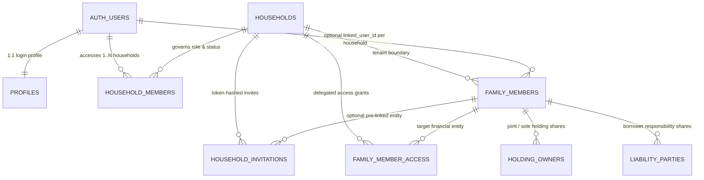

# WealthNest — Household-Based Access Control and Financial Ownership Architecture (Prioritized Phase 18A Blueprint)

**Document Type:** Master Implementation Specification & Engineering Blueprint  
**Roadmap Placement:** [next-phase-development-plan.md](file:///home/ketan/projects/Krisha/wealthNest/docs/next-phase-development-plan.md) — **Phase 18A (Priority Track 2: Top Active Development Priority)**  
**Status:** Prioritized for Next Development — **Stage 1 Repository Audit Required Before SQL or Code Edits**  
**Stage Policy:** WealthNest is pre-production beta with zero production users; evolve the existing monorepo (`apps/web`, `packages/domain`, `packages/application`, `packages/shared`, `supabase`) rather than rebuilding working financial math.

---

## 1. Objective & Authoritative Product Decisions

Establish **household-rooted, multi-user access control and true individual/joint financial ownership** before wider beta adoption or Android packaging:

1. Every new user automatically receives a household during onboarding (unless accepting an existing household invitation).
2. One household has **exactly one active primary owner** (`primary_owner`).
3. A household can have **multiple administrators** (`admin`).
4. Only the **primary owner** can appoint or remove administrators and transfer household ownership.
5. **Family members can exist without login accounts** (`linked_user_id IS NULL`; email is optional until invite time—supporting minors, HUF entities, and managed senior relatives).
6. **Family members can optionally register and link** their login to an existing `family_members` profile via explicit invitation acceptance (no silent auto-linking by email match alone).
7. **A user can belong to multiple households** (e.g., a married member belonging both to their marital household and parental household) without cross-leaking records or double-counting workspace totals.
8. Administrators can manage permitted household financial records, **subject to privacy rules**.
9. Linked members can manage their own permitted financial records.
10. Financial ownership belongs to the **actual `family_members` entity or entities** holding the asset/holding or owing the liability—never silently assumed to be the creator `auth.users.id`.
11. **Joint ownership** (multi-party assets/holdings and multi-party liabilities) must be supported accurately in SQL and integer-paise domain math.
12. Financial records carry explicit visibility settings: **`household_shared` | `owner_only` | `restricted`**.
13. **Private (`owner_only` / `restricted`) records are NOT automatically accessible to administrators.**
14. Access control is enforced strictly via **PostgreSQL RLS, database constraints, Storage policies, and `SECURITY DEFINER` RPCs**, never frontend route/component checks alone.

---

## 2. Stage 1 Requirement: Complete Repository Audit (Mandatory First Step)

Before creating or altering destructive migrations, audit and catalog every occurrence across:
- [supabase/migrations/](file:///home/ketan/projects/Krisha/wealthNest/supabase/migrations) (including `assets`, `holdings`, `transactions`, `liabilities`, `asset_valuations`, `liability_balances`, `asset_liability_links`, `loan_payments`, `goals`, `goal_holding_allocations`, `family_members`, `portfolio_accounts`, `import_batches`, `family_documents`, `admin_support_sessions`)
- All Supabase adapters under `apps/web/src/lib/supabase/` (currently filtering `.eq('user_id', userId)` across holding, transaction, liability, valuation/link, goal, family, backup, and CAS import modules)
- [packages/application/src/persistence/sqlite/sqlite-schema.ts](file:///home/ketan/projects/Krisha/wealthNest/packages/application/src/persistence/sqlite/sqlite-schema.ts) and Tauri SQLite parity layers (`FOREIGN KEY (user_id, member_id)`)
- Storage bucket [`family-vault`](file:///home/ketan/projects/Krisha/wealthNest/supabase/migrations/20260101000016_family_document_vault.sql#L101-L124) (`<owner_user_id>/...` path checks) and realtime hooks (currently zero realtime channels)
- Auth, onboarding, context providers ([FamilyContext](file:///home/ketan/projects/Krisha/wealthNest/apps/web/src/lib/family/family-context.tsx), [HouseholdSharingCard](file:///home/ketan/projects/Krisha/wealthNest/apps/web/src/components/settings/HouseholdSharingCard.tsx)), dashboard/Section 112A calculations ([family-wealth-calculator.ts](file:///home/ketan/projects/Krisha/wealthNest/packages/domain/src/family/family-wealth-calculator.ts)), backup/restore ([backup.adapter.ts](file:///home/ketan/projects/Krisha/wealthNest/apps/web/src/lib/supabase/backup.adapter.ts)), [supabase/seed_qa.sql](file:///home/ketan/projects/Krisha/wealthNest/supabase/seed_qa.sql), and pgTAP suites ([`01_rls_and_household_isolation.sql`](file:///home/ketan/projects/Krisha/wealthNest/supabase/tests/01_rls_and_household_isolation.sql)).

**Inventory Rule:** Explicitly classify every existing `user_id` column/filter by which of the five distinct concepts it currently conflates:
1. Login identity
2. Tenant boundary
3. Financial owner
4. Record creator / updater
5. Permission subject

---

## 3. Codebase-Aligned Target Database Architecture

The following schema reconciles target requirements with WealthNest's existing verified migrations ([`000001`](file:///home/ketan/projects/Krisha/wealthNest/supabase/migrations/20260101000001_core_schema.sql)–[`000019`](file:///home/ketan/projects/Krisha/wealthNest/supabase/migrations/20260101000019_household_membership_write_rls.sql)) to prevent silent breaks:

### 3.1 Core Identity & Household Tables
- **`public.profiles`**: `id` (`REFERENCES auth.users(id) ON DELETE CASCADE`), `display_name`, `default_currency`, `created_at`, `updated_at` (with onboarding columns added cleanly in Phase 19 or alongside).
- **`public.households`**: `id`, `name`, `created_by` (`ON DELETE SET NULL`), `created_at`, `updated_at`.
- **`public.household_members`**:
  - Align with existing `household_role` (extending [`000009`](file:///home/ketan/projects/Krisha/wealthNest/supabase/migrations/20260101000009_admin_portal_and_access_control.sql#L166) from `'primary_owner' | 'member' | 'viewer'` to **`'primary_owner' | 'admin' | 'member' | 'viewer'`**) or rename atomically across admin RPCs & pgTAP tests.
  - Add **`status`:** `'active' | 'suspended' | 'revoked'` (default `'active'`), `joined_at`, `created_at`, `updated_at`.
  - **Constraints:**
    - A user can hold multiple household memberships across distinct `household_id`s.
    - Prevent duplicate active membership in the same household (`UNIQUE (household_id, user_id)`).
    - **Exactly one active primary owner per household:** partial unique index `ON public.household_members (household_id) WHERE household_role = 'primary_owner' AND status = 'active'`, paired with an atomic **Transfer Ownership RPC** (never leaving 0 or 2 active primary owners).
- **`public.family_members`** (Evolved from [`000007`](file:///home/ketan/projects/Krisha/wealthNest/supabase/migrations/20260101000007_family_entities_and_accounts.sql#L6-L19)):
  - Add `household_id uuid NOT NULL REFERENCES public.households(id) ON DELETE CASCADE` (replacing `user_id` as tenant root).
  - Add `linked_user_id uuid NULL REFERENCES auth.users(id) ON DELETE SET NULL` (optional login link; email is NOT required on creation).
  - Track `created_by uuid REFERENCES auth.users(id) ON DELETE SET NULL`, `display_name` (synced/replacing `name`), entity type (`'individual' | 'huf' | 'minor'`), `relationship` relative to household (`'self' | 'spouse' | 'huf' | 'child' | 'parent' | 'other'`—never rendered as `"self"` to another logged-in user; UI computes `"You"` from `linked_user_id = auth.uid()`).
  - **Constraint:** Partial unique index `ON public.family_members (household_id, linked_user_id) WHERE linked_user_id IS NOT NULL` — prevents duplicate links inside one household while allowing one user (`linked_user_id`) to participate in multiple households.
- **`public.family_member_access`**: Explicit entity delegation (`id`, `household_id`, `family_member_id`, `user_id`, `permission`: `'view' | 'create' | 'update' | 'delete' | 'manage'`, `granted_by`, `created_at`, `expires_at`).
- **`public.household_invitations`**: `id`, `household_id`, `family_member_id` (nullable), `invited_email`, `role` (`'admin' | 'member' | 'viewer'` — never `'primary_owner'`), `token_hash` (SHA-256 only, never raw token), `invited_by`, `expires_at`, `accepted_at`, `revoked_at`, `created_at`.
- **`public.household_audit_logs`** (Separate from platform [`admin_audit_logs`](file:///home/ketan/projects/Krisha/wealthNest/supabase/migrations/20260101000017_security_hardening_rls_and_grants.sql#L6-L9)):
  - **Do not write household financial/privacy events into `admin_audit_logs`**, which is strictly platform-admin isolated (`Zero-Knowledge Platform Isolation`). Create an append-only `household_audit_logs` table readable only by that household's `primary_owner` / authorized `admin`s, written solely by `SECURITY DEFINER` RPCs / triggers.

---

## 4. Financial Ownership, Holdings Split & Privacy Model

### 4.1 Reconciling `assets` vs `holdings` & Replacing `co_borrower_ids`
- **Holdings & Portfolio Accounts (`holding_owners` instead of instrument-only `asset_owners`):**
  - In WealthNest, `public.assets` is the security/instrument master (`ISIN`, `ticker`, `instrument_type`) with zero `member_id`, while [`public.holdings`](file:///home/ketan/projects/Krisha/wealthNest/supabase/migrations/20260101000004_separate_equities_and_mutual_funds.sql#L20-L21) holds user positions, Demats, and folios.
  - Scope `holdings`, `portfolio_accounts`, `assets`, `transactions`, `asset_valuations`, `goals`, `goal_holding_allocations`, `liabilities`, `liability_balances`, `loan_payments`, `asset_liability_links`, `import_batches`, and `family_documents` to `household_id` (removing `ON DELETE CASCADE` from `auth.users`).
  - Migrate `idx_holdings_user_asset_account` ([`000004`](file:///home/ketan/projects/Krisha/wealthNest/supabase/migrations/20260101000004_separate_equities_and_mutual_funds.sql#L20-L21)) to `household_id` + account/folio/owner scoping so distinct members holding the same equity/fund in one household never collide.
  - Introduce **`holding_owners`** (`holding_id`, `family_member_id`, `ownership_percentage`, `ownership_type`, `created_at`)—and optionally `asset_owners` where asset-level appraisals/real estate exist directly on `assets`—enforcing `SUM(ownership_percentage) = 100` via `DEFERRABLE INITIALLY DEFERRED` constraint triggers / atomic RPCs.
- **Liabilities (`liability_parties` replacing `co_borrower_ids`):**
  - Replace the unvalidated [`liabilities.co_borrower_ids uuid[]`](file:///home/ketan/projects/Krisha/wealthNest/supabase/migrations/20260101000008_family_goals_and_liabilities.sql#L15) column cleanly with **`liability_parties`** (`liability_id`, `family_member_id`, `party_role`: `'primary_borrower' | 'co_borrower' | 'guarantor'`, `responsibility_percentage`) and backfill before dropping `co_borrower_ids`.
- **Keep Permission Tables Lean:** Combine `visibility` (`'household_shared' | 'owner_only' | 'restricted'`) on financial tables + `family_member_access` + targeted `record_permissions` (or `restricted_record_grants` queried only when `visibility = 'restricted'`) wrapped in `SECURITY DEFINER STABLE` RLS helper functions to prevent planner slowdowns and recursion.

### 4.2 Role & Privacy Invariants
- **`owner_only` for Unlinked Profiles:** An unlinked managed profile (`linked_user_id IS NULL`) cannot lock out the household owner/managers cleanly while having zero login of its own. Enforce that `owner_only` private isolation from Admins applies cleanly to linked user-owned records (or restrict `owner_only` selection to records with at least one `linked_user_id` owner / explicit user grant) so managed minor/parent data cannot become permanently orphaned.
- **Role Summary:**
  - `primary_owner`: Governance, admin assignment/removal, ownership transfer, invitations, permitted records (respecting others' `owner_only`/`restricted` flags).
  - `admin`: Manages `household_shared` & explicitly granted/managed-profile records; **cannot** manage admins, transfer ownership, or automatically view `owner_only`/`restricted` rows.
  - `member`: Manages records for their linked `family_members` profile + explicit delegations (`family_member_access`).
  - `viewer`: Read-only on `household_shared` + explicitly permitted records.

---

## 5. Secure Invitation Claim, Storage, SQLite Parity & Math

- **Atomic Invitation Acceptance (`accept_household_invitation` RPC):**
  - Validate `token_hash` (SHA-256), `expires_at > now()`, `revoked_at IS NULL`, `accepted_at IS NULL`, case-insensitive match against `auth.users.email`, **AND require `auth.users.email_confirmed_at IS NOT NULL`** before linking `family_members.linked_user_id`, upserting `household_members`, marking `accepted_at`, and logging to `household_audit_logs`.
- **Storage Vault Path Refactor ([`000016`](file:///home/ketan/projects/Krisha/wealthNest/supabase/migrations/20260101000016_family_document_vault.sql#L101-L124)):**
  - Switch `family-vault` upload paths from `<owner_user_id>/<doc_id>/<file>` to **`<household_id>/<doc_id>/<file>`**, and tie Storage policies to **DB `family_documents` membership + visibility checks** (preventing a multi-household user's `user_id` folder prefix from cross-leaking across households).
- **Support Impersonation Updates ([`000010`](file:///home/ketan/projects/Krisha/wealthNest/supabase/migrations/20260101000010_admin_support_sessions.sql#L258-L296)):**
  - Refactor `support_get_user_*` RPCs to resolve records accessible to `v_target_user_id` under active household membership + visibility rules without leaking other household members' private `owner_only`/`restricted` rows.
- **Desktop / Offline SQLite Parity ([`sqlite-schema.ts`](file:///home/ketan/projects/Krisha/wealthNest/packages/application/src/persistence/sqlite/sqlite-schema.ts)):**
  - Update `@wealthnest/domain`, `@wealthnest/application` ports, SQLite tables, and offline tests in lockstep with Supabase adapter migrations from `userId` -> `householdId` + `visibility` + `holding_owners` / `liability_parties`.
- **Zero-Drift Fractional `BigInt` Paise Math:**
  - Implement deterministic largest-remainder paise allocation in `@wealthnest/domain` for joint `holding_owners` / `liability_parties` shares so per-member net worth sums **exactly** to household net worth without double-counting or 1-paisa rounding drift, and surface multi-household PAN disclaimers on Section 112A summaries.

---

## 6. Phased Execution Sub-Plan (Under Phase 18A)

| Sub-Stage | Workstream | Gate Criteria |
|---|---|---|
| **Stage 1 (Step 0)** | **Full Repository Audit** (`user_id` classification inventory across DB, RLS, RPCs, Storage, adapters, SQLite, UI, tests) & Beta Data Disposition Decision (reset vs backfill) | Audit inventory signed off before destructive SQL changes |
| **Phase 1–2** | Identity, `households`, `household_members` (`household_role`, `status`, 1-active-owner constraint), `family_members` (`household_id`, nullable `linked_user_id`, unique per household), `family_member_access`, `household_audit_logs` | Schema migration + constraint pgTAP checks pass |
| **Phase 3–4** | Add `household_id` + `visibility` across financial tables, `holding_owners` + `liability_parties` (backfill/drop `co_borrower_ids`), helper functions + non-recursive RLS + `<household_id>/...` Storage RLS + Support RPC alignment | Old `user_id`-bypass RLS removed; pgTAP cross-household, admin-privacy, and deletion-preservation tests green |
| **Phase 5** | `household_invitations`, `create_household_invitation` + `accept_household_invitation` RPCs (with `email_confirmed_at` guard, hash-only tokens, idempotent linking) | Invite claim, replay, expiry, revocation, and email-mismatch DB tests green |
| **Phase 6** | Active Household Switcher UI, role-aware nav, mandatory explicit owner/joint selector for admins, default linked profile for members, visibility picker, SQLite & Supabase adapter parity | Adapters free of legacy `.eq('user_id')` filters; desktop/web tests pass |
| **Phase 7–8** | `BigInt` fractional joint-ownership & net-worth verification, Section 112A disclaimers, backup/export/import scoping, full regression + pgTAP + beta readiness review | All deliverables below complete and verified |

### Planned Deliverables Checklist (§15)
- [x] `docs/architecture/household-ownership-and-access-model.md` (this baseline blueprint; update post-audit & per phase)
- [ ] `docs/architecture/household-permission-matrix.md`
- [ ] `docs/implementation/household-migration-plan.md` (including Stage 1 `user_id` inventory & ERD)
- [ ] `docs/security/household-rls-security-review.md` (migration & RLS inventory)
- [ ] `docs/testing/household-access-control-test-plan.md` (DB/pgTAP + API test results & beta checklist)
