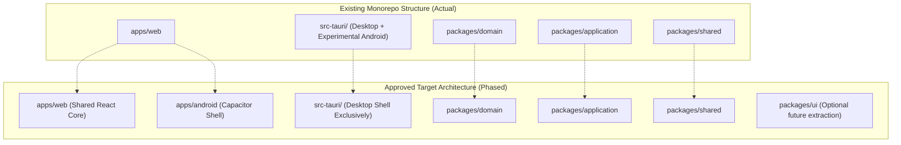
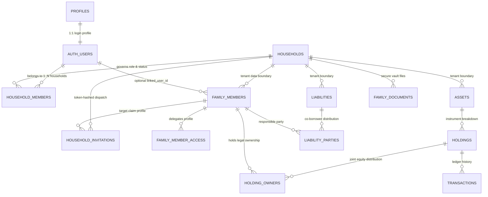
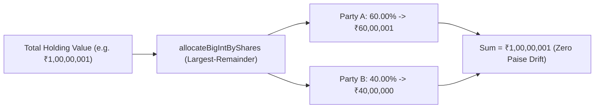
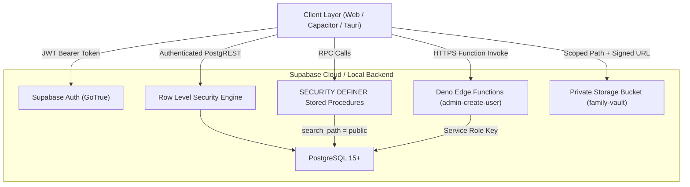
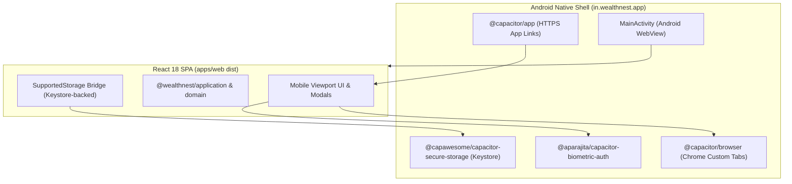
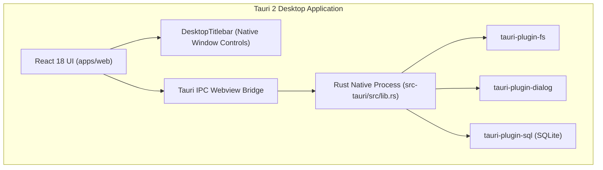
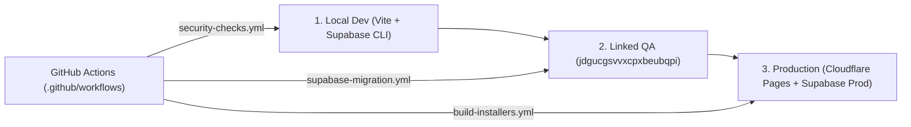
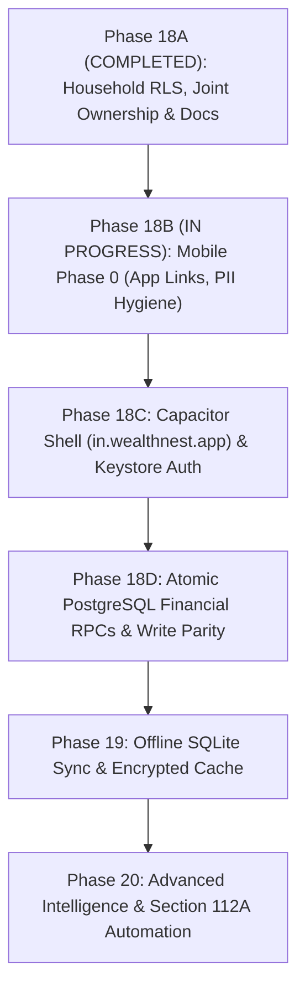

# WealthNest — Platform Architecture & Technology Strategy

**Document Status:** Baseline Platform Architecture & Technical Strategy  
**Document Version:** 1.0.0  
**Target Date:** 2026-11-17  
**Approved Decisions Cross-Reference:** [wealthnest-architecture-decisions.md](file:///home/ketan/projects/Krisha/wealthNest/docs/architecture/wealthnest-architecture-decisions.md)

---

## Status Classification Key
To ensure absolute technical accuracy and avoid misleading future development, this document rigorously labels every subsystem, component, and architectural pattern using the following standardized statuses:

- `IMPLEMENTED`: Verified in the repository with running code, database migrations, and passing automated tests.
- `PARTIALLY IMPLEMENTED`: Foundational code or schema exists in the repository, but requires further refinement, mobile adaptation, or completion.
- `APPROVED / NOT IMPLEMENTED`: Formally approved target architectural decision, planned for upcoming implementation phases (no code currently in tree).
- `PROPOSED`: Candidate architectural approach or optimization under technical evaluation, awaiting final product owner sign-off.
- `NEEDS INVESTIGATION`: Technical unknown, external dependency, or operational requirement requiring prototyping or spike investigation.

---

## 1. Executive Summary

**WealthNest** is an institutional-grade **Family Financial Management Platform** designed to solve the structural limitations of single-user personal finance applications. Rooted in an India-first wealth context (handling complex multi-folio mutual funds, CAS statements, demat accounts, HUF entities, and Section 112A LTCG tax harvesting), WealthNest models wealth from the perspective of **Households** and **Collaborative Families**.

The platform is architected around a unified core:
1. **Frontend Core:** A high-performance, responsive React 18 SPA built with TypeScript (Strict Mode) and Vite 6.
2. **Backend Engine:** Supabase PostgreSQL 15+ leveraging advanced Row Level Security (RLS), partial unique indexes, integer `bigint` precision for paise math, and `SECURITY DEFINER` stored procedures.
3. **Platform Distribution Strategy:** A tri-platform shell model:
   - **Web:** Hosted on modern edge CDN infrastructure (Cloudflare Pages / Docker Nginx).
   - **Android:** Packaged via **Capacitor** (`in.wealthnest.app`) wrapping the existing React application, reusing 100% of domain business logic and ~95% of UI components.
   - **Desktop:** Packaged via **Tauri 2** (Rust native layer) solely for Windows, macOS, and Linux desktop environments.
4. **Business Logic Isolation:** Pure domain calculations (zero floating-point arithmetic, deterministic largest-remainder joint share allocation, loan amortization) isolated into platform-agnostic TypeScript packages.

---

## 2. Product Overview & Core Capabilities

WealthNest provides a unified operating system for household wealth:

- **Household & Family Workspace Governance:** Centralized workspace creation with multi-user access, role delegation, and member lifecycle management.
- **Individual Financial Profiles & Entity Diversity:** Support for individual adults, minor dependents, elderly relatives, and corporate/trust/HUF (Hindu Undivided Family) non-individual tax entities.
- **Assets & Multi-Class Investments:** Granular tracking of Indian Equities (NSE/BSE), Mutual Funds (Direct/Regular, Growth/IDCW), Fixed Deposits, EPF/PPF, Sovereign Gold Bonds (SGB), and Physical Gold.
- **Real Estate & Property Management:** Real estate portfolios linked with historical municipal/market valuations, multi-owner equity allocation, and property-linked mortgages.
- **Liabilities, Loans & EMI Bifurcation:** Tracking of home loans, vehicle loans, personal loans, and credit cards with exact principal-vs-interest mathematical bifurcation.
- **Household & Individual Net Worth Analytics:** Instant toggle between total aggregated household balance sheets and individual member net worth slices, with zero double-counting.
- **Financial Document Vault:** End-to-end encrypted or access-controlled vault for property deeds, PAN cards, insurance policies, and wills, linked directly to financial assets.
- **Automated CAS Statement Ingestion:** Ingestion of CAMS / KFintech Consolidated Account Statements (CAS) with smart duplicate detection and automated folio reconciliations.

### Product Philosophy: The Household-Based Workspace
WealthNest is fundamentally distinct from single-user budgeting software. It models real-world family dynamics:
- **Single Caretaker Mode:** One family member (e.g., primary earner or financial head) can manage the entire family's finances without requiring every member to log in.
- **Multi-Login Collaboration:** Independent family members can create their own accounts, link to their existing financial profiles, and manage their personal finances collaboratively.
- **Individual Autonomy & Privacy:** Family members retain the absolute right to keep specific bank balances, investments, or liabilities private from other members, including household administrators.

---

## 3. Current vs. Approved Target Technology Stack

| Architecture Layer | Current Repository Implementation (`Status`) | Approved Target Architecture (`Status`) | Strategic Trade-Off & Evolution Notes |
|---|---|---|---|
| **Frontend Framework** | React 18.3 (`IMPLEMENTED`) | React 18.3 (`IMPLEMENTED`) | Modern component architecture, functional hooks, responsive layout. |
| **Language** | TypeScript 5.8 Strict (`IMPLEMENTED`) | TypeScript 5.8 Strict (`IMPLEMENTED`) | Shared across apps and packages via Project References. |
| **Build Tooling** | Vite 6.2 (`IMPLEMENTED`) | Vite 6.2 (`IMPLEMENTED`) | Sub-second HMR, optimized static rollup output. |
| **Styling & Icons** | Tailwind CSS 3.4 + Lucide React (`IMPLEMENTED`) | Tailwind CSS 3.4 + Lucide React (`IMPLEMENTED`) | Utility-first CSS, dark-mode native, dense data tables. |
| **Data Fetching / State** | TanStack React Query 5.67 (`IMPLEMENTED`) | TanStack React Query 5.67 (`IMPLEMENTED`) | Automated query caching, keyed by `activeHouseholdId`. |
| **Backend as a Service** | Supabase Cloud / Local CLI 2.15+ (`IMPLEMENTED`) | Supabase Cloud / Local CLI 2.15+ (`IMPLEMENTED`) | Managed GoTrue Auth, Postgres 15+, Private Storage, Edge Functions. |
| **Database Engine** | PostgreSQL 15+ (`IMPLEMENTED`) | PostgreSQL 15+ (`IMPLEMENTED`) | Standard relational migrations, constraint triggers, integer `bigint`. |
| **Database Tenancy Model** | Household Tenancy (`000020`–`000024`) (`IMPLEMENTED`) | Household Tenancy (`IMPLEMENTED`) | `household_id NOT NULL` across all financial tables. Zero legacy `user_id`. |
| **Authorization / Security** | PostgreSQL RLS + RPCs (`IMPLEMENTED`) | PostgreSQL RLS + RPCs (`IMPLEMENTED`) | Row-level security on all 17 public tables; non-recursive `SECURITY DEFINER`. |
| **Android Shell** | Tauri 2 Android (`scripts/build-android.sh`) (`PARTIALLY IMPLEMENTED`) | **Capacitor** (`in.wealthnest.app`) (`APPROVED / NOT IMPLEMENTED`) | **Architectural Decision:** Replace Tauri 2 Android wrapper with Capacitor for production-grade Keystore, BiometricPrompt, and App Links. |
| **Desktop Shell** | Tauri 2 (Rust) (`IMPLEMENTED`) | Tauri 2 (Rust) (`IMPLEMENTED`) | **Architectural Decision:** Retain `src-tauri/` solely for desktop packaging (`.exe`, `.msi`, `.deb`). |
| **Shared Business Logic** | npm workspaces (`domain`, `application`, `shared`) (`IMPLEMENTED`) | npm workspaces (`domain`, `application`, `shared`) (`IMPLEMENTED`) | Shared pure financial math, paise integer values, zero DOM/DB dependencies. |
| **Web Deployment** | Cloudflare Pages / Docker Nginx (`IMPLEMENTED`) | Cloudflare Pages / Docker Nginx (`IMPLEMENTED`) | 100% static client distribution; zero server runtime vulnerabilities. |

---

## 4. Repository Architecture Assessment

### 4.1 Current Physical Repository Structure (`IMPLEMENTED`)
The repository is currently organized as a modular monolith using **npm workspaces**:

```
wealthnest/
├── apps/
│   └── web/                               # React 18 + Vite 6 + Tailwind SPA (@wealthnest/web)
│       ├── public/                        # Static assets, PWA icons, _headers for Cloudflare
│       └── src/
│           ├── components/                # UI presentation & feature modals
│           ├── lib/                       # Adapters, contexts, and runtime bridges
│           │   ├── config/                # Server config, app redirect URL resolution
│           │   ├── family/                # FamilyContext and privacy state
│           │   ├── supabase/              # Supabase adapters (holding, liability, admin, etc.)
│           │   └── tauri/                 # Tauri runtime detection & SQLite bridge
│           └── pages/                     # Routed view components (Portfolio, Liabilities, etc.)
├── packages/
│   ├── application/                       # Framework-agnostic use cases & ports (@wealthnest/application)
│   │   └── src/
│   │       ├── ports/                     # Repository interfaces (HoldingRepo, FamilyRepo, etc.)
│   │       ├── persistence/sqlite/        # Offline SQLite schema and adapter implementations
│   │       └── use-cases/                 # Orchestration use cases (ExportPortfolio, ManageFamily)
│   ├── domain/                            # Pure domain models & financial math (@wealthnest/domain)
│   │   └── src/
│   │       ├── family/                    # Family types & family-wealth-calculator
│   │       ├── household/                 # Joint ownership BigInt allocation algorithms
│   │       ├── liabilities/               # Loan amortization & historical net worth
│   │       ├── money/                     # Money value objects (paise bigint) & currency
│   │       └── tax/                       # India Section 112A LTCG tax harvesting
│   └── shared/                            # Primitives, Result type, common utilities (@wealthnest/shared)
├── src-tauri/                             # Tauri 2 Desktop configuration & Rust native harness
│   ├── capabilities/                      # Tauri 2 desktop security capabilities
│   ├── icons/                             # Native multi-resolution icons
│   ├── src/                               # Rust main.rs & lib.rs entrypoints
│   ├── Cargo.toml                         # Rust dependencies (tauri, tauri-plugin-sql, dialog, fs)
│   └── tauri.conf.json                    # Tauri 2 bundle configuration
├── supabase/                              # Database definition & local development
│   ├── functions/                         # Supabase Edge Functions (admin-create-user)
│   ├── migrations/                        # 25 versioned PostgreSQL SQL migrations (000000 -> 000024)
│   ├── tests/                             # pgTAP automated database security test suites (72 assertions)
│   ├── full_schema.sql                    # Clean concatenated snapshot of all migrations
│   └── seed_qa.sql                        # Multi-user, multi-household QA test fixtures
├── scripts/                               # Automation, verification, and containerized builders
├── infra/                                 # Dockerfiles, Nginx configs, and compose manifests
└── docs/                                  # Comprehensive architecture, security, and QA specifications
```

### 4.2 Structural Comparison: Current vs. Proposed Monorepo Structure



| Structural Element | Present in Repository? | Status & Assessment | Recommendation |
|---|---|---|---|
| `apps/web` | **Yes** | `IMPLEMENTED` | Retain as the single core React application consumed by Web, Capacitor, and Tauri. |
| `apps/android` | **No** (Currently `src-tauri/gen/android`) | `APPROVED / NOT IMPLEMENTED` | Add Capacitor Android shell (`in.wealthnest.app`) in Phase 18C. |
| `apps/desktop` | **No** (Located in root `src-tauri/`) | `IMPLEMENTED` (in `src-tauri/`) | Keep `src-tauri/` at root as standard for Tauri projects; no benefit in moving to `apps/desktop`. |
| `packages/shared` | **Yes** | `IMPLEMENTED` | Retain for common types, Result wrappers, date utilities. |
| `packages/domain` | **Yes** | `IMPLEMENTED` | Contains the complete pure financial engine (zero dependencies). |
| `packages/application` | **Yes** | `IMPLEMENTED` | Contains use cases, repository contracts, and SQLite adapters. |
| `packages/financial-engine`| **Integrated** | `IMPLEMENTED` (inside `packages/domain`) | Keep inside `packages/domain` to avoid unnecessary package fragmentation. |
| `packages/supabase` | **Partially** | `PARTIALLY IMPLEMENTED` (in `apps/web/src/lib/supabase`) | Keep adapters in `apps/web` for now; extract if a second React/Node client emerges. |
| `packages/validation` | **Integrated** | `PARTIALLY IMPLEMENTED` (in `apps/web/src/lib/validation`) | Retain currently; extract to shared package only when shared with mobile native bridges. |
| `packages/ui` | **Integrated** | `PARTIALLY IMPLEMENTED` (in `apps/web/src/components/ui`) | Retain in `apps/web`; extraction adds overhead without multi-framework requirements. |

### 4.3 Monorepo Migration & Restructuring Assessment
- **Is an immediate monorepo restructuring beneficial?** **No.**
- **Rationale:** The repository already possesses clean architectural boundaries enforced by TypeScript Project References (`tsc -b`), native npm workspaces, and strict hexagonal isolation. Moving `packages/domain` logic into additional sub-packages (e.g. splitting into `financial-engine` or `validation`) would introduce package boundary friction, redundant `package.json` maintenance, and build script churn without delivering any user or architectural value.
- **Guidance:** Proceed with **incremental evolution**. Maintain the current workspace structure, add the Capacitor Android shell cleanly alongside `apps/web`, and keep `src-tauri/` dedicated solely to desktop packaging.

---

## 5. Household-Based Application Architecture



### 5.1 The Seven Fundamental Identity & Access Concepts
A core defect in legacy personal finance systems is the conflation of user identity with financial ownership. WealthNest strictly decouples these seven concepts:

1. **Authentication Identity (`auth.users.id`):** The cryptographic identity created during signup. Authenticates credentials and issues JWTs.
2. **Household Membership (`household_members`):** The association connecting an authenticated user to a specific household, defining their **governance role** (`primary_owner`, `admin`, `member`, `viewer`).
3. **Financial Family Identity (`family_members`):** The human or non-individual legal entity that owns wealth (e.g., "Ketan Vaghela", "Rohan (Minor)", "Vaghela HUF"). Can exist completely without an `auth.users` login account (`linked_user_id IS NULL`).
4. **Financial Ownership (`holding_owners` / `liability_parties`):** The legal attribution of an asset or debt to one or more `family_members`, defined by explicit percentage shares totaling 100.00%.
5. **Record Creator (`created_by`):** The `auth.users.id` of the actor who initially typed or imported the record into the database. Preserved for auditability; conveys zero inherent ownership rights.
6. **Record Updater (`updated_by`):** The `auth.users.id` of the actor who executed the most recent mutation.
7. **Access Permissions (PostgreSQL RLS):** The dynamic decision computed at the database row level determining whether the current caller (`auth.uid()`) can SELECT, INSERT, UPDATE, or DELETE a given record based on household membership, visibility level, and explicit delegation grants.

---

## 6. Access Control & Permission Matrix

### 6.1 Household Governance Roles

| Role | Cardinality Invariant | System Privileges | Boundary Restrictions |
|---|---|---|---|
| **`primary_owner`** | Exactly **1 active** per household (`partial unique index`) | Full governance: delete household, billing, rename, invite members, appoint/demote admins, transfer ownership. | **Cannot** bypass RLS to read `owner_only` or `restricted` records of other linked members. |
| **`admin`** | 0 or more per household | Workspace operations: invite members/viewers, manage unlinked profiles (minors/HUFs), manage household-shared records. | **Cannot** appoint/remove admins, cannot transfer ownership, cannot view private records of other linked members. |
| **`member`** | 0 or more per household | Personal financial autonomy: manage own linked profile, insert/edit personal assets, manage profile delegations. | **Cannot** view private records of others; cannot manage unlinked profiles without explicit delegation. |
| **`viewer`** | 0 or more per household | Read-only inspection: view household net worth, shared asset allocation, and shared family goals. | **Strictly read-only**: Zero INSERT, UPDATE, or DELETE capability on any financial entity. |

### 6.2 Record Visibility Levels (`visibility`)
Every financial entity (`assets`, `holdings`, `liabilities`, `goals`, `family_documents`) enforces an explicit `visibility` column:

```sql
visibility text NOT NULL DEFAULT 'household_shared' 
CHECK (visibility IN ('household_shared', 'owner_only', 'restricted'))
```

1. **`household_shared`:**
   - **Accessible to:** All active members (`primary_owner`, `admin`, `member`, `viewer`) of that specific household.
   - **Use Cases:** Family home, shared emergency savings, joint education funds.
2. **`owner_only`:**
   - **Accessible to:** The financial owner(s) matching `family_members.linked_user_id` and explicit profile delegates (`family_member_access`).
   - **Crucial Invariant:** **Completely hidden from household `primary_owner` and `admin`** if owned by a different linked member.
   - **Use Cases:** Personal salary accounts, individual PPF/EPF, personal discretionary investments.
3. **`restricted`:**
   - **Accessible to:** The financial owner(s) **plus** specific household members explicitly granted access via `restricted_record_grants(household_id, record_type, record_id, grantee_user_id)`.
   - **Use Cases:** Confidential business venture shared with a spouse, but hidden from parents or children.

---

## 7. Financial Ownership & Mathematical Data Integrity

The pure financial engine in [`packages/domain`](file:///home/ketan/projects/Krisha/wealthNest/packages/domain) implements institutional mathematical safeguards:



### 7.1 Mathematical Integrity Rules (`IMPLEMENTED`)
1. **Zero Floating-Point Drift:** All monetary values are represented as integer paise (`BigInt` in TypeScript, `bigint` in PostgreSQL). Never use binary floating-point (`number` / `float8`) for monetary sums.
2. **Deterministic Joint Share Allocation:** Handled via `allocateBigIntByShares` in [`joint-ownership.ts`](file:///home/ketan/projects/Krisha/wealthNest/packages/domain/src/household/joint-ownership.ts) using the Hare-Niemeyer (largest-remainder) algorithm. Fractions of a paisa are deterministically awarded to the largest fractional remainder, guaranteeing that the sum of parts strictly equals the total.
3. **Sum of Shares Invariant (100.00%):** Deferrable constraint triggers on `holding_owners` and `liability_parties` validate that the sum of shares for any multi-owner instrument equals exactly `100.00%` before transaction commit.
4. **Historical Valuation Integrity:** Historical net worth calculations (`calculateHistoricalNetWorth` in [`historical-net-worth-calculator.ts`](file:///home/ketan/projects/Krisha/wealthNest/packages/domain/src/liabilities/historical-net-worth-calculator.ts)) strictly ignore valuations occurring after the reporting date, and never replace past loan balances with today's balance.
5. **Double-Entry Cashflow Rule:** Internal account-to-account transfers (`type === 'transfer'`) are mathematically neutral in [`cashflow-summary.ts`](file:///home/ketan/projects/Krisha/wealthNest/packages/domain/src/cashflow/cashflow-summary.ts), preventing false inflation of family income or living expenses.
6. **No Silent Zero Coercion:** Missing asset valuations or loan balances are surfaced explicitly as missing checkpoints (`missingAssetValuations`), never silently coerced to zero.
7. **EMI Principal/Interest Separation:** Handled via `bifurcateLoanPayment` in [`loan-amortization.ts`](file:///home/ketan/projects/Krisha/wealthNest/packages/domain/src/models/loan-amortization.ts), calculating exact monthly interest accruals and principal amortization in integer paise.

---

## 8. Supabase Backend Architecture



### 8.1 Backend Responsibilities & Security Policies
- **Supabase Auth (GoTrue):** Issues and verifies ES256/HS256 JWTs. Enforces breached-password detection (HIBP), rate limiting, and password complexity (12+ characters with uppercase, lowercase, numbers, and symbols).
- **PostgreSQL Database:** Enforces schema constraints, foreign key cascades (`ON DELETE CASCADE` from `households`), partial unique indexes, and audit logs.
- **Row Level Security (RLS):** All 17 public application tables have `rowsecurity = true`. Anonymous access is revoked from all tables except `SELECT` on `public.asset_classes` (for public onboarding tickers).
- **`SECURITY DEFINER` Functions:** All stored procedures (`accept_household_invitation`, `transfer_household_primary_owner`, `appoint_household_admin`, `admin_*`) explicitly enforce `SET search_path = public` to prevent search-path hijacking attacks.
- **Edge Functions:** Run privileged server-side flows in an isolated Deno sandbox (e.g. [`admin-create-user`](file:///home/ketan/projects/Krisha/wealthNest/supabase/functions/admin-create-user/index.ts)). Validates caller JWT, enforces platform admin RBAC, applies sliding-window Postgres rate limiting (10/min, 30/15m), and restricts CORS via `ALLOWED_ORIGINS`.
- **Storage (`family-vault`):** Private storage bucket. Storage RLS restricts object operations to paths prefixed by `/<household_id>/...` joined with `can_access_family_document` metadata checks.

---

## 9. Android Architecture — Capacitor

### 9.1 Approved Mobile Technology Decision
**Capacitor** is the approved target technology for the Android mobile application.
- **Target Package Identifier:** `in.wealthnest.app`
- **Architectural Rationale:** WealthNest already possesses a fully responsive, mobile-optimized React 18 SPA (`apps/web`) with dedicated touch ergonomics and mobile titlebars. Capacitor enables 100% reuse of the domain and application layers, avoiding a costly, bug-prone rewrite in React Native or Kotlin.
- **Tauri 2 Android Status:** While the repository contains an experimental Tauri 2 Android build script (`scripts/build-android.sh`), Tauri 2's mobile ecosystem currently lacks battle-tested plugins for Android Keystore, Google Credential Manager, and BiometricPrompt. Consequently, **Tauri is retained exclusively for Desktop**, and **Capacitor is approved for Android**.



### 9.2 Android Implementation Checklist & Security Architecture (`APPROVED / NOT IMPLEMENTED`)
1. **Hardware-Backed Token Persistence (`CRED-01`–`CRED-05`):** Implement custom `SupportedStorage` for `@supabase/supabase-js` backed by Android Keystore and `EncryptedSharedPreferences`. Zero plaintext auth tokens or PAN data in WebView `localStorage`.
2. **Biometric App Lock (`AUTH-07`):** Enforce biometrics (fingerprint / face / device PIN) via `BiometricPrompt` on app launch or resume from background.
3. **Verified Android App Links (`AUTH-04`):** Configure `<intent-filter android:autoVerify="true">` for `https://app.wealthnest.in/invite/*`, `/auth/callback`, and `/reset-password` paired with `/.well-known/assetlinks.json`.
4. **OAuth via Chrome Custom Tabs (`AUTH-05`):** Disallow embedded WebView OAuth. Route Google sign-in through Chrome Custom Tabs via PKCE flow.
5. **Network Security Configuration (`NET-01`–`NET-03`):** Ship `network_security_config.xml` enforcing `cleartextTrafficPermitted="false"`. Disable WebView remote debugging in production release builds.

---

## 10. Desktop Architecture — Tauri 2

### 10.1 Desktop Implementation (`IMPLEMENTED`)
- **Technology:** Tauri 2 (`tauri` v2.0.0, `src-tauri/`) utilizing native WebKit2GTK on Linux, WebView2 on Windows, and WKWebView on macOS.
- **Desktop Isolation Rule:** `src-tauri/` is strictly isolated to desktop targets. It is not shared with the Capacitor Android project.
- **Native OS Capabilities (`capabilities/default.json`):**
  - Native window dragging, minimization, maximization, and snapping.
  - Native system dialogs (`tauri-plugin-dialog`) for local file importing (CAS PDF/CSV) and encrypted backup exports.
  - Local file system read/write (`tauri-plugin-fs`) restricted to user-approved directories.
  - Local SQLite engine (`tauri-plugin-sql`) preloading `sqlite:wealthnest_v1.db`.



---

## 11. Security, Privacy & Compliance Architecture

### 11.1 Security Implementation Summary
- **Multi-Tenant Isolation:** Database engine guarantees isolation via `household_id` filtering in RLS.
- **Admin Privilege Escalation Protections (`P0-1`–`P0-3`):** Removal of simulated admin roles in production; SQL null-role checking hardened (`IS DISTINCT FROM 'super_admin'`); service-role keys restricted strictly to backend Edge Functions.
- **Audit Immutability:** `household_audit_logs` and `admin_audit_logs` tables have row security enabled with zero UPDATE or DELETE grants for any authenticated role.
- **Anonymous Access Restrictions:** Revoked all table privileges from `anon` across the public schema, retaining only `SELECT` on `asset_classes` for onboarding tickers.
- **Support Mode Isolation:** Platform support sessions have a mandatory 15-minute TTL (`support_session_invariants.test.ts`), log all actions, and prevent support admins from altering financial ledgers.

---

## 12. Environments & Deployment Strategy



### 12.1 Environment Pipeline
1. **Local Development:** Developers run Vite locally (`npm run dev:web` on `localhost:5173`) connected to local Supabase Docker containers (`supabase start` on `127.0.0.1:54321`) or linked QA backend.
2. **Linked QA Environment:** Project `jdgucgsvvxcpxbeubqpi` hosted on Supabase Cloud. Receives migrations automatically via GitHub Actions, monitored by `keep-qa-alive.yml` pings, and seeded via `seed_qa.sql`.
3. **Production Environment (`PROPOSED`):** Dedicated production Supabase project with point-in-time recovery (PITR), connected to Cloudflare Pages for the static web client (`app.wealthnest.in`).

---

## 13. Future Strategic Roadmap

The architectural roadmap is organized into logical, non-destructive phases:



1. **Phase 18A (`IMPLEMENTED`):** Complete Household RLS, joint ownership BigInt math, and core documentation.
2. **Phase 18B (`PARTIALLY IMPLEMENTED`):** App Link redirect resolution (`AUTH-04`), fail-closed admin adapters (`AUTH-08`), and pre-Capacitor PII hygiene.
3. **Phase 18C (`APPROVED / NOT IMPLEMENTED`):** Initialize Capacitor Android shell (`in.wealthnest.app`), wire Android Keystore token storage, and configure biometric lock.
4. **Phase 18D (`APPROVED / NOT IMPLEMENTED`):** Implement atomic PostgreSQL financial RPCs (`record_transaction_atomic`, `record_emi_payment_atomic`) to replace multi-step client writes.
5. **Phase 19 (`PROPOSED`):** Offline-first synchronization engine using encrypted local SQLite/SQLCipher.
6. **Phase 20 (`PROPOSED`):** AI-powered financial advisory, document OCR extraction, and automated Section 112A tax harvesting suggestions.

---

## 14. Open Questions & Technical Risks

| # | Item / Risk | Current Assessment | Product Owner Decision Required |
|---|---|---|---|
| **1** | **Production Domain & App Links** | Code resolves `https://app.wealthnest.in` as canonical origin. | Confirm production apex domain (`wealthnest.in` vs alternative) for DNS, SSL, and `assetlinks.json`. |
| **2** | **Support Mode Portfolio Access** | `support_get_user_portfolio` respects household isolation with a 15-min TTL. | Confirm whether support impersonation requires end-user SMS/email consent notification. |
| **3** | **Storage Vault Virus Scanning** | Uploaded documents are checked for magic-number MIME headers client-side. | Decide whether backend virus scanning (ClamAV / VirusTotal) is required for production document storage. |
| **4** | **Capacitor Android Shell Timeline** | Architecture assessment approves Capacitor; Tauri 2 Android script exists as legacy. | Confirm green light to initialize `android/` Capacitor project in Phase 18C. |

---

## 15. Recommended Implementation Sequence

1. **Finalize Phase 18B Pre-Capacitor Prerequisites:** Complete plaintext PII scrubbing in local adapters and execute mobile isolation tests (`TC-MOB-ISO-01`..`10`).
2. **Initialize Capacitor Android Project (Phase 18C):** Add `@capacitor/core`, `@capacitor/android`, and Keystore secure storage plugins under package ID `in.wealthnest.app`.
3. **Deploy Production Infrastructure:** Provision production Supabase instance, apply migrations `000000`–`000024`, and configure Cloudflare Pages deployment.
4. **Implement Transactional Financial RPCs (Phase 18D):** Deploy `record_transaction_atomic` and `record_emi_payment_atomic` to eliminate partial client-side write failures on mobile networks.
