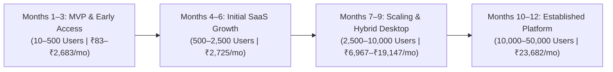

# WealthNest — Infrastructure Cost, User Capacity & Scalability Assessment

**Assessment Type:** Read-Only Technical & Financial Architecture Audit  
**Assessment Date:** October 2026  
**Document Path:** `docs/cost/costAnalysis.md`  
**Currency & Exchange Rate Baseline:** Reported in **INR (`₹`, Indian numbering system: Thousands / Lakhs / Crores)** alongside USD (`$`) and EUR (`€`) provider list prices. Assumed exchange rates as of October 2026: **`$1.00 USD = ₹84.00 INR`**, **`€1.00 EUR = ₹91.00 INR`** (exclusive of 18% Indian GST / Reverse Charge Mechanism unless explicitly noted).

---

## 1. Architecture Audit (Repository Evidence)

Every finding below is verified directly against the repository source code, database migrations, and build artifacts. Implemented functionality is strictly separated from planned or unimplemented capabilities.

### 1.1 Implemented vs. Planned / Unimplemented Matrix

| Subsystem | Current Implementation Status | Repository Evidence & Exact Behavior |
| :--- | :--- | :--- |
| **Frontend SPA & Build** | **Implemented** | React 18.3.1, TypeScript 5.8.2, Vite 6.2.0, Tailwind CSS 3.4.17, TanStack Query 5.67.1 (`apps/web/package.json`). Production build in `apps/web/dist/` totals **2.96 MB uncompressed** (~850 KB gzipped): `index-DX5LWg3f.js` (1.5 MB), `pdf.worker.min-yatZIOMy.mjs` (1.4 MB), `index-CUo-giyJ.css` (55 KB). Served as static files via `nginx:1.27-alpine` (`infra/docker/Dockerfile.prod`, `infra/docker/nginx-prod.conf`). |
| **Backend & Database** | **Implemented (Direct PostgREST + RPC)** | Supabase PostgreSQL 15 (`supabase/config.toml`) with **18 tables** across 11 migrations (`supabase/migrations/`). **Zero custom backend server and zero Supabase Edge Functions exist.** The browser talks directly to Supabase PostgREST (`REST`), GoTrue (`Auth`), and PostgreSQL `SECURITY DEFINER` RPC functions. |
| **Row-Level Security (RLS) & Auth** | **Implemented** | Enabled on all 18 public tables. Standard user tables enforce `auth.uid() = user_id` (`supabase/migrations/20260101000001_core_schema.sql`). Admin/support tables invoke `public.is_platform_admin(auth.uid())` (`20260101000009_admin_portal_and_access_control.sql`) and `public.validate_support_session(p_session_id)` (`20260101000010_admin_support_sessions.sql`). Signup trigger `on_auth_user_created` auto-creates `public.profiles` rows. |
| **Multi-Entity Family vs. Multi-User Household** | **Dual Model (1 Active, 1 Admin-Only)** | **Active Investor Model:** Single login (`auth.users.id`) manages multiple PAN-level legal entities in `public.family_members` (`self`, `spouse`, `huf`, `child`, `parent`) and `public.portfolio_accounts` (`20260101000007_family_entities_and_accounts.sql`). **Admin Schema Only:** `public.households` and `public.household_members` exist in `20260101000009_admin_portal_and_access_control.sql`, but investor tables (`holdings`, `transactions`, `liabilities`, `goals`) filter RLS strictly by `user_id`, not `household_id`. |
| **CAS PDF & Broker CSV Import** | **Implemented (100% Client-Side Parsing + N+1 DB Upserts)** | PDF decryption and text extraction run **entirely in browser memory** via `pdfjs-dist` (`apps/web/src/lib/pdf/pdfjs-extractor.adapter.ts`). Zerodha/Groww CSV parsing runs in pure domain code (`apps/web/src/components/portfolio/ImportCasModal.tsx`). **No PDF or CSV files are ever uploaded to cloud storage.** However, `SupabaseCasImportAdapter.upsertHoldingsFromCas` (`apps/web/src/lib/supabase/cas-import.adapter.ts`) executes sequential per-row HTTP queries from the browser (`for` loops over `items` and `transactions`). |
| **Backup & Restore** | **Implemented (Client-Side JSON/CSV)** | Exports generate JSON/CSV strings in browser memory (`apps/web/src/pages/SettingsPage.tsx`). Restore validates JSON in domain code and runs sequential upserts via `SupabaseBackupAdapter.restoreFromBackup` (`apps/web/src/lib/supabase/backup.adapter.ts`) or transactional SQLite inserts via `SqliteBackupAdapter` (`packages/application/src/persistence/sqlite/sqlite-repositories.ts`). |
| **File / Object Storage** | **Not Used in Code** | Although `[storage]` is enabled in local `supabase/config.toml`, there are **zero `supabase.storage` calls** anywhere in `apps/` or `packages/`. |
| **Market-Price & NAV Feeds** | **Simulated Locally (No Live External HTTP Calls)** | Domain parsers exist for AMFI `NAVAll.txt` (`packages/domain/src/market/amfi-nav.ts`) and Yahoo Finance JSON (`packages/domain/src/market/nse-bse-cmp.ts`). However, `MarketDataAdapter` (`apps/web/src/lib/market/market-data.adapter.ts`) uses a hardcoded 16-security baseline (`INDIAN_SECURITIES`) and simulates micro-ticks (`Math.random()`) in browser memory with a 15s cache. **Zero external market data API calls or costs are incurred in the current code.** |
| **AI APIs** | **Not Implemented** | Zero LLM/AI SDKs or API calls (`OpenAI`, `Gemini`, `Anthropic`) exist in the repository. All tax harvesting, XIRR (Newton-Raphson), CAGR, and reverse SIP calculations are deterministic TypeScript functions in `packages/domain`. |
| **Email Delivery** | **Local Mock Only (`Inbucket`)** | Local dev uses Inbucket on port `54324` (`supabase/config.toml`). Production requires configuring an external SMTP provider (e.g., Resend or AWS SES) in Supabase Auth for signup confirmation and password recovery (`apps/web/src/pages/LoginPage.tsx`). |
| **Logging, Monitoring & Analytics** | **Database Audit Table Only** | Admin/security events are logged to `public.admin_audit_logs` (`20260101000009_admin_portal_and_access_control.sql`). No external APM, error tracker (Sentry), or product analytics (PostHog) is integrated; client errors log to `console.error`. |
| **Tauri 2 Desktop & Mobile + Local SQLite** | **Scaffolding & Adapters Implemented; Auto-Wiring Pending** | Tauri 2 Rust core (`src-tauri/Cargo.toml`) bundles `tauri-plugin-sql` (`sqlite`), `tauri-plugin-dialog`, and `tauri-plugin-fs`. Linux `.deb` package is built. 12-table local SQLite schema (`sqlite-schema.ts`) and 7 SQLite repository adapters (`sqlite-repositories.ts`) are tested, but `RepositoryProvider` (`apps/web/src/lib/persistence/repository-context.tsx`) still defaults to `mode = 'supabase'` and `SqliteCasImportAdapter` is pending. |
| **Cloud Sync (SQLite <-> Supabase)** | **Not Implemented (Manual Backup/Restore Only)** | No automatic delta sync, CRDT, or outbox queue exists between local SQLite and Supabase PostgreSQL. Cross-device transfer currently relies on manual JSON export/restore. |

---

## 2. User-Base Scenarios & Workload Assumptions

Because production telemetry does not yet exist, we model **Low**, **Base**, and **High** activity assumptions tailored to an Indian personal finance & wealth tracking application (where users check portfolios around NSE/BSE market hours `09:15–15:30 IST`, run monthly SIP updates, and import CAS/broker statements monthly or quarterly).

### 2.1 Behavioral & Workload Multipliers (Low / Base / High)

| Assumption Parameter | Low Usage | Base Usage (Expected) | High Usage (Market Volatility / Tax Season) | Rationale & How to Measure Later |
| :--- | :---: | :---: | :---: | :--- |
| **MAU % of Registered Users** | 30% | **50%** | 70% | Personal finance apps see high retention during monthly salary/SIP cycles and Jan–Mar tax season, but lower casual churn than social apps. *Measure via `auth.users.last_sign_in_at`.* |
| **DAU % of MAU** | 12% | **20%** | 35% | Equity investors check CMP/day-change during trading days; MF-only investors check weekly/monthly. *Measure via daily unique PostgREST JWTs.* |
| **Peak Concurrent Users (% of DAU)** | 5% | **10%** | 18% | Concentrated in two Indian windows: `09:15–10:00 IST` (market open) and `20:00–22:30 IST` (evening review). |
| **Sessions / Active User / Month** | 6 | **12** | 25 | ~3 sessions/week in Base mode. |
| **DB Read Queries / Session** | 8 | **14** | 25 | Navigating `PortfolioPage` + `FamilyProvider` + `AdminProvider` fires ~6–8 PostgREST calls (`holdings` join `assets`, `family_members`, `portfolio_accounts`, `get_platform_admin_role`); visiting `Transactions`, `Analytics`, `Goals`, `Liabilities` adds 6–8 more. TanStack Query caches for 5 mins (`staleTime: 300000` in `apps/web/src/App.tsx`). |
| **DB Write Queries / Active User / Month** | 15 | **45** | 140 | Includes manual holding/transaction edits + **CAS/CSV batch imports**. Because `SupabaseCasImportAdapter` performs row-by-row queries/inserts, 1 import of 15 holdings + 15 transactions generates ~90 HTTP requests (~30 writes + ~60 lookup reads). |
| **CAS PDF / CSV Imports / MAU / Month** | 0.25 | **0.60** | 1.50 | Average file size: 600 KB (CAS PDF) or 25 KB (CSV). Processed **100% in browser memory** (`0 bytes` cloud file storage). |
| **Auth Operations / MAU / Month** | 8 | **16** | 35 | 1 login + ~15 JWT token refreshes (`jwt_expiry = 3600` in `supabase/config.toml`). |

### 2.2 Workload Projections Across the 7 User Scenarios (Base Case with Low–High Range)

| Scenario | Registered Users | MAU (Low / **Base** / High) | DAU (**Base**) | Peak Concurrent (**Base** / High) | Monthly Sessions (**Base**) | Monthly PostgREST API Requests (Reads + Writes, **Base**) | Monthly Auth Ops (**Base**) | Monthly Client-Side Imported Docs (Count / Local Size, **Base**) | Total DB Size after Year 1 (**Base**) | Monthly DB Growth (**Base**) |
| :--- | ---: | :---: | ---: | :---: | ---: | ---: | ---: | :---: | ---: | ---: |
| **1. Personal / MVP** | **10** | 3 / **5** / 7 | 1 | **1** / 2 | 60 | 1,185 | 80 | 3 docs (1.5 MB local) | **42 MB** *(incl. 40 MB PG system overhead)* | 0.18 MB/mo |
| **2. Early Adoption** | **100** | 30 / **50** / 70 | 10 | **2** / 5 | 600 | 11,850 | 800 | 30 docs (15 MB local) | **62 MB** | 1.8 MB/mo |
| **3. Small Product** | **500** | 150 / **250** / 350 | 50 | **5** / 16 | 3,000 | 59,250 | 4,000 | 150 docs (75 MB local) | **150 MB** | 9.2 MB/mo |
| **4. Initial SaaS** | **1,000** | 300 / **500** / 700 | 100 | **10** / 35 | 6,000 | 1,18,500 | 8,000 | 300 docs (150 MB local) | **260 MB** | 18.4 MB/mo |
| **5. Growing SaaS** | **5,000** | 1,500 / **2,500** / 3,500 | 500 | **50** / 175 | 30,000 | 5,92,500 | 40,000 | 1,500 docs (750 MB local) | **1.14 GB** | 92 MB/mo |
| **6. Established** | **10,000** | 3,000 / **5,000** / 7,000 | 1,000 | **100** / 350 | 60,000 | 11,85,000 | 80,000 | 3,000 docs (1.5 GB local) | **2.24 GB** | 184 MB/mo |
| **7. Larger Product** | **50,000** | 15,000 / **25,000** / 35,000 | 5,000 | **500** / 1,750 | 3,00,000 | 59,25,000 | 4,00,000 | 15,000 docs (7.5 GB local) | **11.04 GB** | 920 MB/mo |

> [!NOTE]
> **Market Data & AI Calls in Current Code:** Because `MarketDataAdapter` (`apps/web/src/lib/market/market-data.adapter.ts`) is currently an in-memory simulation and no AI API is integrated, external Market Data and AI API calls are **0** in the current implementation. Section 3.D and Section 6 model the exact cost impact if real live market feeds and optional AI portfolio insights are enabled.

---

## 3. Infrastructure Component Cost Analysis (Verified Pricing)

All provider prices below were verified against official pricing structures (October 2026).

### A. Frontend Hosting (Static SPA: 2.96 MB Raw / ~850 KB Gzipped)
- **Cloudflare Pages (`https://www.cloudflare.com/plans/developer-platform/`):**
  - **Free Tier (`$0` / `₹0`):** **Unmetered static bandwidth**, 500 builds/month, custom domain + free TLS, global CDN (including Indian PoPs in Mumbai, Chennai, Delhi, Bengaluru, Hyderabad).
  - **Pro Tier (`$20/mo` = `₹1,680/mo`):** 5,000 builds/month, 5 concurrent builds.
- **Vercel (`https://vercel.com/pricing`):**
  - **Hobby (`$0`):** Non-commercial use only (violates ToS for commercial SaaS).
  - **Pro (`$20/seat/mo` = `₹1,680/mo`):** Includes 1 TB Fast Data Transfer/month; overages billed beyond `$20` included usage credit.
- **Assessment for WealthNest:** Because `apps/web` is a 100% static Vite SPA with zero SSR requirements, **Cloudflare Pages Free (`₹0/mo`)** legally supports commercial apps with **unlimited static bandwidth** up to 50,000+ users. Custom domain (`wealthnest.in` / `.com`) costs ~`₹1,000/year` (`₹83/mo`).

### B. Supabase & PostgreSQL (`https://supabase.com/pricing`)
- **Free Plan (`$0/mo` = `₹0/mo`):**
  - **Quotas:** 50,000 MAU, 500 MB database storage, 5 GB egress, 5 GB cached egress, Nano compute (shared vCPU, up to 0.5 GB RAM), max 60 direct Postgres connections / 200 Supavisor pooler connections.
  - **Critical Limitation:** Projects **auto-pause after 7 days of inactivity** and have **no automated backups**. Suitable only for Scenario 1 (10 users / MVP testing) or staging.
- **Pro Plan (`$25/mo` base = `₹2,100/mo`):**
  - Includes **`$10/mo` compute credit**, which covers 1 **Micro** compute instance (Shared 2-core ARM, 1 GB RAM, 60 direct / 200 pooler connections).
  - **Included Quotas:** **100,000 MAU** (then `$0.00325`/MAU), **8 GB database disk** (then `$0.125`/GB-month = `₹10.50`/GB), **250 GB egress** (then `$0.09`/GB = `₹7.56`/GB), **100 GB file storage**, **7-day daily automated backups**.
- **Compute Upgrades (Net Monthly Cost after `$10` Pro Credit):**
  - **Micro (1 GB RAM, 2-core shared):** `+$0/mo` (`$25/mo` total = `₹2,100/mo`) — handles up to ~1,000–2,500 registered users.
  - **Small (2 GB RAM, 2-core shared, 90 direct / 400 pooler connections):** `$15 - $10 credit = +$5/mo` (`$30/mo` total = `₹2,520/mo`) — recommended at 5,000 users.
  - **Medium (4 GB RAM, 2-core shared, 120 direct / 600 pooler connections):** `$60 - $10 credit = +$50/mo` (`$75/mo` total = `₹6,300/mo`) — recommended at 10,000 users.
  - **Large (8 GB RAM, 2-core dedicated, 160 direct / 800 pooler connections):** `$110 - $10 credit = +$100/mo` (`$125/mo` total = `₹10,500/mo`) — recommended at 50,000 users.
- **Point-in-Time Recovery (PITR) Add-on:**
  - 7-day PITR (2-minute RPO): **`$100/mo` (`₹8,400/mo`)**. Essential for financial SaaS once revenue supports it (5,000–10,000+ users).
- **Additional Environments (Dev / Staging):**
  - Local development uses Docker (`supabase start` in `package.json`) for `₹0`. A cloud Staging project can use the Supabase Free tier (`₹0`) or a second Micro instance on the Pro organization (`+$10/mo` = `₹840/mo`).

### C. File & Backup Storage
- **CAS PDFs & Broker CSVs:** Parsed **100% client-side in browser RAM** via `PdfJsTextExtractorAdapter`. **Cloud file storage cost = `₹0` across all scenarios.**
- **User Portfolio Backups:** Exported directly to the user's disk as JSON/CSV (`~50–150 KB` per user). **Cloud storage cost = `₹0`.**
- *(Optional Future Cloud Vault)*: Even if WealthNest stored encrypted JSON backups in Supabase Storage, 50,000 users x 100 KB = 5 GB, which is well within the **100 GB included free** on Supabase Pro (`₹0` overage).

### D. External Integrations (Implemented vs. Real Production Replacements)
1. **Mutual Fund NAV Data (AMFI):**
   - Official AMFI portal (`https://www.amfiindia.com/spages/NAVAll.txt`) publishes daily NAVs for all ~14,000+ Indian mutual fund schemes in a single ~2.5 MB semicolon-delimited text file once daily after 21:00 IST.
   - `packages/domain/src/market/amfi-nav.ts` already parses this exact format. Fetching it once per day via a central cron job costs **`₹0/mo`**.
2. **Equity & SGB Market-Price Data (NSE/BSE):**
   - *Current Code:* Simulated in memory (`₹0/mo`).
   - *Production Option 1 (Centralized EOD / 15-min Delayed Polling):* Fetching quotes centrally for the ~2,500 active NSE/BSE equities once every 5–15 minutes during the 6.25-hour IST trading session (75 batches/day) via **Zerodha Kite Connect API (`₹500/mo` = ~`$6/mo`)** or **EODHD All-In-One (`$19.99/mo` = `₹1,680/mo`)** and caching in a shared `market_quotes` table. *(Note: Redistributing real-time tick-by-tick NSE data to public commercial users requires an NSE Authorised Data Vendor agreement costing ₹5–15+ Lakhs/year; however, portfolio trackers typically use EOD/delayed NAVs or user-linked broker OAuth).*
   - *Anti-Pattern Warning:* Calling a paid per-request API directly from each client browser every 25 seconds (`PortfolioPage.tsx`) at 50,000 users would trigger **~2.7 Crore (27M) API calls/month**, costing `$200–$1,000+/mo`. Centralizing the feed keeps cost flat at **`₹500–₹1,680/mo`**.
3. **Transactional Email (Auth Confirmation, Password Reset, Admin Invites):**
   - **Resend (`https://resend.com/pricing`):** Free up to **3,000 emails/month** (100/day) — covers up to 1,000 registered users (`₹0/mo`). **Pro (`$20/mo` = `₹1,680/mo`)** covers 50,000 emails/month (sufficient up to 50,000 users).
   - **AWS SES (`https://aws.amazon.com/ses/pricing/`):** **`$0.10` (`₹8.40`) per 1,000 emails** (À la carte). Even 50,000 emails/month costs just **`$5/mo` (`₹420/mo`)**.
4. **Error Monitoring (Sentry — `https://sentry.io/pricing`):**
   - Not currently in `package.json`. When added: **Developer Free (`$0/mo`)** covers 5,000 errors/month (up to 1,000 users); **Team (`$26/mo` = `₹2,184/mo`)** covers 50,000 errors/month (5,000–50,000 users).
5. **AI APIs:**
   - **Currently `₹0` (not used).** If an optional "AI Tax & Portfolio Advisor" (e.g., Gemini 2.5 Flash) is introduced later at 5 queries/MAU/month (~2,000 input + 800 output tokens/query), even at 25,000 MAU (1.25 Lakh requests/month) it would cost ~`$45/mo` (`₹3,780/mo`). Kept strictly in the **High / Optional** column.

### E. Tauri 2 Desktop & Mobile Cost Impact
- **Costs Avoided / Reduced by Local SQLite (`sqlite-repositories.ts`):**
  - **90–100% reduction in database read/write load, connection pool usage, and PostgREST egress** for desktop/mobile users operating in local-first mode. All holdings, transactions, XIRR/CAGR analytics, Section 112A HUF tax calculations, and CAS PDF imports execute on the user's CPU and local disk (`wealthnest_v1.db`).
- **Costs That Remain Even with Tauri Local SQLite:**
  1. **Cloud Authentication & License/Role Checks:** If users log in via Supabase Auth or verify subscription/admin status, GoTrue MAU quotas still apply.
  2. **Central Market Price & AMFI NAV Proxy:** Desktop/mobile clients still need daily AMFI NAVs and NSE/BSE closing prices.
  3. **Code Signing & Mobile App Store Fees (Fixed Annual Costs if Distributed Publicly):**
     - **Apple Developer Program** (iOS `.ipa` + macOS `.dmg` notarization): **`$99/year` (`₹8,316/year` = `₹693/mo`)**.
     - **Google Play Console** (Android `.apk`/`.aab`): **`$25` one-time (`₹2,100`)**.
     - **Windows Authenticode Code Signing** (e.g., Azure Trusted Signing or OV Certificate to prevent SmartScreen warnings on `.msi`/`.exe`): **`~₹8,400–₹20,000/year` (`~₹700–₹1,667/mo`)**.
     - **Linux `.deb` / AppImage:** **`₹0`**.

---

## 4. Database Storage Growth & Performance Bottleneck Analysis

### 4.1 Per-User / Per-Household Storage Footprint (Actual PostgreSQL Schema)

Based on the 18 tables in `supabase/migrations/`, including PostgreSQL 23-byte heap tuple headers, UUID primary keys, and B-tree index overhead (~1.6x raw row width):

| Table Name | Est. Row Width (with Index Overhead) | Active Household Year 1 Rows (Base) | Annual Growth (Rows / Year) | Year 1 Storage / Household | Annual Growth / Household |
| :--- | ---: | ---: | ---: | ---: | ---: |
| `profiles` + `user_access_status` | ~600 B | 2 | 0 | 1.2 KB | 0 KB |
| `family_members` + `portfolio_accounts` | ~550 B | 10 (4 members, 6 Demat/MF accounts) | +1 | 5.5 KB | +0.6 KB |
| `assets` + `holdings` | ~850 B | 60 (30 assets, 30 holdings) | +10 | 51.0 KB | +8.5 KB |
| `transactions` *(Largest User Table)* | ~480 B | 250 (monthly SIPs, trades, dividends) | +180 | 120.0 KB | +86.4 KB |
| `asset_valuations` (Dated snapshots) | ~380 B | 60 (monthly property/gold appraisals) | +60 | 22.8 KB | +22.8 KB |
| `liabilities` + `liability_balances` + `loan_payments` | ~450 B | 55 (2 loans, 24 balances, 24 EMIs) | +48 | 24.8 KB | +21.6 KB |
| `goals` + `goal_holding_allocations` | ~520 B | 15 (5 goals, 10 links) | +2 | 7.8 KB | +1.0 KB |
| `import_batches` + `admin_audit_logs` | ~650 B | 20 | +15 | 13.0 KB | +9.8 KB |
| **Total Per Active Household** | — | **~472 rows (Year 1)** | **+316 rows/yr** | **~246 KB (Year 1)** | **~151 KB / year** |

- **Blended Average per Registered User** (assuming 50% MAU and lighter data for inactive users): **~220 KB in Year 1** (+40 MB fixed PostgreSQL system catalog/WAL baseline).
- **Centralized Market Price Storage (Shared, NOT Multiplied Per User):**
  - Storing latest quotes for 5,000 NSE/BSE equities + 14,000 AMFI mutual funds = 19,000 rows x 300 B = **~5.7 MB** total.
  - Storing 5 years of daily EOD history for 5,000 equities (5,000 x 1,250 days = 6.25M rows x 180 B) = **~1.12 GB** total across the entire platform, regardless of whether there are 100 or 50,000 users.

### 4.2 Code-Verified Performance Bottlenecks & Required Remediations

1. **CRITICAL BOTTLENECK 1: Missing PostgreSQL Index on `public.transactions(user_id, transaction_date DESC)`**
   - **Evidence:** In `supabase/migrations/20260101000001_core_schema.sql`, `public.transactions` has `user_id uuid NOT NULL REFERENCES auth.users(id)`, and `20260101000007_family_entities_and_accounts.sql` only added indexes on `(member_id)` and `(account_id)`. **No index exists on `transactions(user_id)` in PostgreSQL** (unlike SQLite's `sqlite-schema.ts`, which added `idx_transactions_user_date`).
   - **Impact:** `SupabaseTransactionAdapter.listByUser` (`WHERE user_id = ? ORDER BY transaction_date DESC`) and RLS policy checks (`auth.uid() = user_id`) will trigger full table **Sequential Scans** once `transactions` exceeds ~50,000 rows (~500–1,000 users), spiking database CPU to 100%.
   - **Fix:** Add `CREATE INDEX CONCURRENTLY idx_transactions_user_date ON public.transactions (user_id, transaction_date DESC);` and `CREATE INDEX CONCURRENTLY idx_assets_user_id ON public.assets (user_id);`.

2. **CRITICAL BOTTLENECK 2: Sequential N+1 HTTP Loops in CAS/CSV Import & Backup Restore**
   - **Evidence:** `SupabaseCasImportAdapter.upsertHoldingsFromCas` (`apps/web/src/lib/supabase/cas-import.adapter.ts`) loops sequentially over `params.items` and `params.transactions`, firing 2 to 4 `await supabase.from(...)` HTTP requests per item. Importing a statement with 25 holdings and 200 historical mutual fund transactions fires **~675 sequential HTTP requests** from the client browser, taking 30–90 seconds and consuming connection pool slots. Similarly, `SupabaseBackupAdapter.restoreFromBackup` (`apps/web/src/lib/supabase/backup.adapter.ts`) loops row-by-row without a server-side DB transaction.
   - **Fix:** Replace the client-side `for` loops with bulk `.upsert(rowsArray)` batches or a single PostgreSQL RPC (`public.confirm_cas_import_batch(jsonb)`) that executes atomically inside one database transaction in `< 150 ms`.

3. **HIGH BOTTLENECK 3: PostgREST `max_rows = 1000` Silent Truncation on Unpaginated Queries**
   - **Evidence:** `supabase/config.toml` sets `max_rows = 1000` (standard Supabase default). `SupabaseTransactionAdapter.listByUser` and `SupabaseLiabilityAdapter.listLiabilitiesByUser` fetch all rows for a user without `.range()`.
   - **Impact:** Any long-term investor with `> 1,000` historical SIP/trade transactions will have their older transactions silently omitted from XIRR/cashflow calculations.

4. **MEDIUM BOTTLENECK 4: Unwrapped `auth.uid()` in RLS Policies**
   - **Evidence:** Policies in `20260101000001_core_schema.sql` use `USING (auth.uid() = user_id)` instead of `USING ((select auth.uid()) = user_id)`. Wrapping in `(select auth.uid())` allows the PostgreSQL query planner to cache the JWT UID as an `InitPlan` scalar rather than re-evaluating the function per row.

---

## 5. Deployment Architecture Comparison

| Dimension | 1. Managed MVP (Cloudflare Pages + Supabase Free/Pro) | 2. Optimised Managed SaaS (Cloudflare + Supabase Pro/Scaled + Central Market Cron) | 3. Hybrid Local-First (Web + Tauri Desktop/Mobile SQLite + Optional Cloud Sync) | 4. Self-Hosted Alternative (VPS + Docker Compose + Self-Managed Postgres/Supabase) |
| :--- | :--- | :--- | :--- | :--- |
| **Monthly Infrastructure Cost (100 -> 10,000 Users)** | **`₹83` -> `₹3,863 / mo`** (`$1` -> `$46 / mo`) | **`₹2,683` -> `₹19,987 / mo`** (`$32` -> `$238 / mo`, incl. PITR & market feed) | **`₹2,683` -> `₹7,560 / mo`** (60%+ lower DB compute at 10k–50k users; `+$99/yr` Apple Dev if on iOS/macOS) | **`₹1,800` -> `₹8,500 / mo` raw VPS** (`€15–€80` Hetzner/DO) **+ `₹30,000–₹80,000/mo` engineering time** |
| **Annual Infrastructure Cost (100 -> 10,000 Users)** | **`₹1,000` -> `₹46,356 / yr`** | **`₹32,196` -> `₹2,39,844 / yr`** | **`₹32,196` -> `₹90,720 / yr`** | **`₹21,600` -> `₹1,02,000 / yr` raw VPS** (Excl. DevOps labor) |
| **Estimated Capacity & Main Constraints** | Up to **2,500 users** on Pro Micro (1 GB RAM). Constrained by N+1 import queries & missing `transactions(user_id)` index. | Up to **50,000+ users** (Small -> Large compute + Supavisor Transaction Pooler on port `6543`). | **100,000+ users** with minimal cloud DB size because heavy power users run on local SQLite (`wealthnest_v1.db`). | Hardware-bound by VPS vCPU/RAM (4 vCPU / 8 GB RAM handles ~10,000 users if tuned with PgBouncer). |
| **Maintenance & DevOps Effort** | **Near Zero** (~1 hr/month). Managed OS, TLS, Auth, and DB patching. | **Low** (~2–4 hrs/month). Manage index migrations and 1 scheduled market-data worker. | **Medium** (~6–10 hrs/month). Requires maintaining Tauri release builds (`.deb`, `.msi`, `.dmg`, `.apk`) and schema parity. | **High** (15–25+ hrs/month). OS security patching, Docker Compose upgrades, Postgres WAL archiving, SSL renewals, 24/7 on-call. |
| **Backup & DR Responsibility** | Automated daily backups (7-day retention on Pro). | Automated PITR (2-min RPO) + daily snapshots managed by Supabase. | Local user JSON backups + Cloud DB backups for synced accounts. | **100% Founder Responsibility** (`pgBackRest` to S3/Backblaze B2 + regular restore drills). |
| **Security & Compliance** | SOC2/HIPAA-compliant managed infrastructure; strict Postgres RLS. | High security; centralized API keys kept off client browsers. | **Highest financial privacy** (zero-knowledge local SQLite + client-side CAS PDF parsing). | High risk of misconfigured firewalls, unpatched CVEs, or broken backup scripts. |
| **When Preferable** | **0 to 1,000 users (MVP & Early Validation).** | **1,000 to 50,000+ web SaaS users.** | **Privacy-conscious HNI/Family Office users & desktop/mobile distribution.** | **Only if regulatory data-residency mandates a specific Indian DC not covered by AWS Mumbai (`ap-south-1`), or when cloud bills exceed `₹1.5 Lakhs/mo`.** |

> [!IMPORTANT]
> **Why Self-Hosting a VPS Is Not Recommended for MVP / Early SaaS:** While a 4 GB RAM VPS costs ~`₹1,500/mo` vs. Supabase Pro at `₹2,100/mo`, self-hosting the full Supabase stack (Postgres, GoTrue Auth, PostgREST, Kong, Supavisor, WAL backups) requires at least 10–15 hours/month of DevOps maintenance. At even a modest freelance contractor rate of `₹2,500/hour`, that represents **`₹25,000–₹37,500/month` in hidden opportunity cost** plus catastrophic data-loss risk if a DIY backup script silently fails.

---

## 6. Consolidated Infrastructure Cost Model (All 7 Scenarios)

### 6.1 Currency & Tier Definitions
- **Exchange Rate:** `$1.00 USD = ₹84.00 INR` (October 2026 baseline, pre-GST).
- **Low Estimate (Lean Cloud):** Cloudflare Pages Free (`₹0`) + Supabase (Free at 10 users; Pro Base `$25` from 100–5,000 users; Pro Small/Medium at 10k–50k) + AWS SES pay-as-you-go email + Free AMFI daily NAVs (`₹0`) + Sentry Free (`₹0`) + Domain (`₹83/mo`).
- **Base Estimate (Recommended Production SaaS):** Cloudflare Pages Free (`₹0`) + Supabase Pro (Micro at 100–1,000 users; Small `$30` at 5,000; Medium `$75` + PITR `$100` at 10,000; Large `$125` + PITR `$100` at 50,000) + Central NSE/BSE Quote Feed (`₹500/mo` Zerodha Kite Connect + `₹0` AMFI) + Resend/SES Email + Sentry Team (`$26/mo` from 5,000 users).
- **High Estimate (Full Redundancy + Optional AI + Multi-Platform Signing):** Adds Vercel/Cloudflare Pro (`$20/mo`), Staging DB (`$10/mo`), commercial global market data API (`$20–$50/mo`), optional AI Portfolio Assistant usage (`$0.0018`/MAU/mo), and Apple/Windows desktop/mobile signing certificates (`~₹1,400/mo`).

### 6.2 Master Cost Table (INR & USD)

| Registered Users | Active Users (Base MAU) | Monthly Cost (Low / **Base** / High) | Annual Cost (Low / **Base** / High) | Cost / Registered User / Mo (**Base**) | Cost / Active User (MAU) / Mo (**Base**) | Primary Infrastructure Constraint at Tier |
| ---: | ---: | :--- | :--- | ---: | ---: | :--- |
| **10** *(MVP / Test)* | **5** | `₹83` / **`₹83`** / `₹2,683` *(`$1` / **`$1`** / `$32`)* | `₹1,000` / **`₹1,000`** / `₹32,196` *(`$12` / **`$12`** / `$383`)* | `₹8.30` | `₹16.60` | **Supabase Free 7-day inactivity auto-pause** & no automated DB backups. |
| **100** *(Early)* | **50** | `₹2,183` / **`₹2,683`** / `₹6,883` *(`$26` / **`$32`** / `$82`)* | `₹26,196` / **`₹32,196`** / `₹82,596` *(`$312` / **`$383`** / `$983`)* | `₹26.83` | `₹53.66` | **N+1 sequential HTTP calls** during CAS/CSV import (`cas-import.adapter.ts`). |
| **500** *(Small)* | **250** | `₹2,183` / **`₹2,683`** / `₹8,773` *(`$26` / **`$32`** / `$104`)* | `₹26,196` / **`₹32,196`** / `₹1,05,276` *(`$312` / **`$383`** / `$1,253`)* | `₹5.37` | `₹10.73` | **PostgREST `max_rows = 1000` truncation** on unpaginated `transactions` queries. |
| **1,000** *(Initial SaaS)* | **500** | `₹2,195` / **`₹2,725`** / `₹9,865` *(`$26` / **`$32`** / `$117`)* | `₹26,340` / **`₹32,700`** / `₹1,18,380` *(`$314` / **`$389`** / `$1,409`)* | `₹2.73` | `₹5.45` | **Missing `transactions(user_id)` index** causing sequential scans as table passes 1 Lakh rows; Resend free email limit (100/day). |
| **5,000** *(Growing)* | **2,500** | `₹2,687` / **`₹6,967`** / `₹22,759` *(`$32` / **`$83`** / `$271`)* | `₹32,244` / **`₹83,604`** / `₹2,73,108` *(`$384` / **`$995`** / `$3,251`)* | `₹1.39` | `₹2.79` | **Micro 1 GB RAM memory pressure & 200 pooler connection limit** during `09:15 IST` market-open peak (upgrade to Small 2 GB RAM). |
| **10,000** *(Established)* | **5,000** | `₹6,551` / **`₹19,147`** / `₹34,687` *(`$78` / **`$228`** / `$413`)* | `₹78,612` / **`₹2,29,764`** / `₹4,16,244` *(`$936` / **`$2,735`** / `$4,955`)* | `₹1.91` | `₹3.83` | **Shared CPU contention & PITR requirement** (upgrade to Medium 4 GB RAM + enable `$100/mo` PITR). |
| **50,000** *(Larger)* | **25,000** | `₹11,293` / **`₹23,682`** / `₹53,078` *(`$134` / **`$282`** / `$632`)* | `₹1,35,516` / **`₹2,84,184`** / `₹6,36,936` *(`$1,613` / **`$3,383`** / `$7,583`)* | `₹0.47` | `₹0.95` | **8 GB DB disk quota exceeded (~11 GB DB)** + concurrent writes during morning peak (upgrade to Large 8 GB Dedicated RAM). |

### 6.3 Component-by-Component Monthly Cost Breakdown (Base Case, in `₹ INR`)

| Component | Type | 10 Users | 100 Users | 500 Users | 1,000 Users | 5,000 Users | 10,000 Users | 50,000 Users |
| :--- | :--- | ---: | ---: | ---: | ---: | ---: | ---: | ---: |
| **1. Frontend Hosting & Domain** (Cloudflare Pages Free + `.in` Domain) | Fixed | ₹83 | ₹83 | ₹83 | ₹83 | ₹83 | ₹83 | ₹83 |
| **2. Supabase Compute & Base Plan** (Free -> Pro Micro -> Small -> Med -> Large) | Fixed / Step | ₹0 | ₹2,100 | ₹2,100 | ₹2,100 | ₹2,520 | ₹6,300 | ₹10,500 |
| **3. DB Storage & PITR Backups** (8 GB incl.; +`$0.125`/GB; +`$100` PITR at >= 10k) | Step + Usage | ₹0 | ₹0 | ₹0 | ₹0 | ₹0 | ₹8,400 *(PITR)* | ₹8,735 *(PITR + 3.2 GB disk)* |
| **4. Market Data Feed** (Central NSE/BSE via Kite Connect `₹500` + AMFI `₹0`) | Fixed | ₹0 *(Sim)* | ₹500 | ₹500 | ₹500 | ₹500 | ₹500 | ₹500 |
| **5. Email & Error Monitoring** (Resend Free/Pro + AWS SES + Sentry Free/Team) | Step + Usage | ₹0 | ₹0 | ₹0 | ₹42 *(SES)* | ₹3,864 *(Resend + Sentry)* | ₹3,864 | ₹3,864 |
| **6. AI APIs** *(Not in current code; optional only in High case)* | Optional | ₹0 | ₹0 | ₹0 | ₹0 | ₹0 | ₹0 | ₹0 |
| **Total Monthly Cost (Base Case)** | — | **₹83** | **₹2,683** | **₹2,683** | **₹2,725** | **₹6,967** | **₹19,147** | **₹23,682** |

---

## 7. Cost Optimisation & Unit Economics

### 7.1 Architectural Cost Rules
1. **What Should Remain Managed:**
   - **PostgreSQL, GoTrue Auth, and PITR Backups (Supabase Pro in `ap-south-1` Mumbai):** Up to 50,000 users, Supabase Pro includes **100,000 MAU** and **250 GB egress** at zero overage cost. Building custom auth or managing raw PostgreSQL replication costs far more in engineering hours than `₹2,100–₹10,500/mo`.
   - **Static Hosting & CDN (Cloudflare Pages):** Keeps static asset bandwidth (`2.96 MB` JS/PDF.js worker bundle) 100% free across all user tiers.
2. **What Should Run Client-Side / Locally in Tauri:**
   - **CAS PDF Decryption & Broker CSV Parsing:** Must remain 100% client-side (`PdfJsTextExtractorAdapter`). Moving PDF parsing to serverless functions would create heavy RAM/CPU compute charges, file upload bandwidth, and severe privacy/compliance liability (storing unencrypted PAN + Demat statements).
   - **Domain Financial Math:** XIRR Newton-Raphson solver, CAGR, reverse SIP, and Section 112A HUF tax calculations are pure CPU functions that cost `₹0` when executed on the client device.
   - **Tauri SQLite Persistence:** Offering the Tauri Desktop/Mobile app as a "Local Vault Mode" offloads 100% of database storage and read/write traffic for privacy-focused users.
3. **Centralized vs. Per-User Market Price Fetching:**
   - **Never fetch market quotes directly from client browsers against a commercial market data API.** Instead, run a single scheduled background job (GitHub Actions / Cloudflare Worker Cron / Supabase `pg_cron`) that:
     - Pulls AMFI `NAVAll.txt` once daily at `21:30 IST` and upserts `public.market_quotes`.
     - Pulls NSE/BSE batch quotes every 5–15 minutes during `09:15–15:30 IST` (only on trading days) and writes to `public.market_quotes` (readable by all authenticated users via RLS `USING (true)`).
   - **Terms of Service & Licensing Note:** AMFI `NAVAll.txt` is public data. For NSE/BSE equities, redistributing real-time (tick-by-tick Level 1) exchange data to paying subscribers requires an exchange data vendor license; to avoid this `₹5–15 Lakh/yr` regulatory fee during early stages, use **End-of-Day (EOD) closing prices**, **delayed prices**, or allow power traders to link their own personal broker API token locally in Tauri.
4. **Preventing Abusive API Usage & Surprise Bills:**
   - Enable **Supabase Spend Caps** in the billing dashboard (prevents unexpected egress or storage overages).
   - Put **Cloudflare WAF / Rate Limiting** in front of `/login`, `/signup`, and password reset endpoints to block credential stuffing and email-sending spikes.
   - Enforce client-side and RPC batch limits on CAS/CSV imports (e.g., max 500 holdings / 2,000 transactions per import batch).

### 7.2 Unit Economics & Break-Even Formula
- **Unit Cost at Scale (Base Case):**
  - At **1,000 Registered Users (500 MAU / Households):** **`₹2.73` per registered user/month** (`₹5.45` per active household/month, or **`₹65.40 / year`** per active household).
  - At **10,000 Registered Users (5,000 MAU / Households, with PITR):** **`₹1.91` per registered user/month** (`₹3.83` per active household/month, or **`₹45.95 / year`** per active household).
  - At **50,000 Registered Users (25,000 MAU / Households):** **`₹0.47` per registered user/month** (`₹0.95` per active household/month, or **`₹11.40 / year`** per active household).
- **Break-Even Formula (No Subscription Price Hardcoded in Repository):**
  $$\text{Required Paying Subscribers} = \left\lceil \frac{\text{Monthly Fixed \& Usage Infrastructure Cost (₹)}}{\text{Net Revenue per Subscriber per Month after Payment Gateway Fees (₹)}} \right\rceil$$
  - *Illustrative Example (Assumption Only):* If WealthNest charges an annual family plan of **`₹999/year`** (`₹83.25/mo`, or `~₹81.50/mo` after 2% Razorpay fee):
    - At **1,000 users** (`₹2,725/mo` infra cost): Break-even requires just **34 paying households** (**3.4% conversion of registered users**).
    - At **10,000 users** (`₹19,147/mo` infra cost including PITR): Break-even requires **235 paying households** (**2.35% conversion**), yielding a **>95% gross infrastructure margin** at a 10% paid conversion rate.

---

## 8. Capacity Thresholds, First Bottlenecks & Load Testing Plan

### 8.1 Actionable Scaling Thresholds

| Metric | Warning Threshold (Investigate) | Action Threshold (Upgrade / Refactor) | Concrete Remediation Action |
| :--- | :--- | :--- | :--- |
| **Database CPU Utilization** | `> 60%` sustained for 5 mins (e.g., `09:15 IST` open) | `> 80%` sustained or frequent throttling | 1. Add missing `transactions(user_id, transaction_date)` index. 2. Upgrade Supabase compute (`Micro` -> `Small` -> `Medium`). |
| **Database RAM / Cache Hit Ratio** | Index cache hit ratio `< 98%` | RAM utilization `> 85%` or cache hit `< 95%` | Upgrade database RAM tier so active B-tree indexes stay 100% resident in RAM. |
| **Connection Pool Utilisation** | `> 65%` of Supavisor pooler limit | `> 80%` of pooler limit (e.g., 160/200 on Micro) | Ensure all client/serverless traffic uses Transaction Pooler (`port 6543`) and eliminate N+1 loops in `cas-import.adapter.ts`. |
| **Database Disk Storage** | `> 6.0 GB` (75% of 8 GB Pro quota) | `> 7.2 GB` (90% of Pro quota) | Enable auto-scaling disk (`$0.125`/GB) and archive `admin_audit_logs` older than 1 year. |
| **PostgREST Query Latency (`p95`)** | `p95 > 150 ms` | `p95 > 400 ms` | Run `EXPLAIN (ANALYZE, BUFFERS)` on top queries in `pg_stat_statements`; wrap `auth.uid()` as `(select auth.uid())` in RLS policies. |
| **CAS Import / Restore Duration** | `> 5 seconds` per statement | `> 15 seconds` or HTTP 429/504 errors | Replace client-side `for` loops in `cas-import.adapter.ts` and `backup.adapter.ts` with single batch RPCs. |
| **Code Splitting / Bundle Size** | Main JS chunk `> 500 KB` | Main JS chunk `> 1.0 MB` (Currently `1.5 MB` + `1.4 MB` PDF worker) | Lazy-load `ImportCasModal` (so `pdfjs-dist` only downloads when a user clicks "Import CAS") and route-split `/admin` pages via `React.lazy()`. |

### 8.2 Recommended Realistic Load Tests (Before Production Launch)
Run these against a local or staging PostgreSQL instance using `k6` or a Vitest benchmark script:
1. **Heavy Household Portfolio Seed Test:** Seed 1,000 users where each user has 5 `family_members`, 6 `portfolio_accounts`, 40 `holdings`, and **1,500 `transactions`** (1.5M total transactions). Measure `p95` latency of `SupabaseTransactionAdapter.listByUser` before and after adding `idx_transactions_user_date`, and verify pagination past 1,000 rows.
2. **Concurrent CAS Import Spike Test:** Simulate 25 concurrent users confirming a 30-holding + 250-transaction CAS/Tradebook import simultaneously. Measure total HTTP requests, Supavisor connection saturation, and execution time (current N+1 loop vs. single bulk RPC).
3. **Market Open (`09:15 IST`) Thundering Herd Test:** Simulate 200 concurrent users opening `PortfolioPage` with `Auto-Poll: ON` over a 5-minute window.

---

## 9. Practical 12-Month Infrastructure Roadmap

- **Phase 1 (Months 1–3 | 10 to 500 Users | Budget: `₹83–₹2,683/mo`):**
  1. Deploy `apps/web` to **Cloudflare Pages Free** with route-level code splitting (`React.lazy` for `pdfjs-dist` and `/admin`).
  2. Provision **Supabase Pro (`$25/mo` Micro)** in **AWS Mumbai (`ap-south-1`)** once moving past the 10-user internal test so the DB never auto-pauses.
  3. Add the missing PostgreSQL index on `public.transactions(user_id, transaction_date DESC)` and `public.assets(user_id)`.
  4. Configure **Resend Free** (or AWS SES) for transactional auth emails and **Sentry Developer Free** for error tracking.
- **Phase 2 (Months 4–6 | 500 to 2,500 Users | Budget: `~₹2,725/mo`):**
  1. Refactor `SupabaseCasImportAdapter` and `SupabaseBackupAdapter` to use bulk upserts / atomic PostgreSQL RPCs instead of sequential row-by-row HTTP loops.
  2. Add pagination (or increased range) to `transactions` and `liability_balances` queries to eliminate the 1,000-row PostgREST truncation ceiling.
  3. Replace the in-memory `MarketDataAdapter` simulation with a central daily AMFI `NAVAll.txt` sync + EOD/delayed NSE/BSE quote table (`public.market_quotes`).
- **Phase 3 (Months 7–9 | 2,500 to 10,000 Users | Budget: `₹6,967–₹19,147/mo`):**
  1. Complete `SqliteCasImportAdapter` and auto-wire `RepositoryProvider` for Tauri 2 desktop/mobile releases so heavy desktop users run on local SQLite (`0` cloud DB load).
  2. Upgrade Supabase compute from **Micro (`1 GB`) -> Small (`2 GB`, `+$5/mo`) -> Medium (`4 GB`, `+$50/mo`)** when peak CPU exceeds 70%.
  3. Enable **Point-in-Time Recovery (PITR, `$100/mo`)** once recurring revenue crosses `₹1,00,000/mo`.
- **Phase 4 (Months 10–12 | 10,000 to 50,000 Users | Budget: `~₹23,682/mo`):**
  1. Upgrade Supabase compute to **Large (`8 GB Dedicated RAM`, `$125/mo` net)** and partition/archive `admin_audit_logs` and historical `asset_valuations`.
  2. Introduce optional delta-sync for Tauri offline users as a premium paid feature.

---

## 10. Unknowns Requiring Measurement or Provider Confirmation

1. **Commercial NSE/BSE Live Redistribution Licensing:** If WealthNest wants to display *real-time intraday* NSE/BSE prices (rather than EOD/delayed prices or user-supplied broker OAuth tokens) to commercial SaaS users, confirmation of exchange licensing terms with an authorized distributor (or Zerodha Rainmatter startup program) is required.
2. **Real-World Average Transactions per Indian Investor:** Our Base model assumes 250 transactions in Year 1 (+180/year). Investors who import 10+ years of weekly SIPs and active F&O/intraday equity tradebooks via CSV could have 3,000–10,000 rows each; measure actual row counts per user in `public.transactions` after the first 100 users onboard.
3. **Web vs. Tauri Desktop/Mobile Adoption Split:** Every 10% of active users who choose the local-first Tauri SQLite app reduces cloud database compute, storage, and egress requirements by ~10%.
4. **Target Subscription Pricing & GST Structure:** Confirm whether WealthNest will be priced as a Freemium SaaS, an annual household subscription (e.g., `₹999–₹2,499/year`), or a one-time desktop license, and account for 18% GST on both domestic revenue and foreign cloud invoices (Reverse Charge Mechanism if unregistered, or Input Tax Credit if GST-registered in India).

---

## 11. Final Executive Recommendation

1. **For the Immediate MVP (10 to 1,000 Users):** Deploy the static frontend on **Cloudflare Pages Free (`₹0/mo`)** paired with **1 Supabase Pro project (`$25/mo` = `₹2,100/mo`)** in AWS Mumbai (`ap-south-1`), **AWS SES / Resend Free (`₹0–₹42/mo`)**, **Sentry Free (`₹0/mo`)**, and a centralized daily AMFI NAV + NSE closing price job (`₹0–₹500/mo`). Total operating cost is **`₹2,683–₹2,725/month` (`~₹32,500/year`)** and comfortably supports up to **1,000–2,500 registered users** once the missing `transactions(user_id, transaction_date)` index and bulk CAS import RPC are applied.
2. **Concrete Scaling Trigger Points:**
   - **Trigger 1 (Before 500 Users — Code Fix, `₹0` Cost):** Add `idx_transactions_user_date`, convert CAS/backup sequential loops into bulk upserts, and paginate `transactions` past 1,000 rows.
   - **Trigger 2 (~2,500–5,000 Users — `₹6,967/mo`):** Upgrade Supabase compute from Micro (`1 GB`) to Small (`2 GB`, `+$5/mo`) when `09:15 IST` market-open CPU exceeds 70% or pooler connections exceed 150.
   - **Trigger 3 (~10,000 Users — `₹19,147/mo`):** Upgrade to Medium compute (`4 GB RAM`) and enable 7-day PITR (`$100/mo`) for institutional disaster recovery.

