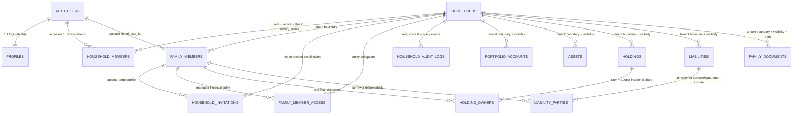

# WealthNest — Stage 1 Repository Audit & Household Migration Plan (Phase 18A Part 2)

**Document Type:** Stage 1 Audit Inventory & Execution Migration Plan  
**Authoritative Architecture Spec:** [household-ownership-and-access-model.md](file:///home/ketan/projects/Krisha/wealthNest/docs/architecture/household-ownership-and-access-model.md)  
**Roadmap Placement:** [next-phase-development-plan.md](file:///home/ketan/projects/Krisha/wealthNest/docs/next-phase-development-plan.md) (§3.6 Phase 18A Part 2 — Priority 1 Active Track)  
**Audit Date:** 2026-11-15  
**Stage 1 Gate Constraint:** Read-only repository audit completed with **zero** changes to application code, SQL migrations, or package dependencies.

---

## 1. Executive Audit Summary

WealthNest currently behaves at runtime as a **single-user-account workspace overlaid with partial household collaboration RLS (`000014`) and client-side member filters**. Although [`000009`](file:///home/ketan/projects/Krisha/wealthNest/supabase/migrations/20260101000009_admin_portal_and_access_control.sql), [`000014`](file:///home/ketan/projects/Krisha/wealthNest/supabase/migrations/20260101000014_household_collaboration_rls.sql), and [`000019`](file:///home/ketan/projects/Krisha/wealthNest/supabase/migrations/20260101000019_household_membership_write_rls.sql) introduced `public.households` and `public.household_members`, every financial table, domain port, adapter query, SQLite table, backup payload, and support RPC still keys ownership and tenant boundaries directly off `user_id` (`auth.users.id`).

### High-Level Audit Metrics Observed
- **PostgreSQL Migrations Inspected:** 20 files (`20260101000000` through `20260101000019`) + [`full_schema.sql`](file:///home/ketan/projects/Krisha/wealthNest/supabase/full_schema.sql) (stale at `000010`) + [`seed_qa.sql`](file:///home/ketan/projects/Krisha/wealthNest/supabase/seed_qa.sql).
- **Supabase Client Queries Audited:** 85 `.from('...')` call sites across [`apps/web/src/lib/supabase/`](file:///home/ketan/projects/Krisha/wealthNest/apps/web/src/lib/supabase) and [`admin-create-user/index.ts`](file:///home/ketan/projects/Krisha/wealthNest/supabase/functions/admin-create-user/index.ts), plus admin/support RPC calls.
- **Realtime Subscriptions Found:** **0** (verified across `apps/web/src`, `packages/`, and `supabase/`).
- **Storage Buckets Audited:** 1 private bucket (`family-vault`) in [`000016`](file:///home/ketan/projects/Krisha/wealthNest/supabase/migrations/20260101000016_family_document_vault.sql) consumed solely by [`document-vault.adapter.ts`](file:///home/ketan/projects/Krisha/wealthNest/apps/web/src/lib/supabase/document-vault.adapter.ts).
- **Test Suites Audited:** 96 total test files (`37` web, `25` application, `30` domain, `1` shared, `3` files in [`supabase/tests/`](file:///home/ketan/projects/Krisha/wealthNest/supabase/tests) — two pgTAP SQL suites plus `.gitkeep`).

---

## 2. Authoritative `user_id` Classification Matrix

Every existing `user_id` reference (and derived column/parameter) falls into one or more of the five distinct conceptual roles below. Wherever a column or filter currently conflates multiple roles, the **Target State** column states how Phase 18A Part 2 separates them.

| Concept Role | Current Codebase Expression | Target Separation |
|---|---|---|
| **1. Login identity** | `auth.users.id`, `profiles.id`, `useAuth().user.id` | Remains `auth.users.id` & `profiles.id` (`1:1`). |
| **2. Tenant boundary** | `user_id` on all 14 PostgreSQL financial/family/vault tables & 11 SQLite tables | Replaced by `household_id uuid NOT NULL REFERENCES public.households(id) ON DELETE CASCADE`. |
| **3. Financial owner** | Conflated onto `user_id`, optional unlinked `member_id`, or unvalidated `co_borrower_ids uuid[]` | Explicit `family_members` entities via `member_id`, `holding_owners` (fractional %), and `liability_parties` (role + share %). |
| **4. Record creator / updater** | `user_id uuid NOT NULL REFERENCES auth.users(id) ON DELETE CASCADE` | Replaced by nullable `created_by` / `updated_by` `REFERENCES auth.users(id) ON DELETE SET NULL` (preserving household data if a user leaves or deletes their login). |
| **5. Permission subject** | `household_members.user_id`, `platform_admin_roles.user_id`, `user_access_status.user_id`, `admin_support_sessions.*`, `is_same_household(auth.uid(), user_id)` | Preserved on identity/role/grant tables (`household_members.user_id`, `family_members.linked_user_id`, `family_member_access.user_id`, platform admin/support tables); financial RLS evaluates `(household_id, visibility, ownership/delegation)` rather than peer `user_id` equality. |

---

## 3. Complete Repository Inventory by Layer

### 3.1 PostgreSQL Schema, Foreign Keys, Unique Constraints & Indexes

| Table & Source Migration | `user_id` / User Ref Column | Current Role Conflation | Destructive / Multi-User Conflicts |
|---|---|---|---|
| `public.profiles` ([`000001`](file:///home/ketan/projects/Krisha/wealthNest/supabase/migrations/20260101000001_core_schema.sql#L6-L7)) | `id PRIMARY KEY REFERENCES auth.users(id) ON DELETE CASCADE` | **Login identity** | Appropriate as 1:1 auth profile; will later house progressive onboarding attributes (Phase 19). |
| `public.asset_classes` ([`000001`](file:///home/ketan/projects/Krisha/wealthNest/supabase/migrations/20260101000001_core_schema.sql#L15)) | None (global reference data) | N/A | None (`SELECT` granted to `anon` in [`000017`](file:///home/ketan/projects/Krisha/wealthNest/supabase/migrations/20260101000017_security_hardening_rls_and_grants.sql#L22)). |
| `public.assets` ([`000001`](file:///home/ketan/projects/Krisha/wealthNest/supabase/migrations/20260101000001_core_schema.sql#L40-L42), [`000002`](file:///home/ketan/projects/Krisha/wealthNest/supabase/migrations/20260101000002_cas_import_schema.sql#L8)) | `user_id NOT NULL ON DELETE CASCADE` | **Tenant + Creator + Owner** | `idx_assets_user_isin (user_id, isin)` duplicates securities per uploader instead of scoping by `household_id`; user deletion cascades away shared property/instrument masters. |
| `public.holdings` ([`000001`](file:///home/ketan/projects/Krisha/wealthNest/supabase/migrations/20260101000001_core_schema.sql#L53-L61), [`000004`](file:///home/ketan/projects/Krisha/wealthNest/supabase/migrations/20260101000004_separate_equities_and_mutual_funds.sql#L17-L25), [`000007`](file:///home/ketan/projects/Krisha/wealthNest/supabase/migrations/20260101000007_family_entities_and_accounts.sql#L50-L53)) | `user_id NOT NULL ON DELETE CASCADE` + nullable `member_id`, `account_id`, `demat_account_id` | **Tenant + Creator + Fallback Owner** | `idx_holdings_user_asset_account (user_id, asset_id, COALESCE(folio_number,''), COALESCE(demat_account_id,''))` prevents clean household-wide dedup & cross-creator folio ownership; zero support for joint `holding_owners` or `visibility`. |
| `public.transactions` ([`000001`](file:///home/ketan/projects/Krisha/wealthNest/supabase/migrations/20260101000001_core_schema.sql#L65-L67), [`000007`](file:///home/ketan/projects/Krisha/wealthNest/supabase/migrations/20260101000007_family_entities_and_accounts.sql#L61-L64), [`000015`](file:///home/ketan/projects/Krisha/wealthNest/supabase/migrations/20260101000015_inter_account_transfers.sql#L20)) | `user_id NOT NULL ON DELETE CASCADE` + optional `member_id`, `account_id`, `destination_account_id` | **Tenant + Creator + Owner** | Ledger rows have no `household_id` or `visibility`; user deletion destroys family cashflow/transfer history. |
| `public.import_batches` ([`000002`](file:///home/ketan/projects/Krisha/wealthNest/supabase/migrations/20260101000002_cas_import_schema.sql#L11-L13), [`000012`](file:///home/ketan/projects/Krisha/wealthNest/supabase/migrations/20260101000012_import_batches_cams_kfin_provider.sql#L3)) | `user_id NOT NULL ON DELETE CASCADE` | **Tenant + Creator** | Missing `household_id`, `target_member_id`, and household RLS (still `auth.uid() = user_id`). |
| `public.asset_valuations` ([`000005`](file:///home/ketan/projects/Krisha/wealthNest/supabase/migrations/20260101000005_loans_and_liabilities.sql#L6-L24)) | `user_id NOT NULL ON DELETE CASCADE` | **Tenant + Creator** | `unique_user_asset_valuation_date UNIQUE (user_id, asset_id, as_of_date)` allows two household members to write conflicting valuations for the same property on the same date. |
| `public.liabilities` ([`000005`](file:///home/ketan/projects/Krisha/wealthNest/supabase/migrations/20260101000005_loans_and_liabilities.sql#L27-L54), [`000008`](file:///home/ketan/projects/Krisha/wealthNest/supabase/migrations/20260101000008_family_goals_and_liabilities.sql)) | `user_id NOT NULL ON DELETE CASCADE` + `member_id` + `co_borrower_ids uuid[]` | **Tenant + Creator + Partial Owner** | `co_borrower_ids uuid[]` lacks FK integrity, responsibility split percentages, and role distinction (`primary_borrower` vs `co_borrower` vs `guarantor`); needs replacement by `liability_parties`. |
| `public.liability_balances` ([`000005`](file:///home/ketan/projects/Krisha/wealthNest/supabase/migrations/20260101000005_loans_and_liabilities.sql#L58-L74)) | `user_id NOT NULL ON DELETE CASCADE` | **Tenant + Creator** | Lacks `household_id`; inherits visibility/access from parent liability. |
| `public.asset_liability_links` ([`000005`](file:///home/ketan/projects/Krisha/wealthNest/supabase/migrations/20260101000005_loans_and_liabilities.sql#L77-L95)) | `user_id NOT NULL ON DELETE CASCADE` | **Tenant + Creator** | Still enforces `auth.uid() = user_id` (`000014` missed it); cannot link asset & liability created by different household members; lacks cross-tenant FK guard trigger. |
| `public.loan_payments` ([`000005`](file:///home/ketan/projects/Krisha/wealthNest/supabase/migrations/20260101000005_loans_and_liabilities.sql#L99-L115)) | `user_id NOT NULL ON DELETE CASCADE` | **Tenant + Creator** | Still enforces `auth.uid() = user_id` (`000014` missed it); blocks co-borrowers or admins from recording/viewing EMI payments. |
| `public.goals` ([`000006`](file:///home/ketan/projects/Krisha/wealthNest/supabase/migrations/20260101000006_financial_goals.sql#L6-L30), [`000008`](file:///home/ketan/projects/Krisha/wealthNest/supabase/migrations/20260101000008_family_goals_and_liabilities.sql#L9)) | `user_id NOT NULL ON DELETE CASCADE` + optional `member_id` | **Tenant + Creator + Beneficiary** | Lacks `household_id` & `visibility`; user deletion wipes shared family goals. |
| `public.goal_holding_allocations` ([`000006`](file:///home/ketan/projects/Krisha/wealthNest/supabase/migrations/20260101000006_financial_goals.sql#L33-L48)) | `user_id NOT NULL ON DELETE CASCADE` | **Tenant + Creator** | Lacks `household_id` & cross-household link validation between `goal_id` and `holding_id`. |
| `public.family_members` ([`000007`](file:///home/ketan/projects/Krisha/wealthNest/supabase/migrations/20260101000007_family_entities_and_accounts.sql#L6-L22)) | `user_id NOT NULL ON DELETE CASCADE` | **Tenant + Creator** (NOT login link!) | Major design flaw: `user_id` is uploader's login, NOT `linked_user_id`; lacks `household_id`, optional `linked_user_id`, unique `(household_id, linked_user_id)`, or `family_member_access`. |
| `public.portfolio_accounts` ([`000007`](file:///home/ketan/projects/Krisha/wealthNest/supabase/migrations/20260101000007_family_entities_and_accounts.sql#L25-L43)) | `user_id NOT NULL ON DELETE CASCADE` + `member_id` | **Tenant + Creator** | Lacks `household_id`, `visibility` (currently faked in `localStorage`), and `joint_owner_member_ids` / account owners support. |
| `public.family_documents` ([`000016`](file:///home/ketan/projects/Krisha/wealthNest/supabase/migrations/20260101000016_family_document_vault.sql#L11-L44)) | `user_id NOT NULL ON DELETE CASCADE` + nullable `member_id` | **Tenant + Creator + Storage Prefix** | Lacks `household_id` & `visibility`; `storage_path` embeds creator `user_id` instead of `household_id`. |
| `public.households` ([`000009`](file:///home/ketan/projects/Krisha/wealthNest/supabase/migrations/20260101000009_admin_portal_and_access_control.sql#L154-L157)) | `created_by REFERENCES auth.users(id) ON DELETE SET NULL` | **Creator** | Already uses `ON DELETE SET NULL`; missing `updated_at` / bootstrap trigger linkage on signup. |
| `public.household_members` ([`000009`](file:///home/ketan/projects/Krisha/wealthNest/supabase/migrations/20260101000009_admin_portal_and_access_control.sql#L162-L171)) | `user_id NOT NULL REFERENCES auth.users(id) ON DELETE CASCADE` | **Permission subject** | Only allows `'primary_owner' | 'member' | 'viewer'` (`'admin'` missing); lacks `status` (`active|suspended|revoked`) and partial unique index enforcing 1 active `primary_owner` per household. |
| `public.platform_admin_roles` ([`000009`](file:///home/ketan/projects/Krisha/wealthNest/supabase/migrations/20260101000009_admin_portal_and_access_control.sql#L7-L22)) | `user_id`, `granted_by`, `revoked_by` | **Permission subject + Actor** | Correct platform-level isolation; keep separate from household roles. |
| `public.user_access_status` ([`000009`](file:///home/ketan/projects/Krisha/wealthNest/supabase/migrations/20260101000009_admin_portal_and_access_control.sql#L64-L75)) | `user_id UNIQUE`, `changed_by` | **Permission subject + Actor** | Not populated by `handle_new_user()` trigger on normal signup (relies on absent-row default = active). |
| `public.admin_audit_logs` ([`000009`](file:///home/ketan/projects/Krisha/wealthNest/supabase/migrations/20260101000009_admin_portal_and_access_control.sql#L80-L95)) | `actor_user_id`, `target_user_id` (`ON DELETE SET NULL`) | **Actor + Subject** | Reserved for platform-admin events only; household role/privacy audit must go into a separate `public.household_audit_logs` table. |
| `public.admin_support_sessions` ([`000010`](file:///home/ketan/projects/Krisha/wealthNest/supabase/migrations/20260101000010_admin_support_sessions.sql#L7-L26)) | `admin_user_id`, `target_user_id` (`ON DELETE CASCADE`), `revoked_by` | **Permission subject (Admin + Impersonated User)** | Keep platform support session governance; refactor `support_get_user_*` RPCs to resolve accessible household/non-private records cleanly. |

---

### 3.2 PostgreSQL RLS Policies, Functions, Triggers & Grants

1. **`handle_new_user()` Trigger ([`000001`](file:///home/ketan/projects/Krisha/wealthNest/supabase/migrations/20260101000001_core_schema.sql#L143-L159), replaced in [`000013`](file:///home/ketan/projects/Krisha/wealthNest/supabase/migrations/20260101000013_profiles_insert_policy_and_inr_default.sql#L13-L25)):**
   - Currently inserts ONLY into `public.profiles` (`id, display_name, default_currency='INR'`).
   - Creates **no** `households` row, **no** `primary_owner` row in `household_members`, and **no** initial `family_members` record — directly contradicting the UI message on [`SignUpPage.tsx`](file:///home/ketan/projects/Krisha/wealthNest/apps/web/src/pages/SignUpPage.tsx#L169).
2. **Broken Multi-Household RLS Helpers ([`000014`](file:///home/ketan/projects/Krisha/wealthNest/supabase/migrations/20260101000014_household_collaboration_rls.sql#L20-L59)):**
   - `is_same_household(check_user_id, target_user_id)` returns `true` if `check_user_id` and `target_user_id` share *any* `household_id` in `household_members`.
   - `can_edit_household_record(check_user_id, target_user_id)` returns `true` if `m1.household_role IN ('primary_owner', 'member')` in *any* shared household.
   - **Critical Cross-Household Privacy Leak:** If a married user belongs to both **Marital Household H1** (with spouse) and **Parental Household H2** (with parents), then every row they created (`assets`, `holdings`, `transactions`, `liabilities`, `goals`, `family_members`, `portfolio_accounts`, `family_documents`) in H1 is **automatically readable and editable** by H2 members, and vice versa — because records carry no `household_id`!
   - **No Privacy / Record-Level Restrictions:** `000014` & `000016` have zero concept of `visibility` (`household_shared` | `owner_only` | `restricted`), zero `admin` role distinction, and zero `family_member_access` delegation checks.
3. **Un-Migrated Tables Bypassed by `000014`:**
   - `public.import_batches` ([`000002`](file:///home/ketan/projects/Krisha/wealthNest/supabase/migrations/20260101000002_cas_import_schema.sql#L29-L35)) still enforces `auth.uid() = user_id`.
   - `public.asset_liability_links` ([`000005`](file:///home/ketan/projects/Krisha/wealthNest/supabase/migrations/20260101000005_loans_and_liabilities.sql#L148-L151)) still enforces `auth.uid() = user_id`.
   - `public.loan_payments` ([`000005`](file:///home/ketan/projects/Krisha/wealthNest/supabase/migrations/20260101000005_loans_and_liabilities.sql#L154-L157)) still enforces `auth.uid() = user_id`.
4. **Membership Write RLS ([`000019`](file:///home/ketan/projects/Krisha/wealthNest/supabase/migrations/20260101000019_household_membership_write_rls.sql)):**
   - Adds `SECURITY DEFINER` helpers `is_household_member`, `is_household_primary_owner`, `can_bootstrap_household_owner`, `household_creator_unchanged` and locks `households` / `household_members` writes to primary owner or creator bootstrap (`GRANT EXECUTE ... TO authenticated`).
   - Needs extension in Phase 1–2 for `status = 'active'`, `'admin'` role distinction, atomic primary-ownership transfer (preventing direct client updates that leave 0 or 2 primary owners), and blocking arbitrary self-insertion by outsiders during invitation flows (moving joins into `SECURITY DEFINER` RPCs).
5. **Privilege Hardening Risk ([`000011`](file:///home/ketan/projects/Krisha/wealthNest/supabase/migrations/20260101000011_grant_public_table_privileges.sql) vs [`000017`](file:///home/ketan/projects/Krisha/wealthNest/supabase/migrations/20260101000017_security_hardening_rls_and_grants.sql)):**
   - `000011` granted `ALL` on tables/sequences/routines + `ALTER DEFAULT PRIVILEGES` to `anon`; `000017` revoked them from `anon` (`asset_classes` `SELECT` excepted). Every new table, trigger function, and RPC added in Phase 18A Part 2 must include explicit `REVOKE ALL ... FROM PUBLIC, anon` and least-privilege `GRANT` statements.
6. **Stale Provisioning Snapshot ([`full_schema.sql`](file:///home/ketan/projects/Krisha/wealthNest/supabase/full_schema.sql)):**
   - Stops at `000010` (`support_get_user_summary` at line 1751), omitting migrations `000011`–`000019` (including `000014` collaboration, `000016` vault, `000017` security hardening, `000018` admin fix, and `000019` membership write RLS). Must be regenerated or retired at the end of Phase 18A Part 2.

---

### 3.3 Admin & Support RPCs + Edge Functions

| Symbol / File | Current `user_id` Usage | Role & Required Phase 18A Change |
|---|---|---|
| `admin_get_users`, `admin_get_user_detail`, `admin_get_households` ([`000009`](file:///home/ketan/projects/Krisha/wealthNest/supabase/migrations/20260101000009_admin_portal_and_access_control.sql#L233-L735)) | Queries `user_access_status`, `platform_admin_roles`, `household_members.user_id` (`household_count`, `householdRole`) | **Permission subject**: Extend `household_role` projection & tests for `'admin'` and active membership `status = 'active'`. Keep zero-knowledge isolation from household financial tables. |
| `admin_set_user_status`, `admin_manage_role`, `admin_start_support_session` ([`000009`](file:///home/ketan/projects/Krisha/wealthNest/supabase/migrations/20260101000009_admin_portal_and_access_control.sql), [`000018`](file:///home/ketan/projects/Krisha/wealthNest/supabase/migrations/20260101000018_fix_admin_rpc_null_role_checks.sql#L11-L260)) | `p_target_user_id`, `admin_user_id`, `target_user_id` | **Permission subject / Actor**: Preserve platform RBAC; no schema breakage expected except ensuring `handle_new_user()`/households stays compatible. |
| `support_get_user_portfolio` (`:258`), `support_get_user_liabilities` (`:306`), `support_get_user_goals` (`:349`), `support_get_user_transactions` (`:389`), `support_get_user_summary` (`:437`) in [`000010`](file:///home/ketan/projects/Krisha/wealthNest/supabase/migrations/20260101000010_admin_support_sessions.sql#L258-L490) | Strictly filters `WHERE h.user_id = v_target_user_id`, `WHERE l.user_id = v_target_user_id`, `WHERE g.user_id = v_target_user_id`, `WHERE tr.user_id = v_target_user_id` | **Tenant + Owner + Permission subject**: In a household-scoped DB, creator `user_id` no longer represents what `v_target_user_id` can view, AND a support session must NEVER bypass other members' `owner_only` / `restricted` privacy flags! Refactor via household/visibility resolver with optional `p_household_id`. |
| [`admin-create-user/index.ts`](file:///home/ketan/projects/Krisha/wealthNest/supabase/functions/admin-create-user/index.ts#L141-L348) | Checks `caller.id` against `user_access_status` & `platform_admin_roles`; calls `auth.admin.createUser(...)`; inserts `platform_admin_roles` & `admin_audit_logs` | **Login identity / Permission subject**: Confirm auto-household trigger on `auth.users` insert works cleanly when called via `auth.admin.createUser` (so admin-created users also receive a default personal household + primary `family_members` profile atomically). |

---

### 3.4 Storage (`family-vault`) & Realtime

- **Realtime:** Verified **0** channels (`ZERO_REALTIME_MATCHES` across `apps/web/src`, `packages/`, `supabase/`). Multi-household live sync is not currently active, simplifying migration ordering (any future Phase 18A/realtime work must key channels/filters by `household_id` + RLS).
- **Storage Bucket `family-vault` ([`000016`](file:///home/ketan/projects/Krisha/wealthNest/supabase/migrations/20260101000016_family_document_vault.sql#L72-L124)):**
  - Storage path convention is `<owner_user_id>/<document_id>/<sanitized_file_name>` built in [`document-vault.ts`](file:///home/ketan/projects/Krisha/wealthNest/packages/domain/src/vault/document-vault.ts#L144) (`buildVaultStoragePath`) and [`document-vault.adapter.ts`](file:///home/ketan/projects/Krisha/wealthNest/apps/web/src/lib/supabase/document-vault.adapter.ts#L84-L122).
  - Storage RLS (`SELECT`, `INSERT`, `UPDATE`, `DELETE` on `storage.objects`) calls `is_same_household(auth.uid(), (storage.foldername(name))[1]::uuid)` / `can_edit_household_record(auth.uid(), (storage.foldername(name))[1]::uuid)`.
  - **Gap:** Because prefix folder `[1]` is `user_id`, a multi-household user's private or single-household documents leak across all households they share! Target path must move to **`<household_id>/<document_id>/<sanitized_file_name>`** with Storage policies authorizing via `public.family_documents` membership + `visibility` + role helpers.

---

### 3.5 Supabase Data Adapters ([`apps/web/src/lib/supabase/`](file:///home/ketan/projects/Krisha/wealthNest/apps/web/src/lib/supabase))

Every financial adapter currently treats `userId` as the **Tenant boundary** and passes `.eq('user_id', userId)` on queries/updates/deletes — actively **hiding rows created by other household members** even when `000014` RLS allows them:

| Adapter File | Observed `user_id` Usage & Line Refs | Latent Defects / Multi-User Breakage |
|---|---|---|
| [`holding.adapter.ts`](file:///home/ketan/projects/Krisha/wealthNest/apps/web/src/lib/supabase/holding.adapter.ts) | `.eq('user_id', userId)` on SELECT/UPDATE/DELETE (`:75,:214,:221,:229,:256`); writes `user_id` on `assets` & `holdings` (`:125,:146`). | Hides collaborator holdings; couples asset cleanup (`:229`) to creator `user_id`; lacks `household_id`, `visibility`, and `holding_owners`. |
| [`transaction.adapter.ts`](file:///home/ketan/projects/Krisha/wealthNest/apps/web/src/lib/supabase/transaction.adapter.ts) | `.eq('user_id', userId)` on SELECT/DELETE (`:59,:164`); inserts `user_id` (`:98`). | Hides household cashflow/transfers created by spouse/admin; uses creator `user_id` instead of `household_id` + `created_by`. |
| [`liability.adapter.ts`](file:///home/ketan/projects/Krisha/wealthNest/apps/web/src/lib/supabase/liability.adapter.ts) | `.eq('user_id', userId)` on SELECT/UPDATE/DELETE (`:87,:100,:186,:333,:353`); writes `user_id` (`:245`) + legacy `co_borrower_ids`. | Hides shared family loans unless created by the logged-in user; lacks `household_id`, `visibility`, and normalized `liability_parties`. |
| [`liability-valuations-links.ts`](file:///home/ketan/projects/Krisha/wealthNest/apps/web/src/lib/supabase/liability-valuations-links.ts) | `.eq('user_id', ...)` on `liability_balances`, `holdings`, `asset_valuations`, `asset_liability_links` (`:61,:121,:148,:180,:239`); upserts `onConflict: 'user_id, asset_id, as_of_date'` (`:102`). | `onConflict` breaks once scoped to `household_id`; `asset_liability_links` cannot connect another member's asset/loan. |
| [`goal.adapter.ts`](file:///home/ketan/projects/Krisha/wealthNest/apps/web/src/lib/supabase/goal.adapter.ts) | `.eq('user_id', userId)` on `goals` & `goal_holding_allocations` (`:54,:221,:262,:307`); inserts `user_id` (`:147,:280`). | Hides household goals created by other members; lacks `household_id` & `visibility`. |
| [`cas-import.adapter.ts`](file:///home/ketan/projects/Krisha/wealthNest/apps/web/src/lib/supabase/cas-import.adapter.ts) | **14** `user_id` lookups/writes across `assets`, `holdings`, `transactions`, `import_batches` (`:29,:53,:80,:102,:130,:185,:229,:242,:255,:269,:291,:300,:329`). | Forces single-user asset/holding/transaction scoping; needs `household_id` + target owner (`holding_owners` / `member_id`) + `created_by` + `visibility`. |
| [`family.adapter.ts`](file:///home/ketan/projects/Krisha/wealthNest/apps/web/src/lib/supabase/family.adapter.ts) | `.eq('user_id', userId)` on `family_members` & `portfolio_accounts` (`:231,:355`); falls back to `localStorage` (`wealthnest_family_members`, `wealthnest_family_accounts`, `:188-216`) & `DEFAULT_DEMO_MEMBERS` (`mem-self`); **swallows upsert errors with `console.warn`**. | Silently desyncs DB vs `localStorage` on permission failures; must remove `localStorage` fallback for authenticated Supabase sessions & switch to `householdId` + `linked_user_id`. |
| [`document-vault.adapter.ts`](file:///home/ketan/projects/Krisha/wealthNest/apps/web/src/lib/supabase/document-vault.adapter.ts) | Writes `user_id: params.userId` (`:103`); relies on `<userId>/<docId>/<file>` storage paths (`:84-142`); NOTE: `list` relies on RLS without `.eq('user_id', ...)` but will return cross-household documents unless filtered by `household_id`! | Cross-household bleed if user belongs to >1 household; needs `householdId`, `visibility`, `created_by`, and `<householdId>/<docId>/<file>` paths. |
| [`backup.adapter.ts`](file:///home/ketan/projects/Krisha/wealthNest/apps/web/src/lib/supabase/backup.adapter.ts) | Writes `user_id: userId` on all upserts (`:38,:56,:83,:108,:139`). | **Verified Critical Runtime Bugs:** Line `:136` calls `.from('financial_goals')` (PostgreSQL table is `goals`); line `:69` specifies `{ onConflict: 'user_id, asset_id' }` (constraint `unique_user_asset` was dropped in `000004:17`!); omits `member_id`/`coBorrowerMemberIds` on liabilities & lacks `household_id`. |
| [`user.adapter.ts`](file:///home/ketan/projects/Krisha/wealthNest/apps/web/src/lib/supabase/user.adapter.ts) | Uses `id` as **Login identity** on `profiles` (`:39,:115,:127`); caches `wealthnest_user_profile` & `wealthnest_user_preferences` in `localStorage` (`:6-7`). | Must remain login-scoped for `profiles`, clearing sensitive local cache safely on account switch / sign-out. |
| [`uuid-utils.ts`](file:///home/ketan/projects/Krisha/wealthNest/apps/web/src/lib/supabase/uuid-utils.ts#L5-L12) | `toValidUuidOrNull` silently converts non-UUID demo sentinels (`mem-self`) to `null`. | Masks UI attribution bugs where `'mem-self'` leaks into authenticated DB writes instead of resolving the actual household `family_members.id`. |

---

### 3.6 React Auth, Onboarding, Contexts, Pages & Client-Only Persistence

| Module / Component | Current `user_id` / Identity & State Behavior | Target Phase 18A Change |
|---|---|---|
| [`auth-context.tsx`](file:///home/ketan/projects/Krisha/wealthNest/apps/web/src/lib/supabase/auth-context.tsx) & [`LoginPage.tsx`](file:///home/ketan/projects/Krisha/wealthNest/apps/web/src/pages/LoginPage.tsx) | Authenticates Supabase session (`user.id` = **Login identity**). No active household resolution. | Keep as login identity; pair with an **Active Household Context** resolving `household_members` + linked `family_members`. |
| [`SignUpPage.tsx`](file:///home/ketan/projects/Krisha/wealthNest/apps/web/src/pages/SignUpPage.tsx#L102-L170) | Calls `supabase.auth.signUp(...)`; promises `"Once confirmed, your profile and household are ready automatically."` (`:169`). | Support optional invitation token continuation (`?invite=` / post-verify claim) and align with DB-level auto-household onboarding. |
| [`family-context.tsx`](file:///home/ketan/projects/Krisha/wealthNest/apps/web/src/lib/family/family-context.tsx) | Uses `user?.id || 'demo-user-001'` (`:91`); stores **account privacy (`privacyRules`) in browser `localStorage` (`wealthnest_family_privacy_rules`, `:63,:102,:259`)** — ZERO backend/RLS backing! | Replace `userId` queries with `activeHouseholdId`; migrate privacy from `localStorage` to PostgreSQL `visibility` + `family_member_access` / `restricted_record_grants` + role-aware capability checks. |
| [`HouseholdSharingCard.tsx`](file:///home/ketan/projects/Krisha/wealthNest/apps/web/src/components/settings/HouseholdSharingCard.tsx) | **Purely mocked UI:** client-side state & synthetic invite link `?household_invite=vaghela-hhd-...` with zero Supabase RPC/table writes. | Wire to real `household_members`, `household_invitations` (`create_household_invitation`, `revoke_household_invitation`, `accept_household_invitation`), role changes (`primary_owner` only for `admin`), ownership transfer, and per-entity `family_member_access`. |
| [`RealEstatePage.tsx`](file:///home/ketan/projects/Krisha/wealthNest/apps/web/src/pages/RealEstatePage.tsx#L25-L163) | Persists property metrics overrides (`purchasePricePaise`, rent, tax, maintenance, location) in `localStorage` key `wealthnest_real_estate_overrides_v1_${userId}` (`:107,:151`). | Scope key to `householdId` (or persist server-side/holding metadata) so collaborating spouses/admins don't lose property overrides per device/user. |
| [`HomePage.tsx`](file:///home/ketan/projects/Krisha/wealthNest/apps/web/src/pages/HomePage.tsx), [`PortfolioPage.tsx`](file:///home/ketan/projects/Krisha/wealthNest/apps/web/src/pages/PortfolioPage.tsx), [`AnalyticsPage.tsx`](file:///home/ketan/projects/Krisha/wealthNest/apps/web/src/pages/AnalyticsPage.tsx), [`TransactionsPage.tsx`](file:///home/ketan/projects/Krisha/wealthNest/apps/web/src/pages/TransactionsPage.tsx), [`LiabilitiesPage.tsx`](file:///home/ketan/projects/Krisha/wealthNest/apps/web/src/pages/LiabilitiesPage.tsx), [`GoalsPage.tsx`](file:///home/ketan/projects/Krisha/wealthNest/apps/web/src/pages/GoalsPage.tsx), [`DocumentsPage.tsx`](file:///home/ketan/projects/Krisha/wealthNest/apps/web/src/pages/DocumentsPage.tsx), [`SettingsPage.tsx`](file:///home/ketan/projects/Krisha/wealthNest/apps/web/src/pages/SettingsPage.tsx) | React Query keys (`['liabilities-list', userId]`, `['user-goals', userId]`, `['transactions-cashflow', user?.id]`, etc.) and repo calls pass `userId`; fallback `'demo-user'` or `'demo-user-001'`; unattributed holdings/txs visually default to `'mem-self'`; `GoalsPage` falls back to `DEMO_GOALS` if signed-in DB returns 0 goals (`:56`)! | Re-key React Query caches by `[..., activeHouseholdId]`, pass `householdId` + caller role/member context, replace hardcoded `'mem-self'` fallbacks with explicit ownership prompts for admins or caller's linked `family_members.id`, and fix empty-DB demo data leakage (`GoalsPage:56`). |
| [`preferences-context.tsx`](file:///home/ketan/projects/Krisha/wealthNest/apps/web/src/lib/preferences/preferences-context.tsx#L41) & [`privacy-context.tsx`](file:///home/ketan/projects/Krisha/wealthNest/apps/web/src/lib/preferences/privacy-context.tsx#L23-L33) | UI currency/formatting preferences & local number-blur toggle (`wealthnest_privacy_mode` in `localStorage`). | Keep `preferences-context` & UI mask toggle login-scoped (**Login identity** / device preference). |

---

### 3.7 Application Ports, Use Cases & Domain Math ([`packages/application`](file:///home/ketan/projects/Krisha/wealthNest/packages/application) & [`packages/domain`](file:///home/ketan/projects/Krisha/wealthNest/packages/domain))

- **All 10 Repository Ports Take `userId` as Tenant Key:**
  - [`holding-repository.port.ts`](file:///home/ketan/projects/Krisha/wealthNest/packages/application/src/ports/holding-repository.port.ts), [`transaction-repository.port.ts`](file:///home/ketan/projects/Krisha/wealthNest/packages/application/src/ports/transaction-repository.port.ts), [`liability-repository.port.ts`](file:///home/ketan/projects/Krisha/wealthNest/packages/application/src/ports/liability-repository.port.ts), [`goal-repository.port.ts`](file:///home/ketan/projects/Krisha/wealthNest/packages/application/src/ports/goal-repository.port.ts), [`family-repository.port.ts`](file:///home/ketan/projects/Krisha/wealthNest/packages/application/src/ports/family-repository.port.ts), [`document-vault-repository.port.ts`](file:///home/ketan/projects/Krisha/wealthNest/packages/application/src/ports/document-vault-repository.port.ts), [`cas-import.port.ts`](file:///home/ketan/projects/Krisha/wealthNest/packages/application/src/ports/cas-import.port.ts), [`backup.port.ts`](file:///home/ketan/projects/Krisha/wealthNest/packages/application/src/ports/backup.port.ts), [`asset-repository.port.ts`](file:///home/ketan/projects/Krisha/wealthNest/packages/application/src/ports/asset-repository.port.ts) — all accept `list*ByUser(userId)` and require `userId` in `Create*`/`Update*` params. Only [`auth.port.ts`](file:///home/ketan/projects/Krisha/wealthNest/packages/application/src/ports/auth.port.ts) and [`admin-repository.port.ts`](file:///home/ketan/projects/Krisha/wealthNest/packages/application/src/ports/admin-repository.port.ts) rightly use `userId` as login/permission subject.
- **Use Cases Depending on `userId` Tenant Queries:**
  - [`get-net-worth-summary.ts`](file:///home/ketan/projects/Krisha/wealthNest/packages/application/src/use-cases/get-net-worth-summary.ts), [`get-portfolio-summary.ts`](file:///home/ketan/projects/Krisha/wealthNest/packages/application/src/use-cases/get-portfolio-summary.ts), [`get-performance-analytics.ts`](file:///home/ketan/projects/Krisha/wealthNest/packages/application/src/use-cases/get-performance-analytics.ts), [`get-cashflow-summary.ts`](file:///home/ketan/projects/Krisha/wealthNest/packages/application/src/use-cases/get-cashflow-summary.ts), [`get-tax-harvesting-summary.ts`](file:///home/ketan/projects/Krisha/wealthNest/packages/application/src/use-cases/get-tax-harvesting-summary.ts), [`manage-goals.ts`](file:///home/ketan/projects/Krisha/wealthNest/packages/application/src/use-cases/manage-goals.ts), [`manage-family.ts`](file:///home/ketan/projects/Krisha/wealthNest/packages/application/src/use-cases/manage-family.ts), [`manage-document-vault.ts`](file:///home/ketan/projects/Krisha/wealthNest/packages/application/src/use-cases/manage-document-vault.ts), [`add-holding.ts`](file:///home/ketan/projects/Krisha/wealthNest/packages/application/src/use-cases/add-holding.ts), [`create-liability.ts`](file:///home/ketan/projects/Krisha/wealthNest/packages/application/src/use-cases/create-liability.ts), [`manage-liability.ts`](file:///home/ketan/projects/Krisha/wealthNest/packages/application/src/use-cases/manage-liability.ts), [`import-broker-csv.ts`](file:///home/ketan/projects/Krisha/wealthNest/packages/application/src/use-cases/import-broker-csv.ts), [`confirm-cas-import.ts`](file:///home/ketan/projects/Krisha/wealthNest/packages/application/src/use-cases/confirm-cas-import.ts), [`export-portfolio-data.ts`](file:///home/ketan/projects/Krisha/wealthNest/packages/application/src/use-cases/export-portfolio-data.ts), [`restore-portfolio-from-backup.ts`](file:///home/ketan/projects/Krisha/wealthNest/packages/application/src/use-cases/restore-portfolio-from-backup.ts), [`validate-and-parse-backup.ts`](file:///home/ketan/projects/Krisha/wealthNest/packages/application/src/use-cases/validate-and-parse-backup.ts).
  - **Special Calculation Gap:** [`GetNetWorthSummaryUseCase`](file:///home/ketan/projects/Krisha/wealthNest/packages/application/src/use-cases/get-net-worth-summary.ts#L50-L54) filters a member's liabilities by `l.memberId === params.memberId || l.coBorrowerMemberIds.includes(params.memberId)`, assigning **100%** of a joint loan to both borrowers instead of prorating by `responsibility_percentage` (double-counting debt per person).
- **Domain Modules Requiring Phase 18A Upgrades:**
  - [`family-wealth-calculator.ts`](file:///home/ketan/projects/Krisha/wealthNest/packages/domain/src/family/family-wealth-calculator.ts#L46-L167): Attributes unlinked holdings to `primaryMemberId` and calculates 100% single-member ownership; needs deterministic `BigInt` largest-remainder fractional split via `holding_owners`.
  - [`section-112a-harvesting.ts`](file:///home/ketan/projects/Krisha/wealthNest/packages/domain/src/tax/section-112a-harvesting.ts#L112): Falls back `h.memberId || 'mem-self'`; needs ownership-split realized LTCG allocation and a multi-household tax disclaimer when a linked individual spans two households (Section 112A PAN limit applies per legal PAN globally, not per household workspace).
  - [`family-privacy.ts`](file:///home/ketan/projects/Krisha/wealthNest/packages/domain/src/family/family-privacy.ts#L19-L64): Models only `'shared_family' | 'owner_only'` on `accountId`; expand to `'household_shared' | 'owner_only' | 'restricted'` aligned with backend RLS.
  - [`cross-user-isolation.ts`](file:///home/ketan/projects/Krisha/wealthNest/packages/domain/src/admin/cross-user-isolation.ts): Validates cross-entity links via `actingUserId` + `authorizedHouseholdMemberUserIds`; refactor to verify explicit **`householdId` equality** (`record.householdId === activeHouseholdId`).
  - [`admin-types.ts`](file:///home/ketan/projects/Krisha/wealthNest/packages/domain/src/admin/admin-types.ts#L33): Extend `householdRole` union (`'primary_owner' | 'member' | 'viewer'`) to include `'admin'`.

---

### 3.8 Desktop / Offline SQLite & Tauri Local Storage Runtime

1. **Composite FK Locking in [`sqlite-schema.ts`](file:///home/ketan/projects/Krisha/wealthNest/packages/application/src/persistence/sqlite/sqlite-schema.ts#L19-L247):**
   - `family_members`, `portfolio_accounts`, `assets`, `holdings`, `transactions`, `liabilities`, `asset_valuations`, `liability_balances`, `asset_liability_links`, `financial_goals`, `goal_holdings`, and `family_documents` ALL bind `user_id` via composite unique/foreign keys (`UNIQUE(user_id, id)` and `FOREIGN KEY (user_id, member_id) REFERENCES family_members(user_id, id)`).
   - **Schema Drift Noted:** SQLite names goals tables `financial_goals` / `goal_holdings` (vs PostgreSQL `goals` / `goal_holding_allocations`) and omits `loan_payments`.
2. **SQLite Repository Adapters (`packages/application/src/persistence/sqlite/`):**
   - All 7 adapter files (`sqlite-portfolio-adapters.ts`, `sqlite-family-adapter.ts`, `sqlite-liability-adapter.ts`, `sqlite-goal-adapter.ts`, `sqlite-document-vault-adapter.ts`, `sqlite-cas-import-adapter.ts`, `sqlite-backup-adapter.ts`) filter every query/mutation with `WHERE user_id = ?` and join on `h.user_id = a.user_id`.
3. **Critical Coupling in Tauri SQL Emulator ([`apps/web/src/lib/tauri/`](file:///home/ketan/projects/Krisha/wealthNest/apps/web/src/lib/tauri)):**
   - [`tauri-sqlite-types.ts`](file:///home/ketan/projects/Krisha/wealthNest/apps/web/src/lib/tauri/tauri-sqlite-types.ts), [`tauri-sqlite-seed.ts`](file:///home/ketan/projects/Krisha/wealthNest/apps/web/src/lib/tauri/tauri-sqlite-seed.ts), [`tauri-sqlite-read.ts`](file:///home/ketan/projects/Krisha/wealthNest/apps/web/src/lib/tauri/tauri-sqlite-read.ts), [`tauri-sqlite-write-portfolio.ts`](file:///home/ketan/projects/Krisha/wealthNest/apps/web/src/lib/tauri/tauri-sqlite-write-portfolio.ts), and [`tauri-sqlite-write-planning.ts`](file:///home/ketan/projects/Krisha/wealthNest/apps/web/src/lib/tauri/tauri-sqlite-write-planning.ts) parse SQL via **regex patterns** (`FROM holdings WHERE user_id = \?`). Modifying SQLite queries to use `household_id`, `visibility`, `holding_owners`, or `liability_parties` without updating `apps/web/src/lib/tauri/tauri-sqlite-*` will break offline/desktop queries immediately.

---

### 3.9 Tests & QA Seed Fixtures

- **[`supabase/seed_qa.sql`](file:///home/ketan/projects/Krisha/wealthNest/supabase/seed_qa.sql):**
  - `seed_qa_primary_household` (lines 63–297) and `seed_qa_secondary_user` (lines 324–367) insert rows into `profiles`, `family_members`, `portfolio_accounts`, `assets`, `holdings`, `transactions`, `goals`, `liabilities`, `liability_balances`, `loan_payments` keyed strictly by `v_user_id` — **never inserting `households` or `household_members`!** Thus the QA primary household currently lacks an actual household record in `public.households` / `household_members`.
- **pgTAP Security Suites ([`01_rls_and_household_isolation.sql`](file:///home/ketan/projects/Krisha/wealthNest/supabase/tests/01_rls_and_household_isolation.sql), [`02_admin_rbac_and_audit_immutability.sql`](file:///home/ketan/projects/Krisha/wealthNest/supabase/tests/02_admin_rbac_and_audit_immutability.sql)):**
  - `01_rls_and_household_isolation.sql` tests cross-household asset/document reads & viewer write blocking, plus `household_members` privilege escalation; however, test inserts pass `user_id` without `household_id` / `visibility`, and there are no pgTAP tests yet for: multi-household non-bleeding, `'admin'` vs `'primary_owner'` boundary, `'admin'` privacy isolation (`owner_only`/`restricted`), user deletion preservation, or invitation token claim security.
- **Frontend / Application / Domain Test Suites:**
  - Tests such as `TauriSqliteDatabase.test.ts`, `liability-use-cases.test.ts` (asserting `'household-a'`/`'household-b'` as `userId`), `family-use-case.test.ts`, `family-privacy.test.ts`, `cross-user-isolation.test.ts`, `AdminPortal.test.tsx`, `SupportImpersonation.test.tsx`, `GoalsPage.test.tsx`, `PortfolioPage.test.tsx`, `TransactionsPage.test.tsx`, and `LiabilitiesPage.test.tsx` will require synchronized fixture updates in Phase 6–8.

---

## 4. Current vs. Target Architecture (Entity Relationship & Access Flow)

---

## 5. Phased Implementation Plan & Execution Status

To evolve WealthNest cleanly without breaking working financial math or desktop parity, execution is sequenced into 8 gated phases:

1. **[x] Phase 1 — Household Core, Identity Separation & Auto-Provisioning (`20260101000020`)**
   - Extended `household_members` with `'admin'` role + `status ('active' | 'suspended' | 'revoked')` + partial unique index `(household_id) WHERE household_role = 'primary_owner' AND status = 'active'`.
   - Evolved `family_members`: added `household_id`, nullable `linked_user_id REFERENCES auth.users(id) ON DELETE SET NULL`, `created_by`/`updated_by`, unique partial index `(household_id, linked_user_id) WHERE linked_user_id IS NOT NULL`, `entity_type ('individual' | 'huf' | 'minor')`, and optional `email`.
   - Added `family_member_access` and append-only `household_audit_logs`.
   - Updated `handle_new_user()` and added `ensure_user_default_household()` so standard & admin-created signups atomically create `profiles` + default personal `households` + `primary_owner` `household_members` + self `family_members` (with `skip_default_household` pathway for invitations).
   - Added `transfer_household_primary_owner(p_household_id, p_new_owner_user_id)` and `assign_household_role(...)` `SECURITY DEFINER` RPCs (primary-owner-only).

2. **[x] Phase 2 — Invitations & Verified Email-Confirmed Account Linking (`20260101000021`, `HouseholdSharingCard`, `InviteAcceptPage`)**
   - Created `public.household_invitations` (SHA-256 `token_hash` only, nullable `family_member_id`, `role IN ('admin','member','viewer')`, `expires_at`, `accepted_at`, `revoked_at`).
   - Implemented `create_household_invitation`, `preview_household_invitation`, `revoke_household_invitation`, and `accept_household_invitation` (`SECURITY DEFINER`), enforcing `auth.users.email_confirmed_at IS NOT NULL`, normalized email match, expiry/revocation checks, duplicate-link rejection, idempotent membership upsert, and audit logging.
   - Replaced client-only mock logic in [`HouseholdSharingCard.tsx`](file:///home/ketan/projects/Krisha/wealthNest/apps/web/src/components/settings/HouseholdSharingCard.tsx) & wired `/invite`, `/signup?invite=`, and `/login?invite=` flows.

3. **[x] Phase 3 — Financial Schema Scoping, Joint Ownership & Privacy Columns (`20260101000022`, `20260101000023`)**
   - Migrated all financial/vault tables to `household_id NOT NULL`, `visibility ('household_shared' | 'owner_only' | 'restricted') DEFAULT 'household_shared'`, `created_by`, `updated_by` (`ON DELETE SET NULL`), and dropped legacy `user_id` columns on those tables under approved **Option A**.
   - Migrated uniqueness indexes to `household_id` scope (`uniq_holdings_household_asset_scope`, `unique_asset_valuation_date`).
   - Created `holding_owners` & `liability_parties` with `DEFERRABLE INITIALLY DEFERRED` constraint triggers enforcing `SUM = 100`, plus cross-household FK guard triggers (`validate_financial_row_integrity`, `assert_same_household_fk`).
   - Created `restricted_record_grants` and dropped legacy `co_borrower_ids`.

4. **[x] Phase 4 — Household + Privacy RLS, Storage Re-Scoping & Support RPC Refactor (`20260101000023`)**
   - Dropped legacy `is_same_household` / `can_edit_household_record` & `auth.uid() = user_id` policies across all financial/vault tables (`import_batches`, `asset_liability_links`, `loan_payments`, etc.).
   - Deployed `SECURITY DEFINER STABLE` evaluators enforcing active household boundary, role capabilities (`primary_owner`, `admin`, `member`, `viewer`), `family_member_access` delegation, and `owner_only` / `restricted` privacy isolation.
   - Moved `family-vault` Storage objects & policies to **`<household_id>/<document_id>/<sanitized_file_name>`** validated against `public.family_documents`.
   - Added `set_holding_owners` / `set_liability_parties` RPCs and updated `support_get_user_*` (`000010`) & admin role projections (`000009`) to respect household isolation and hide private records.

5. **[x] Phase 5 — `pgTAP` Database Verification Gate (`03_household_ownership_privacy_and_invitations.sql`)**
   - Expanded [`supabase/tests/`](file:///home/ketan/projects/Krisha/wealthNest/supabase/tests) (`01`, `02`, `03`: 3 suites, 70 assertions) proving multi-household non-bleeding, `primary_owner`-only admin/transfer gates, admin `owner_only` / `restricted` privacy isolation, Storage path RLS, user-deletion data preservation, and invitation token security.

6. **[x] Phase 6 — Application Ports, Adapters, Backup & SQLite Parity**
   - Updated `@wealthnest/application` ports and Supabase adapters (`holding`, `transaction`, `liability`, `liability-valuations-links`, `goal`, `cas-import`, `family`, `document-vault`, `backup`) to query/write via `householdId`, `visibility`, `holding_owners`, `liability_parties`, and `restricted_record_grants`.
   - Updated [`sqlite-schema.ts`](file:///home/ketan/projects/Krisha/wealthNest/packages/application/src/persistence/sqlite/sqlite-schema.ts), SQLite adapters, and [`apps/web/src/lib/tauri/`](file:///home/ketan/projects/Krisha/wealthNest/apps/web/src/lib/tauri) in lockstep.

7. **[x] Phase 7 — Domain Math (`BigInt` Fractional Ownership) & Household UI**
   - Added `HouseholdProvider` & **Household Switcher** (clearing & re-keying React Query caches to `activeHouseholdId`).
   - Implemented `allocatePaiseByShares` (deterministic largest-remainder `BigInt` distribution) in `@wealthnest/domain` for joint `holding_owners` and `liability_parties` across net worth, family breakdowns, and Section 112A LTCG tax harvesting.
   - Wired `VisibilityControl`, `JointOwnershipEditor`, and `canEditFinancials` viewer guards across all 8 financial pages, modals, and Settings UI.

8. **[ ] Phase 8 — Regression, QA Seed Rebuild & Snapshot Sync**
   - **[x]** Rebuilt [`seed_qa.sql`](file:///home/ketan/projects/Krisha/wealthNest/supabase/seed_qa.sql) with Option A multi-user/multi-household fixtures (`seed_qa_multi_household_matrix`, updated `seed_qa_primary_household` & `seed_qa_secondary_user`) and executed Vitest + `tsc` + pgTAP regression suites ([`HouseholdAccessControl.test.tsx`](file:///home/ketan/projects/Krisha/wealthNest/apps/web/src/__tests__/HouseholdAccessControl.test.tsx)).
   - **[ ]** Remaining doc/snapshot follow-ups before release tag: regenerate [`full_schema.sql`](file:///home/ketan/projects/Krisha/wealthNest/supabase/full_schema.sql) and publish `docs/architecture/household-permission-matrix.md`, `docs/security/household-rls-security-review.md`, and `docs/testing/household-access-control-test-plan.md`.

---

## 6. Beta Data Disposition Decision Gate (Sign-Off Required Before Phase 1 DDL)

Because WealthNest is a **pre-production beta with zero production users**, migrating `user_id` financial constraints to `household_id` + `holding_owners` + `liability_parties` presents two distinct data-migration paths:

| Option | Approach | Impact & Trade-offs | Recommendation |
|---|---|---|---|
| **Option A: Disposable Reset + Fresh Seed** | Reset local/staging beta tables (and clear test `family-vault` objects cleanly), apply clean target schema migrations, and reseed via upgraded multi-user/multi-household [`seed_qa.sql`](file:///home/ketan/projects/Krisha/wealthNest/supabase/seed_qa.sql). | Cleanest constraints (`NOT NULL` from day one, no legacy null-household edge cases, instant `<household_id>/...` vault alignment, clean removal of orphaned test rows missing `households`). Destroys existing local/staging QA test data (re-created immediately by upgraded seed). | **Recommended** for zero-production beta; lowest migration risk and cleanest DDL. |
| **Option B: In-Place Ownership Backfill Migration** | Write multi-step idempotent SQL backfill creating 1 personal household + primary `family_members` row per existing `auth.users` record lacking one, assigning `household_id`, creating 100% `holding_owners` / `liability_parties` rows from legacy `member_id` / `co_borrower_ids`, and copying existing Storage objects into `<household_id>/...` paths. | Preserves any hand-entered beta/staging QA accounts and uploaded files; significantly higher SQL/Storage migration complexity and requires temporary nullable columns during backfill before tightening `NOT NULL`. | Choose **only** if existing staging/local Supabase projects contain curated accounts/documents you want preserved without re-seeding. |

### Stage 1 Decision Recorded
- **Beta Data Disposition:** **Option A (Disposable Reset + Fresh Multi-User QA Seed)** — approved by product owner (2026-11-15). Phase 1–8 execution proceeds using clean non-null `household_id` + ownership constraints and a fresh multi-user/multi-household QA seed (`supabase/seed_qa.sql`).
