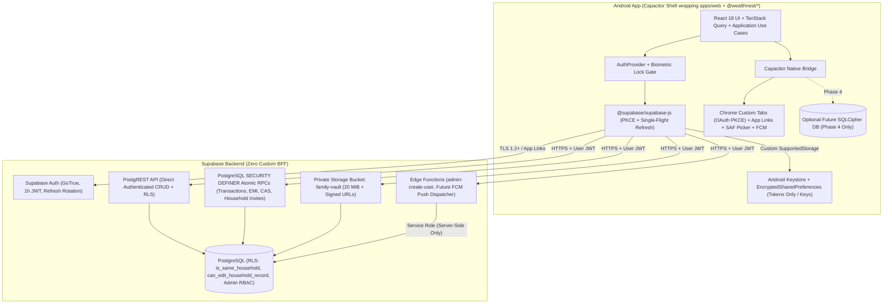
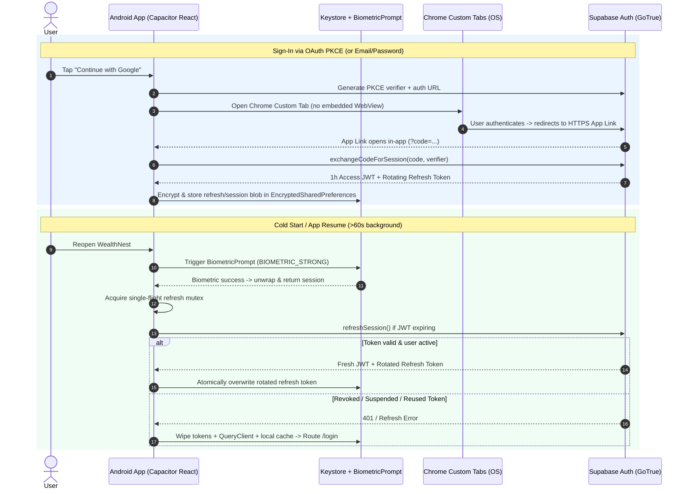
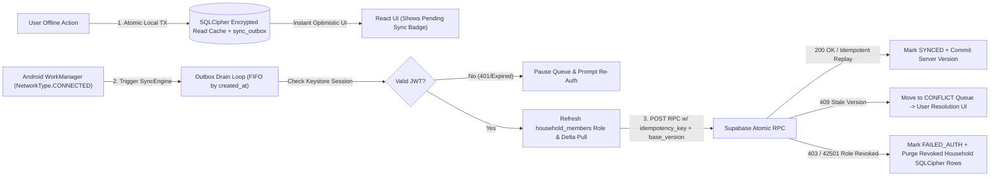

# WealthNest — Android Direct Supabase Integration Architecture Assessment

**Document Type:** Architecture Assessment & Target Implementation Blueprint  
**Status:** Final Assessment (No Code, Schemas, Dependencies, or RLS Policies Modified)  
**Deliverable Suite:**
- Architecture Assessment: [`android-architecture-assessment.md`](./android-architecture-assessment.md)
- Security Checklist & Test Cases: [`supabase-mobile-security-checklist.md`](./supabase-mobile-security-checklist.md)
- API & RPC Classification Matrix: [`mobile-api-operation-matrix.md`](./mobile-api-operation-matrix.md)

---

## Executive Summary & Recommended Architecture

WealthNest can connect Android clients **directly to Supabase** (Auth, PostgREST with RLS, PostgreSQL `SECURITY DEFINER` RPCs, Private Storage, and Deno Edge Functions) **without building or operating a separate custom backend**, provided critical transactional RPCs, client-side token storage, and household query/RLS gaps are closed first.

### Clear Architecture Recommendation

**Recommended Path:** Adopt **Capacitor with the existing React + TypeScript + Vite (`apps/web`) application** for Android (retaining the existing `src-tauri/` setup solely for desktop targets if desktop packaging remains needed, rather than keeping Tauri 2 as the Android production wrapper), paired with **atomic PostgreSQL RPCs** for all multi-table financial mutations.

**Why this fits the existing WealthNest repository best:**
1. **Maximum Immediate Reuse (~90–95% of UI + 100% of Domain/Application Logic):** `packages/shared`, `packages/domain`, `packages/application`, `apps/web` (already built with responsive mobile shell ergonomics), `@tanstack/react-query`, `@supabase/supabase-js` v2.49.1, and `pdfjs-dist` CAS PDF parsing carry straight into Capacitor with **zero UI rewrite**.
2. **Superior Android Native Security & Plugin Ecosystem Over Existing Tauri 2 Android:** The repo already compiles a Tauri 2 Android wrapper (`src-tauri/`, `scripts/build-android.sh`, `infra/docker/Dockerfile.android`), yet lacks biometric lock, hardware-backed Keystore token storage, verified Android App Links, FCM push notifications, encrypted SQLCipher storage, and Play App Signing release tooling. Tauri 2's mobile plugin ecosystem is still maturing and adds Rust/NDK build complexity (`cargo ndk`, NDK 26.2) for minimal gain on Android, whereas Capacitor offers first-class, standard Gradle/Android Studio tooling and production-proven plugins for **Android Keystore / `EncryptedSharedPreferences`**, **`BiometricPrompt`**, **Chrome Custom Tabs PKCE OAuth**, **SQLCipher**, **Storage Access Framework (SAF)**, and **Firebase Cloud Messaging**.
3. **Preserves Small-Team Maintainability:** React Native or Native Kotlin would duplicate the entire UI, routing, validation, and charting surface across two or three codebases without solving any backend security constraint that Supabase + atomic PostgreSQL RPCs do not already solve directly.

---

## 1. Current Architecture & Reusability Audit

### 1.1 Layer-by-Layer Audit of Existing Repository

| Subsystem | Verified Implementation Details | Reusability & Mobile Gap Assessment |
| :--- | :--- | :--- |
| **Supabase Client Config** | `apps/web/src/lib/supabase/client.ts` exports a transparent `Proxy` over `connectionManager.getClient()`. `apps/web/src/lib/config/server-config.ts` supports `local`, `lan`, and `remote` profiles persisted in `localStorage` (`wealthnest_server_config_v1`), with `isSecretApiKey()` blocking `sb_secret_` and `service_role` JWTs. | **Reusable with Adapter Swap.** `ConnectionManager` currently uses `@supabase/supabase-js` default `localStorage` (`wn-<host>-<hash>-auth-token`) and allows runtime switching to `http://` LAN/local backends; Android release builds must plug in a Keystore-backed `SupportedStorage` and lock `remote` HTTPS-only mode. |
| **Authentication** | `AuthProvider` (`auth-context.tsx`) manages `user`, `session`, `isLoading`, `isPasswordRecovery`, and `signOut()`, clearing `QueryClient` on `SIGNED_OUT` or user changes. Pages: `LoginPage.tsx`, `SignUpPage.tsx`, `ForgotPasswordModal.tsx`, `ResetPasswordPage.tsx`. Server config (`supabase/config.toml`): `jwt_expiry = 3600`, `enable_refresh_token_rotation = true` (10s reuse), `minimum_password_length = 12` (`lower_upper_letters_digits_symbols`), `enable_confirmations = true`, anonymous sign-ins disabled. | **Core Logic Reusable; Redirects & OAuth Incomplete.** Zero `signInWithOAuth` flows exist today. `ForgotPasswordModal` uses `${window.location.origin}/reset-password`, which breaks external email links when running inside a native WebView origin. `signOut()` lacks explicit multi-device (`scope: 'global' \| 'others'`) UI controls. |
| **Database Access & Repository Pattern** | Clean hexagonal ports in `@wealthnest/application` wired via `RepositoryProvider` (`apps/web/src/lib/persistence/repository-context.tsx`), supporting `'supabase' | 'sqlite'` bundle modes. Eleven+ Supabase adapters live in `apps/web/src/lib/persistence/`. Notice `<App />` hardcodes `defaultSupabaseBundle`, while `TauriSqliteAdapter` currently stores JSON in `window.localStorage` (`LOCAL_SQLITE_STORAGE_KEY`) and reads from RAM rather than native encrypted SQLite. | **Ports/Use-Cases 100% Reusable; Adapters Need Hardening.** Six adapter modules (`holding`, `transaction`, `liability`, `goal`, `family`, `liability-valuations-links`) append `.eq('user_id', userId)`, masking household records shared via RLS. Multi-step financial writes are non-atomic. |
| **RLS Policies & SQL Security** | Migrations `20260101000001`–`000019` enforce RLS across financial, vault, household, and admin tables (`is_same_household`, `can_edit_household_record`, `is_household_member`, `is_household_primary_owner`, `can_bootstrap_household_owner`, `household_creator_unchanged`). Migration `000017` revokes `anon` schema access except public `asset_classes`. | **Strong Foundation with 3 Table Gaps.** `loan_payments`, `asset_liability_links`, and `import_batches` were not updated in `000014` to household RLS. `transactions` has SELECT and INSERT RLS only (no DELETE/UPDATE), making client `.delete()` fail silently/with error. |
| **PostgreSQL RPC Functions** | 24 existing helper, Admin RBAC, and read-only Ephemeral Support Session RPCs (`is_same_household`, `can_edit_household_record`, `admin_get_users`, `admin_set_user_status`, `admin_manage_role`, `admin_start_support_session`, `support_get_user_*`, etc.), all hardened with `SECURITY DEFINER`, `SET search_path = public`, and NULL role checks (`000018`). | **Existing Admin/Support RPCs Ready; Financial RPCs Missing.** Zero atomic RPCs exist today for transactions, EMIs, valuations, transfers, CAS imports, or backup restores. |
| **Edge Functions** | Single Deno Edge Function: `supabase/functions/admin-create-user/index.ts`. Keeps `SUPABASE_SERVICE_ROLE_KEY` server-side; enforces CORS (`ALLOWED_ORIGINS`), caller JWT check (`auth.getUser`), Postgres-backed rate limits (`10/min`, `30/15m`), role hierarchy, and immutable audit logging. | **Ready (Web); Optional Origin Fix for Mobile.** `ALLOWED_ORIGINS` (synced in `.github/workflows/supabase-migration.yml`) must account for native WebView origins if admin onboarding is allowed from mobile, or keep admin creation Web-only. |
| **File Storage** | `SupabaseDocumentVaultAdapter` (`document-vault.adapter.ts`) uploads to private bucket `family-vault` (20 MiB limit, strict MIME allowlist + client `validateVaultFileBlobSignature`) at `<owner_user_id>/<doc_id>/<sanitized_name>`, previews via 120s `createSignedUrl`. | **RLS Ready; Mobile Orphan & Picker Gaps.** Storage upload precedes `family_documents` DB insert cleanly only on happy path; mid-flight network drops leave orphaned blobs. Android needs SAF/Photo Picker integration and private temp cache cleanup. |
| **Realtime Implementation** | Zero `.channel(...)` or `postgres_changes` subscriptions exist anywhere in `apps/` or `packages/`. Market ticks (`useLiveMarketFeed.ts` + `MarketDataAdapter`) are in-memory baseline price simulations that pause on `visibilitychange`. | **Zero Breaking Realtime Overhead.** TanStack Query (`staleTime: 5m`, manual invalidation) keeps mobile battery/data footprint low; selective Supabase Realtime subscriptions can be added later only where collaboration demands it. |
| **Environment Variables & CI** | `.env.example`, `.github/workflows/build-installers.yml`, `supabase-migration.yml`, `security-checks.yml`, `apps/web/public/_headers`. Uses `VITE_SUPABASE_URL` + `VITE_SUPABASE_PUBLISHABLE_KEY` / `VITE_SUPABASE_ANON_KEY`. | **CI Ready with Mobile Hardening Needed.** `scripts/build-android.sh` signs APKs using hardcoded `wealthnest123` keystore (`wealthnest-local.keystore`); production Play Store CI must replace this with Upload Keystore secrets. |
| **State Management** | React 18 Contexts (`AuthProvider`, `PreferencesProvider`, `PrivacyProvider`, `FamilyProvider`, `AdminProvider`, `SupportSessionProvider`), TanStack `QueryClient` (`refetchOnWindowFocus: false`, `retry: 1`), React Router v7 lazy routes. | **100% Reusable**, after moving PII/privacy rules (`wealthnest_family_members`, `panMasked`, `wealthnest_family_privacy_rules`) out of plaintext `localStorage`. |

### 1.2 Component Reusability Breakdown

| Codebase Layer | Package / Path | Android Reuse % | Action Required for Mobile |
| :--- | :--- | :---: | :--- |
| **Shared Primitives & Errors** | `packages/shared` (`Result`, currency/date helpers) | **100%** | None (pure TypeScript). |
| **Financial Domain Models & Math** | `packages/domain` (paise bigint math, loan EMI/prepayment, CAS parser domain, admin/isolation invariants) | **100%** | Ensure BigInt values serialize safely over bridges if SQLite/native storage is added (`string` or safe integer bounds). |
| **Application Use Cases & Ports** | `packages/application` (CRUD use cases, backup export/import, CAS orchestration, port interfaces) | **~95%** | Refactor multi-step write use cases (`RecordTransaction`, `ConfirmCasImport`, `RecordAssetValuation`, `CreateLiability`, `RestoreBackup`) to invoke new atomic Supabase RPC port methods. |
| **React UI, Routing & Hooks** | `apps/web/src/pages`, `components`, `hooks` | **~90%** | Fix `window.location.origin` redirect builders, replace mock `HouseholdSharingCard` state, adapt `tauri-file-dialog.ts` / `pdfjs-dist` picker to Capacitor File/Share/Browser plugins, tighten release CSP & route guards. |
| **Persistence & Auth Infrastructure** | `apps/web/src/lib/supabase`, `config`, `persistence`, `services` | **~60%** | Plug Keystore `SupportedStorage` into `ConnectionManager`, remove `.eq('user_id', userId)` filters from shared household queries, remove plaintext `localStorage` PII caches, lock release server config. |
| **Native Packaging Shell** | `src-tauri/` & `scripts/build-android.sh` | **Replace for Android** | Introduce Capacitor Android shell (`android/`) in Phase 1 while keeping `src-tauri/` solely for Desktop builds (Windows `.exe/.msi`, macOS, Linux). |

### 1.3 System Architecture Diagram (Current vs. Target Direct-Supabase Android)

---

## 2. Android Technology Assessment

WealthNest's core trade-off is between wrapping the existing production-grade React + TypeScript monorepo (`Capacitor` vs. updating the existing `Tauri 2` wrapper) versus rebuilding the UI layer (`React Native` vs. `Native Kotlin Android`).

### 2.1 Ten-Criteria Comparison Matrix

| Criterion | Capacitor + Existing React (`apps/web`) *(Recommended)* | Existing Tauri 2 Android Shell (`src-tauri/`) *(Status Quo Variant)* | React Native + TypeScript | Native Kotlin Android |
| :--- | :--- | :--- | :--- | :--- |
| **1. Code Reuse** | **Highest (~90–95%).** Reuses `@wealthnest/shared`, `@wealthnest/domain`, `@wealthnest/application`, Tailwind UI, charts, TanStack Query, `pdfjs-dist` CAS extraction. | **Highest (~90–95% UI),** identical React reuse, plus desktop parity. | **Moderate (~40–50%).** Reuses `@wealthnest/domain` & `application` TS only; **100% rewrite** of JSX/HTML/Tailwind UI, React Router, PDF extraction UI. | **Minimal (~0% client UI/domain TS).** Requires porting domain paise/EMI/CAS logic to Kotlin; only Supabase PostgreSQL schema/RLS reused. |
| **2. Supabase Integration** | **Seamless.** Uses existing `@supabase/supabase-js ^2.49.1` directly without polyfills. | **Seamless** for `@supabase/supabase-js`, same WebView runtime. | **Good with Polyfills.** `supabase-js` requires RN URL/crypto polyfills & AsyncStorage/SecureStore replacement; Hermes BigInt support must be vetted. | **Good (`supabase-kt`).** Mature official Kotlin Multiplatform client, Ktor networking, typed kotlinx.serialization models to maintain separately. |
| **3. Authentication** | **Mature.** Clean PKCE via `@capacitor/browser` (Chrome Custom Tabs) + `@capacitor/app` Android App Links (`assetlinks.json`) + `signInWithIdToken` Credential Manager support. | **Incomplete.** No `tauri-plugin-deep-link` or Chrome Custom Tabs OAuth plugin wired in repo; Rust Android OAuth redirects require custom native hooks. | **Mature** (`expo-web-browser` / `react-native-app-auth` + universal linking). | **Best-in-Class.** Native Google Credential Manager + Custom Tabs + OS App Links with zero JS bridge hop. |
| **4. Secure Token Persistence** | **Strong.** Custom `SupportedStorage` backed by Android Keystore AES-GCM + `EncryptedSharedPreferences` (replacing plaintext `localStorage`). | **Weak Currently / Higher Friction.** Current `ConnectionManager` uses plaintext `localStorage`; Tauri Stronghold/Keystore Android support requires Rust FFI/Kotlin glue. | **Strong.** (`react-native-keychain` / `expo-secure-store` backed by Keystore). | **Best-in-Class.** Direct Jetpack Security / Keystore `StrongBox` + `EncryptedSharedPreferences` + `BiometricPrompt` CryptoObject. |
| **5. Offline Support** | **Strong (Phase 4 Ready).** `@capacitor-community/sqlite` supports native Android **SQLCipher** encryption natively and cleanly matches `RepositoryProvider` ports. | **Broken Today.** `tauri-plugin-sql` lacks built-in Android SQLCipher by default in current setup, and `TauriSqliteAdapter` currently writes JSON into `localStorage`. | **Strong.** (`op-sqlite` / WatermelonDB + SQLCipher). | **Best-in-Class.** Native Jetpack Room + SQLCipher with Flow observables. |
| **6. Background Sync** | **Strong.** Write lightweight Kotlin `WorkManager` worker in `android/` project for periodic token-guarded delta sync/outbox retry, triggering TS SyncEngine cleanly on wake. | **Harder.** Requires bridging background Android `WorkManager` / headless service across Rust + WebView lifecycle. | **Moderate–Strong.** Headless JS / native Android `WorkManager`. | **Best-in-Class.** Native `WorkManager` with zero WebView startup penalty during background Doze windows. |
| **7. Push Notifications** | **First-Class.** Official `@capacitor/push-notifications` connects directly to Firebase Cloud Messaging (FCM) with standard `google-services.json` Android Studio setup. | **Immature on Android.** FCM notifications require custom Kotlin/Rust plugin work. | **First-Class.** (`@react-native-firebase/messaging`). | **Best-in-Class.** Native `FirebaseMessagingService` + rich notification channels/actions. |
| **8. Performance** | **Very Good for WealthNest.** Portfolio dashboards, tables, forms, CSV/CAS uploads render cleanly at 60fps in modern Android System WebView (Chrome Evergreen). Slight cold-boot (~300–500ms) WebView cost; fine for personal finance. | **Similar WebView Runtime**, slightly heavier Rust + WebView JNI initialization overhead and binary size (`NDK` `.so` libs per ABI). | **Better Touch/List Scroll.** Native `FlatList`/FlashList animations; no WebView memory overhead, though JS bridge serialization still applies. | **Best.** Instant cold start, lowest RAM footprint, native Compose 120Hz fluidity. |
| **9. Maintenance** | **Lowest Cost.** Single React/TS codebase ships Web (Cloudflare Pages), Desktop (Tauri), and Android (Capacitor) from one UI; standard Android Gradle folder is tiny and transparent. | **Split Friction.** Maintaining Rust + `cargo-ndk` + Android Gradle + WebView shims in `src-tauri/` requires specialized Rust+Android expertise whenever Play Store targets new API levels (`targetSdk`). | **2x UI Codebases.** Every Web feature (charts, admin, CAS wizard, family vault, responsive cards) must be re-implemented and QA'd twice. | **2x Everything.** Separate Kotlin team/feature backlog for every calculation, UI flow, validation rule, and CAS PDF parser. |
| **10. Dev Complexity** | **Low–Moderate.** Standard Android Studio / Gradle project + TypeScript plugins; existing Vite bundle plugs directly in (`webDir: apps/web/dist`). | **Moderate–High.** Docker image (`Dockerfile.android`) needs Rust targets + NDK 26.2 + OpenJDK 17 + CLI, harder to debug native Android plugins in Android Studio. | **High.** Full UI rewrite + RN navigation/reanimated/PDF tooling + Hermes polyfills. | **Very High.** Complete ground-up mobile product build + re-implementing PDF CAS parsing and tax/portfolio domain engines in Kotlin. |

### 2.2 Recommendation Rationale Grounded in This Repository

- **Choose Capacitor for Android (replacing Tauri's Android wrapper role while preserving `src-tauri/` for Desktop if desired):**
  - WealthNest has already invested heavily in a clean React + Tailwind + `@wealthnest/domain` + `@wealthnest/application` architecture, plus responsive mobile UI tests (`apps/web`). Rewriting all screens in Kotlin or React Native discards ~85–90% of that completed engineering without yielding commensurate product benefit for a data-driven personal wealth tracker.
  - Conversely, while `src-tauri/` already produces test Android builds via `scripts/build-android.sh`, **Tauri 2 Android** makes Play Store compliance significantly harder: standard Android security primitives (hardware Keystore `SupportedStorage`, `BiometricPrompt` gating, `FLAG_SECURE`, Chrome Custom Tabs OAuth, verified `assetlinks.json` App Links, `WorkManager`, FCM push notifications, Play App Signing Gradle workflows, and SQLCipher) are native first-class citizens in **Capacitor's Android Gradle module** with minimal boilerplate, whereas Tauri requires Rust-to-Kotlin FFI workarounds for most of them.

---

## 3. Supabase Direct Access Architecture

All Android operations communicate directly with Supabase endpoints using only `VITE_SUPABASE_URL` and the public publishable/anon key + user session JWT. The complete operation-by-operation table is detailed in [`mobile-api-operation-matrix.md`](./mobile-api-operation-matrix.md).

- **Direct Authenticated CRUD (PostgREST + RLS):** Reading portfolios (`holdings`, `assets`, `asset_classes`), reading cashflow ledgers (`transactions`), reading/editing single-table metadata (`profiles`, `goals`, `family_members`, `portfolio_accounts`), reading/uploading `family_documents` + `family-vault` signed URLs, registering FCM device push tokens.
- **PostgreSQL RPC (`SECURITY DEFINER`):** Existing admin/support procedures (`admin_*`, `support_*`) plus **mandatory new atomic financial RPCs** (`record_transaction_atomic`, `transfer_between_accounts_atomic`, `correct_transaction_atomic`, `record_emi_payment_atomic`, `record_loan_prepayment_atomic`, `record_asset_valuation_atomic`, `create_holding_with_asset_atomic`, `create_liability_atomic`, `confirm_cas_import_batch_atomic`, `restore_portfolio_atomic`, `create_household_invite` / `accept_household_invite`).
- **Supabase Edge Functions (Deno):** Existing `admin-create-user` (holds `SUPABASE_SERVICE_ROLE_KEY`), future `dispatch-push-notification` (holds FCM v1 Service Account secret), future authenticated market quote proxy (holds third-party market API keys).
- **Separate Trusted Backend (Not Needed Today):** Only required if WealthNest later adds regulated **RBI Account Aggregator (AA)** FIP/FIU mTLS certificates, persistent third-party broker OAuth `client_secret` custody (Zerodha Kite / Groww server sessions), or stateful high-frequency streaming jobs exceeding Edge Function execution limits.

---

## 4. Authentication & Secure Storage Design

### 4.1 Complete Auth & Lifecycle Flows

| Auth Capability | Target Mobile Design |
| :--- | :--- |
| **Login & Signup** | Email + 12-char password (`lower_upper_letters_digits_symbols`) via `signInWithPassword` / `signUp` directly against GoTrue; server errors (`email_not_confirmed`, suspended account) surfaced cleanly without demo fallbacks. |
| **Email Verification & Password Reset** | Replace `${window.location.origin}/reset-password` (`ForgotPasswordModal.tsx`) with verified HTTPS **Android App Link** (`https://app.wealthnest.in/auth/reset-password` and `/auth/verify`). Android OS routes link clicks directly into WealthNest, which runs `exchangeCodeForSession(code)` (PKCE) and enters `PASSWORD_RECOVERY` UI (`ResetPasswordPage.tsx`). |
| **OAuth (Google / Social Sign-In)** | Use `@capacitor/browser` (**Chrome Custom Tabs**) to launch `supabase.auth.signInWithOAuth({ provider, options: { redirectTo: 'https://app.wealthnest.in/auth/callback', flowType: 'pkce' } })` — **never** an embedded WebView (`DISALLOWED_USERAGENT`), compliant with Google OAuth RFC 8252 — OR use native Google Credential Manager One-Tap ID token with `signInWithIdToken`. |
| **JWT Management** | 1-hour access JWT (`jwt_expiry = 3600`) kept **in memory only** (`supabase-js` client runtime + Authorization header). Never logged or persisted to `localStorage`. |
| **Refresh Token Persistence** | Custom `SupportedStorage` passed to `ConnectionManager`'s `createClient` options backed by **Android Keystore (`AES-256-GCM`) + `EncryptedSharedPreferences`**. Hardware-backed on TEE/StrongBox devices. Migrate & purge any pre-existing `wn-*-auth-token` entries from `localStorage`. |
| **Rotation & Wake Concurrency** | `supabase/config.toml` enforces `enable_refresh_token_rotation = true` (`10s` reuse interval). Serialize refresh requests via an in-process mutex on Android `onResume` and `WorkManager` wakeup so simultaneous refreshes never trigger false reuse family invalidation. |
| **Session Expiration & Revocation** | If refresh fails (`invalid_grant` / revoked user / suspended via `user_access_status`), immediately wipe Keystore tokens, clear TanStack `QueryClient`, wipe offline SQLCipher tables (if enabled), unregister FCM device token, and route to `/login`. |
| **Logout** | Standard Sign Out (`scope: 'local'`) wipes device Keystore + local caches + FCM token; `ProfileSecurityTab.tsx` exposes `"Sign out other devices"` (`scope: 'others'`) and `"Sign out all sessions"` (`scope: 'global'`). |
| **Biometric App Lock** | Native Android `BiometricPrompt` (`BIOMETRIC_STRONG` + user-configured fallback) protects a Keystore lock gate before hydrating UI from cached session upon cold start or >60s background return. Combine with `FLAG_SECURE` to blank the Android app-switcher screenshot preview. |

### 4.2 Mobile Auth, PKCE OAuth & Biometric Unlock Sequence

---

## 5. Household Security & Isolation Analysis

Android connects with the exact same Supabase user JWT and PostgreSQL RLS enforcement (`20260101000014`, `20260101000016`, `20260101000019`) as the Web application:

- **Enforced Server Functions Verified:**
  - `is_same_household(auth.uid(), row.user_id)`: permits SELECT across members of a shared `households` tenant (`primary_owner`, `member`, `viewer`).
  - `can_edit_household_record(auth.uid(), row.user_id)`: permits INSERT/UPDATE/DELETE only for `'primary_owner'` and `'member'`, strictly blocking `'viewer'`.
  - `is_household_member`, `is_household_primary_owner`, `can_bootstrap_household_owner`, `household_creator_unchanged` (`000019`): locks `households` and `household_members` role administration strictly to the `'primary_owner'` and prevents `created_by` hijacking.
- **Five Critical Gaps Discovered Requiring Fix Before Mobile Collaboration Ships:**
  1. **Client `.eq('user_id', userId)` Filters Mask Shared Data:** `SupabaseHoldingAdapter`, `SupabaseTransactionAdapter`, `SupabaseLiabilityAdapter`, `SupabaseAssetValuationAdapter`, `SupabaseGoalAdapter`, and `SupabaseFamilyAdapter` add `.eq('user_id', userId)` to queries, accidentally filtering out spouse/household records even though RLS allows reading them. Fix: remove client `.eq('user_id', userId)` and rely on Postgres RLS (+ optional UI member selector).
  2. **Mock `HouseholdSharingCard.tsx`:** Currently relies on local `useState` demo arrays and builds `${window.location.origin}` mock invites instead of real `households` / `household_members` / invite-token RPCs.
  3. **Local-Only Privacy Rules:** `wealthnest_family_privacy_rules` are stored in `localStorage` (`SupabaseFamilyAdapter` / `FamilyContext`) and never enforced by PostgreSQL across devices. Move sharing permissions server-side if intended as authorization boundaries.
  4. **Incomplete Household RLS on 3 Child Tables:** Migration `20260101000014` did NOT update `loan_payments`, `asset_liability_links`, or `import_batches`, leaving them owner-only (`auth.uid() = user_id`). Moreover, `asset_liability_links` lacks a SQL trigger/constraint guaranteeing linked `asset.user_id` and `liability.user_id` belong to the same household (`validateAssetLiabilityLinkIsolation` currently runs only in domain TypeScript!).
  5. **Admin Error Masking:** `SupabaseAdminAdapter` catches errors and returns `DEMO_ADMIN_USERS`, which must be stripped outside explicit mock/test environments.

**Verification Suite:** Ten concrete cross-household isolation, viewer escalation, role self-promotion, vault traversal, and post-revocation tests (`TC-MOB-ISO-01` through `TC-MOB-ISO-10`) are specified in [`supabase-mobile-security-checklist.md#6-household-security--isolation-test-cases-verification-suite`](./supabase-mobile-security-checklist.md).

---

## 6. Financial Operation Integrity Architecture

Every financial workflow audited exhibits multi-step client-side execution or missing concurrency guards that become high-risk over mobile cellular transitions and multi-device household usage:

| Workflow | Observed Codebase Vulnerability | Required Atomic DB & Concurrency Design |
| :--- | :--- | :--- |
| **1. EMI Payment** | `RecordEmiPaymentModal.tsx` computes principal/interest split in JS (`bifurcateLoanPayment`) and ONLY calls `recordLiabilityBalance` (`onConflict: 'liability_id, as_of_date'`). It never inserts `loan_payments` or `transactions`, and same-date calls overwrite prior entries. | Implement `record_emi_payment_atomic(p_liability_id, p_payment_date, p_amount_cents, p_idempotency_key, p_source_holding_id)` locking `liabilities` `FOR UPDATE`, performing bigint paise interest/principal math in SQL, inserting `loan_payments` + `liability_balances` + updating `liabilities.outstanding_balance_cents` in one TX. |
| **2. Asset Valuation Updates** | `RecordAssetValuationUseCase` writes `asset_valuations` and separately calls `updateHoldingValues`. Backdated valuations overwrite live `holdings.current_value_cents`. | Implement `record_asset_valuation_atomic`: upsert `asset_valuations`, check `p_as_of_date >= MAX(as_of_date)` before updating live `holdings.current_value_cents`, and persist inside one TX. |
| **3. Investment Transactions** | `RecordTransactionUseCase` reads holding qty/cost in JS, updates `holdings`, then inserts `transactions` — vulnerable to lost-update races (Web + Android editing simultaneously) and torn state if network fails mid-call. | Implement `record_transaction_atomic` with `p_idempotency_key uuid` + optimistic `p_expected_updated_at` / `version` check (`409 Conflict` if stale) and `FOR UPDATE` row locking. |
| **4. Account Transfers** | Migration `000015` supports `transaction_type = 'transfer'` and `destination_account_id`, but no atomic transfer endpoint pairs source debit, destination credit, and household account validation. | Implement `transfer_between_accounts_atomic` acquiring deterministic UUID-ordered `FOR UPDATE` locks (deadlock-free), asserting both accounts belong to caller's editable household, and posting paired ledger adjustments atomically. |
| **5. CAS & Broker Imports** | `SupabaseCasImportAdapter` executes N+1 sequential `assets` -> `holdings` -> `transactions` -> `import_batches` round-trips; dropped 4G mid-batch leaves partial holdings without dedup token. | Implement `confirm_cas_import_batch_atomic` accepting batch SHA-256 `idempotency_key` + JSONB rows, upserting multi-folio holdings (`idx_holdings_user_asset_account`), deduplicating ledger entries, and inserting `import_batches` inside one TX. |
| **6. Loan Prepayments** | Processed through generic balance updates without validating remaining principal or linking cash source account debits atomically. | Implement `record_loan_prepayment_atomic` enforcing `0 < prepayment <= outstanding_balance_cents` under `FOR UPDATE` lock, writing `loan_payments` (`prepayment`), updating balance & optional `'closed'` status atomically. |
| **7. Transaction Corrections** | `DeleteTransactionUseCase` executes `.delete()` on `transactions`, even though Postgres has zero `DELETE` RLS policy on `transactions`. | Preserve append-only ledger integrity: do NOT add `DELETE` RLS. Build `correct_transaction_atomic` inserting a signed compensating reversal + replacement transaction and recomputing holding units/avg cost in one TX. |
| **8. Backup Restore & Vault Orphan Risk** | `SupabaseBackupAdapter` runs non-atomic sequential upserts, targets non-existent `financial_goals` (Supabase table is `goals`), and uses dropped conflict target `(user_id, asset_id)`. Vault upload uploads file before inserting `family_documents` row. | Implement `restore_portfolio_atomic` targeting `goals` & `idx_holdings_user_asset_account` under strict `auth.uid()` scoping. For Vault, pair pending metadata + Storage confirmation + scheduled orphan reaper. |
| **9. Numeric Precision & Schema Drift** | `LiabilityDto` uses `bigint` (`currentBalanceCents`) while `HoldingDetailDto` mixes `number` (`unitCostCents`) and `Math.round(val * 100)`; `sqlite-schema.ts` uses `*_paise` and `financial_goals`. | Standardize integer paise `bigint`/string DTO serialization across SQL RPCs, TypeScript ports, and any future SQLCipher cache (preventing IEEE-754 float precision errors on large portfolios). |

---

## 7. Optional Future Offline-First Architecture (Design Proposal Only)

> **Scope Notice:** Offline write support is **not** implemented during this assessment and is **not** required for Phase 1 Android launch. When enabled in **Phase 4**, it must align strictly with the hexagonal `RepositoryProvider` architecture in `apps/web/src/lib/persistence/`.

### 7.1 Nine-Point Target Offline Architecture

1. **Local Encrypted Storage (`SQLCipher`):** Replace `TauriSqliteAdapter`'s `localStorage` JSON stub with `@capacitor-community/sqlite` compiled with **SQLCipher (`AES-256`)**, keyed by a 256-bit install key wrapped in **Android Keystore**. Align `sqlite-schema.ts` columns directly with Postgres (`*_cents`, `goals`, `goal_holding_allocations`, `households`, `household_members`, multi-folio unique index, plus local `version` and `synced_at` metadata).
2. **Cached Read Models:** UI reads immediately from SQLCipher (via `SqliteRepositoryBundle` / TanStack Query initialData) cleanly showing last synced timestamp (`stale` indicator when offline), while background delta sync (`updated_at > last_pulled_at`) refreshes changed rows on reconnect.
3. **Pending Write Queue (`sync_outbox`):** Every offline mutation writes atomically inside one SQLCipher transaction to **both** the optimistic local read table and a persistent `sync_outbox` table (`operation_id`, `rpc_name`, `payload_json`, `idempotency_key`, `base_version`, `created_at`, `retry_count`, `status`: `PENDING | SYNCING | CONFLICT | FAILED_AUTH`).
4. **UUID-Based Synchronization:** All client-created entities (`holdings`, `goals`, `family_members`, `liabilities`, `transactions`, `outbox` `idempotency_key`) mint cryptographic `crypto.randomUUID()` UUIDs before enqueueing so offline inserts and foreign-key links (`goal_holding_allocations`, `asset_liability_links`) require zero server ID remapping.
5. **Idempotent Replay:** Mobile `SyncEngine` transmits `idempotency_key` to target Postgres atomic RPCs; timeouts or mid-flight network switches (`Wi-Fi <-> 5G`) safely retry the exact operation without double-posting EMIs, trades, or CAS imports.
6. **Conflict Resolution Policy:**
   - *Append-Only Ledgers (`transactions`, `loan_payments`, `asset_valuations`)*: Server accepts timestamped entries monotonically; valuations only update live `holdings.current_value_cents` when `as_of_date` is latest.
   - *Versioned Financial State (`holdings` qty, `liabilities` balance)*: RPC compares `p_expected_version` / `updated_at`; mismatch returns `409 CONFLICT`, moving the outbox item to `CONFLICT` and prompting user review rather than silently overwriting a co-owner's Web edit via blind LWW.
   - *Non-Financial Metadata (`profiles`, `goals` name, `family_members` notes)*: Server-timestamp Last-Write-Wins (LWW).
7. **Reauthentication Pause:** If SyncEngine receives `401` or `user_access_status` block while draining the outbox (e.g., offline > refresh expiry or user revoked), drain pauses immediately **without deleting queued mutations**, displaying a "Re-authenticate to sync N pending changes" prompt (unless user was removed/suspended cleanly — see #8).
8. **Permission & Membership Changes:** On reconnect, SyncEngine pulls updated `household_members` role before flushing writes. If downgraded from `'member'` to `'viewer'` or removed from household, server rejects queued mutations cleanly (`403`/`42501`); SyncEngine marks affected outbox entries `FAILED_AUTH`, exports diagnostic conflict summary if needed, and **immediately purges unauthorized household rows from SQLCipher**.
9. **Sync Monitoring & Telemetry:** Expose persistent sync status indicator (`Synced`, `Offline (N pending)`, `Action Required (Conflict)`), exponential backoff (`WorkManager` `NetworkType.CONNECTED`), max-retry dead-letter inspector, and scrubbed telemetry counters (pending count, lag seconds, failure HTTP code — zero financial amounts or PII).

### 7.2 Optional Offline Sync & Outbox State Flow (Phase 4)

---

## 8. Android Deployment, Native Integration & Security Posture

| Area | Current State (`src-tauri/` + `scripts/build-android.sh`) | Target Capacitor Production Architecture |
| :--- | :--- | :--- |
| **Permissions** | Implicit minimal WebView permissions; file access via `tauri-plugin-dialog`/`fs`. | Declare strictly: `INTERNET`, `ACCESS_NETWORK_STATE`, `USE_BIOMETRIC`, `POST_NOTIFICATIONS` (API 33+). Use Android **Photo Picker / Storage Access Framework (SAF)** for CAS PDFs & Document Vault uploads — never request `READ_EXTERNAL_STORAGE` or `MANAGE_EXTERNAL_STORAGE`. |
| **Deep Links / App Links** | None configured; auth redirects use `${window.location.origin}`. | Configure `<intent-filter android:autoVerify="true">` for `https://app.wealthnest.in/auth/*` and `/invite/*` paired with Cloudflare Pages hosting `/.well-known/assetlinks.json`. Handles cold start + warm resume links cleanly via `@capacitor/app`. |
| **Network Security** | `server-config.ts` permits switching to `http://` LAN/local backends; CSP allows `http://*:54321`. | `res/xml/network_security_config.xml`: **`cleartextTrafficPermitted="false"`** in `release` variant; `src/debug` override allows `127.0.0.1` / local Supabase emulator only when debugging. Strip LAN/local mode UI in release build flag. |
| **TLS & Pinning** | Standard platform TLS in WebView. | Enforce TLS 1.2/1.3 via OS trust store + HSTS. **Do NOT hardcode Supabase leaf SSL certs** (CDN rotation breaks installed APKs). If policy requires pinning later, pin Cloudflare/Root CAs with dual backup pins + remote config kill-switch. |
| **Push Notifications** | None. | `@capacitor/push-notifications` (**FCM**) + `user_device_tokens` table (RLS `auth.uid() = user_id`) + Supabase Edge Function `dispatch-push-notification` holding FCM v1 Service Account secret. **Lockscreen privacy rule:** push payload contains generic triggers only (*"Upcoming EMI reminder due in 3 days"* — zero amounts, lender names, or PAN!). |
| **Background Tasks** | None (`useLiveMarketFeed` pauses on background). | Use **Android `WorkManager`** (`PeriodicWorkRequest` >=15m + `OneTimeWorkRequest` on `NetworkType.CONNECTED`) only for optional Phase 4 outbox draining or gentle pre-fetch; keep financial reminders server-driven (`pg_cron` -> Edge -> FCM) so Doze mode never misses alerts. |
| **Secure Storage** | `localStorage` holds auth tokens, user profile, `panMasked`, `family_members`, and `LOCAL_SQLITE_STORAGE_KEY`. | **Keystore (`AES-256-GCM`) + `EncryptedSharedPreferences`** for refresh tokens + Keystore-wrapped **SQLCipher** key (if offline mode enabled). Set `android:allowBackup="false"` and `FLAG_SECURE` on sensitive routes. |
| **App Signing & Release Config** | `scripts/build-android.sh` signs APK with hardcoded local keystore password `wealthnest123` (`wealthnest-local.keystore`). | Enable **Google Play App Signing**; CI signs `.aab` using an encrypted upload keystore injected from GitHub Actions Secrets / KMS. Set `debuggable=false`, `minifyEnabled true` (R8), `shrinkResources true`, `WebView.setWebContentsDebuggingEnabled(false)`. |
| **Logging & Crash Reporting** | Console warnings + unhandled browser/WebView logs. | Mandatory pre-export scrubbing middleware modeled on `sanitizeAuditMetadata()` (`packages/domain/src/admin/admin-invariants.ts`): redact JWTs, refresh tokens, `apikey`, PAN, Aadhaar, account numbers, monetary amounts, CAS PDF text, and signed Storage URLs before Sentry/Crashlytics transmission. Disable verbose console output in production builds. |

---

## 9. Risks, Dependencies & Phased Implementation Roadmap

### 9.1 Key Risks & Mitigations

| Risk | Impact | Likelihood | Concrete Mitigation |
| :--- | :---: | :---: | :--- |
| **Non-atomic client mutations corrupt ledger over mobile 4G drops** | Critical | High | Do not launch mobile write features until **Phase 2 Atomic RPCs** (`record_transaction_atomic`, `record_emi_payment_atomic`, `confirm_cas_import_batch_atomic`, etc.) are live and routed via adapters. |
| **Plaintext `localStorage` leaks refresh tokens or PAN on compromised devices** | Critical | Medium | Implement Phase 1 Keystore `SupportedStorage` plugin + delete plaintext `localStorage` caches in `SupabaseUserAdapter`, `SupabaseFamilyAdapter`, and `TauriSqliteAdapter`. |
| **Household sharing inconsistency (client `.eq('user_id')` + missing table RLS)** | High | High | Fix client `.eq('user_id', userId)` filters, migrate `loan_payments` / `asset_liability_links` / `import_batches` to `000014` household RLS, and enforce cross-household trigger on `asset_liability_links`. |
| **Refresh-token rotation family revocation on Android background/foreground race** | High | Medium | Implement single-flight async mutex around `refreshSession()` shared across foreground hooks and background sync tasks. |
| **CORS / WebView origin rejection on Edge Functions** | Medium | Medium | Include verified Capacitor origin (`https://localhost`) in `ALLOWED_ORIGINS` if calling Edge Functions from mobile, or keep `admin-create-user` restricted to authenticated Web portal. |
| **Google OAuth rejection (`disallowed_useragent`)** | High | High (if WebView used) | Always use Chrome Custom Tabs (`@capacitor/browser`) + PKCE or native Credential Manager; never run Google login inside WebView. |
| **Android System WebView version fragmentation / `pdfjs-dist` memory spikes** | Medium | Medium | Recommend `minSdkVersion` >= 26 (Android 8+), enforce the existing 20 MiB / 100-page CAS PDF limits strictly, and bundle the local `pdfjs-dist` worker asset cleanly with Vite/Capacitor. |

### 9.2 Dependency Sequence

1. **Domain & Database Fixes First (Phase 0)** -> Unlocks safe multi-user households and eliminates broken Backup/Delete/EMI paths for **both** Web and Mobile.
2. **Domain hosting (`https://app.wealthnest.in/.well-known/assetlinks.json`) + Google Play Developer Console (`SHA-256` App Signing fingerprint)** -> Hard dependency before Auth Email Verification, Password Reset, and PKCE OAuth App Links work on Android.
3. **Firebase Project + FCM v1 Service Account** -> External dependency solely for Phase 3 Push Notifications.

### 9.3 Phased Implementation Roadmap

| Phase | Target Outcomes | Key Deliverables & Verification Gates |
| :--- | :--- | :--- |
| **Phase 0: Database, RLS & Client Correctness Prerequisites** *(Pre-Mobile Foundation)* | Close household RLS & schema drift gaps across existing codebase (benefits Web immediately too). | - Migration: household RLS on `loan_payments`, `asset_liability_links`, `import_batches`; SQL cross-household trigger on `asset_liability_links`. - Fix `SupabaseBackupAdapter` (`goals` instead of `financial_goals`, multi-folio conflict key) & drop `.eq('user_id', userId)` from household adapters. - Remove `DEMO_ADMIN_USERS` catch fallback & stop persisting `panMasked`/PII in `localStorage`. - Expand `supabase/tests/01_rls_and_household_isolation.sql` with `TC-MOB-ISO-*` pgTAP assertions. |
| **Phase 1: Capacitor Android Shell, Keystore Auth & Deep Links** *(MVP Online Read + Auth)* | Bootable Android `.apk`/`.aab` reusing `apps/web` securely with direct Supabase HTTPS connection. | - Initialize Capacitor Android (`in.wealthnest.app`) consuming `apps/web/dist`. - Custom `SupportedStorage` via Keystore `EncryptedSharedPreferences` + single-flight refresh lock. - Replace `${window.location.origin}` auth/reset/invite URLs with verified App Links (`assetlinks.json`); add Google OAuth PKCE via Chrome Custom Tabs. - Lock release build `server-config.ts` to HTTPS remote only + `network_security_config.xml` (`cleartextTrafficPermitted="false"`). |
| **Phase 2: Atomic Financial RPCs & Full Write Parity** *(Production Financial Writes)* | Safe write parity across Web & Android with concurrency protection and zero partial-write corruption. | - Implement & integrate PostgreSQL RPCs: `record_transaction_atomic`, `transfer_between_accounts_atomic`, `correct_transaction_atomic`, `record_emi_payment_atomic`, `record_loan_prepayment_atomic`, `record_asset_valuation_atomic`, `create_liability_atomic`, `create_holding_with_asset_atomic`, `confirm_cas_import_batch_atomic`, `restore_portfolio_atomic`, `create/accept_household_invite`. - Wire real `HouseholdSharingCard.tsx` mutations + server privacy scopes. |
| **Phase 3: Mobile Native Polish, Push & Play Store Hardening** *(Public Android Launch)* | Play Store compliance, biometric security, vault/CAS file workflows, push alerts. | - Biometric App Lock (`BIOMETRIC_STRONG` + grace window) & `FLAG_SECURE` app-switcher protection. - Android SAF / Photo Picker (`family-vault` + CAS PDFs) with private cache auto-purge. - `user_device_tokens` + Edge Function FCM push alerts (privacy-scrubbed payloads). - Google Play App Signing CI workflow (deprecating local `wealthnest123` keystore), R8/ProGuard, scrubbed crash logging, full `TC-MOB-ISO-01..10` E2E verification. |
| **Phase 4: Optional Offline-First Sync Engine** *(Future Enhancement)* | Full read-and-write resilience on flights / zero-connectivity environments. | - Align `sqlite-schema.ts` with Postgres schema -> enable SQLCipher AES-256 via Keystore. - Implement `sync_outbox` queue, UUID sync, conflict UI, `WorkManager` trigger, post-revocation cache purge, and sync telemetry. |

---

## Conclusion

For the existing WealthNest codebase, **Capacitor wrapping `apps/web` paired with atomic PostgreSQL RPCs and Android Keystore-backed session storage** is decisively the strongest architecture: it reuses nearly the entire production application and clean hexagonal domain packages, resolves every mobile financial atomicity and household isolation gap directly inside Supabase without running an unnecessary BFF server, and provides an idiomatic, Play Store-ready native Android shell with biometric locking, verified App Links, SAF vault handling, and FCM notifications.
