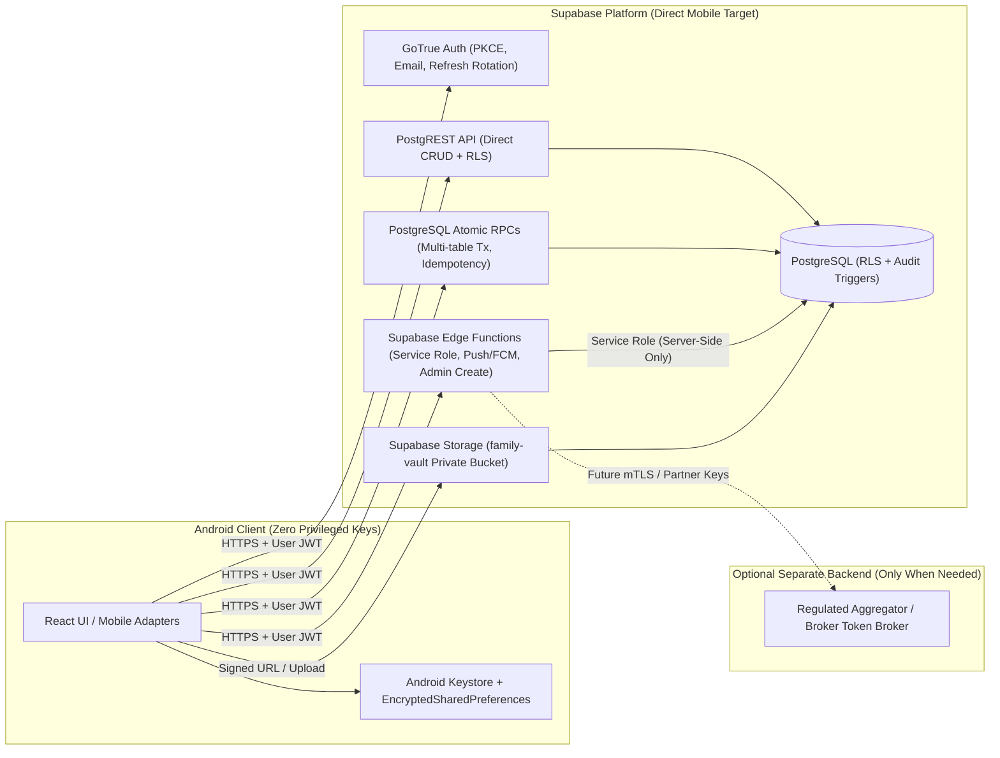

# WealthNest — Mobile API Operation Matrix & Direct Supabase Access Classification

**Document Type:** Architecture Assessment Deliverable  
**Status:** Proposed Target Contract (Assessment Only — No Schema or Code Modified)  
**Scope:** Classification of every existing and planned WealthNest operation for direct Android access via Supabase (`supabase-js` v2.49.1+).

---

## 1. Guiding Principle: Direct-to-Supabase Without a Custom Middleware Backend

WealthNest Android clients connect **directly** to Supabase (GoTrue Auth, PostgREST, PostgreSQL `SECURITY DEFINER` RPCs, Private Storage, and Deno Edge Functions) using only public client configuration (`VITE_SUPABASE_URL` and the public anon/publishable key) paired with a short-lived authenticated user JWT.

- **Zero Privileged Secrets in Mobile:** `SUPABASE_SERVICE_ROLE_KEY`, admin signing secrets, broker OAuth client secrets, or database connection passwords **never** ship in the Android APK/AAB, WebView bundle, or native Android config.
- **No Unnecessary BFF:** Standard reads and single-table CRUD are enforced directly by PostgreSQL Row Level Security (`auth.uid()`, `is_same_household`, `can_edit_household_record`, `is_platform_admin`).
- **Four Execution Tiers:**
  1. **Direct Authenticated CRUD (PostgREST + RLS):** Single-row or single-table operations governed cleanly by RLS with no cross-table balance invariant.
  2. **PostgreSQL RPC (`SECURITY DEFINER` / `SECURITY INVOKER` + Atomic Transaction):** Multi-table financial mutations, balance updates, idempotent batch imports, compensating ledger corrections, RBAC transitions, and cross-table integrity checks.
  3. **Supabase Edge Functions (Deno):** Operations requiring `SUPABASE_SERVICE_ROLE_KEY` (e.g., admin user creation), third-party HTTP orchestration (e.g., Firebase Cloud Messaging push dispatch, authenticated market quote proxy), or Storage-plus-DB cleanup orchestration.
  4. **Separate Trusted Backend (Conditional / Future Only):** Only introduced if WealthNest later integrates regulated Account Aggregator (RBI AA) mTLS certificates, broker OAuth `client_secret` custody (Zerodha Kite / Groww persistent tokens), or scheduled high-frequency background market polling outside Supabase Edge limits.

---

## 2. Classification Matrix by Domain

> **Notation:**
> - **Current Implementation:** Observed state in `apps/web` & `supabase/migrations/`.
> - **Target Tier:** `Direct CRUD` | `PostgreSQL RPC` | `Edge Function` | `Trusted Backend`.
> - **Mobile Readiness:** `Ready` | `Fix Required` | `New RPC Needed` | `New Edge Function Needed`.

### A. Authentication & Session Lifecycle

| Operation | Current Implementation | Target Tier | Security / RLS / Rate Control | Mobile Readiness & Required Changes |
| :--- | :--- | :--- | :--- | :--- |
| Email + password sign in | `supabase.auth.signInWithPassword` (`LoginPage.tsx`) | **Direct Auth (GoTrue)** | Supabase `[auth.rate_limit]`, email confirmation required (`enable_confirmations = true`) | **Fix Required:** Replace `localStorage` session persistence (`ConnectionManager`) with Android Keystore / `EncryptedSharedPreferences`. |
| User signup & profile init | `supabase.auth.signUp` + trigger `handle_new_user()` (`000013`) | **Direct Auth (GoTrue)** | Password >= 12 chars (`lower_upper_letters_digits_symbols`), confirmation required | **Fix Required:** Pass mobile App Link (`https://app.wealthnest.in/auth/callback` or custom scheme fallback) as `emailRedirectTo`. |
| Password reset request | `resetPasswordForEmail` (`ForgotPasswordModal.tsx`) | **Direct Auth (GoTrue)** | Currently sets `redirectTo: ${window.location.origin}/reset-password` | **Fix Required:** Must use verified Android App Link HTTPS URL on mobile; `window.location.origin` (`https://tauri.localhost` / `http://localhost`) breaks external email links. |
| Complete password recovery | `supabase.auth.updateUser({ password })` (`ResetPasswordPage.tsx`) | **Direct Auth (GoTrue)** | Triggered by `PASSWORD_RECOVERY` auth event | **Fix Required:** Handle deep-link cold start + PKCE code exchange (`exchangeCodeForSession`). |
| OAuth / Social login (Google) | Not implemented in web app | **Direct Auth (GoTrue)** | PKCE flow via system browser (Chrome Custom Tabs) + App Link redirect | **New Flow Needed:** Implement `signInWithOAuth` with Chrome Custom Tabs (never embedded WebView OAuth) or native Credential Manager ID token + `signInWithIdToken`. |
| Refresh token rotation | Managed by GoTrue (`enable_refresh_token_rotation = true`, 10s reuse interval) | **Direct Auth (GoTrue)** | Automatic rotation; reuse triggers family revocation | **Fix Required:** Serialize concurrent refresh calls on mobile wake-up / multi-tab resume; handle invalid refresh token by wiping Keystore + local cache and forcing re-login. |
| Sign out (`local` / `global` / `others`) | `supabase.auth.signOut()` (`auth-context.tsx`) | **Direct Auth (GoTrue)** | Default scope only; clears TanStack Query cache | **Fix Required:** Expose "Sign out all devices" (`scope: 'global'`) and "Sign out other devices" (`scope: 'others'`) in `ProfileSecurityTab.tsx`; wipe local encrypted cache on logout. |
| Session status check & biometric unlock | No biometric lock; checks `auth.getSession()` | **Local Native Gate + Direct Auth** | Native Android `BiometricPrompt` (`BIOMETRIC_STRONG`) unlocks Keystore wrapping key before hydrating Supabase session | **New Native Capability Needed.** |

---

### B. User Profiles & Preferences

| Operation | Current Implementation | Target Tier | Security / RLS Rules | Mobile Readiness & Required Changes |
| :--- | :--- | :--- | :--- | :--- |
| Read own profile | `SupabaseUserAdapter.getById` (`SELECT` on `profiles`) | **Direct CRUD** | `profiles` SELECT RLS (`auth.uid() = id` / `000014` household read); `000017` denies `anon` | **Fix Required:** Stop caching PII profile JSON in plaintext `localStorage`. |
| Upsert own profile & preferences | `SupabaseUserAdapter.updateProfile` (`UPDATE` then `INSERT` fallback) | **Direct CRUD** | `profiles` INSERT (`000013`) & UPDATE (`auth.uid() = id`) | **Ready** (minor cleanup: single `upsert` after removing `localStorage` PII cache). |
| Hide balances / Privacy mode flag | Client-only `PrivacyProvider` (`localStorage` key `wealthnest_hide_balances`) | **Local UI Setting** | Non-secret boolean flag; resets or persists locally | **Ready** (keep UI preference local; optional sync to `profiles.preferences` JSON). |
| Cross-device active sessions viewer | Not implemented | **PostgreSQL RPC / Auth UI** | Cannot query `auth.sessions` directly from client via PostgREST | **Optional Enhancement:** Read-only metadata RPC or rely on `signOut({ scope: 'others' })`. |

---

### C. Asset Classes & Market Quotes

| Operation | Current Implementation | Target Tier | Security / RLS / Control | Mobile Readiness & Required Changes |
| :--- | :--- | :--- | :--- | :--- |
| List `asset_classes` | `SupabaseAssetClassAdapter` (`SELECT` on `asset_classes`) | **Direct CRUD** | Public read allowed by `000017` exception; reference taxonomy | **Ready:** Cache aggressively in TanStack Query (`staleTime` long) / local cache. |
| Live market quote simulation | `MarketDataAdapter` + `useLiveMarketFeed` (in-memory simulated ticks) | **Client Simulation (Current)** | No external HTTP calls; pauses on `visibilitychange` | **Ready (Current):** Pause feed cleanly on Android `AppLifecycleState` backgrounding to save battery. |
| Real NSE/BSE/MF NAV feeds (Future) | Not implemented yet | **Edge Function** (or **Trusted Backend** for paid streaming) | Upstream market API keys must stay server-side; enforce per-user rate limit & caching | **New Edge Function Needed** when replacing simulated ticks with live provider APIs. |

---

### D. Assets & Holdings

| Operation | Current Implementation | Target Tier | Security / RLS Rules | Mobile Readiness & Required Changes |
| :--- | :--- | :--- | :--- | :--- |
| List portfolio holdings | `SupabaseHoldingAdapter.listDetailsByUser` (queries `holdings` + `assets` + `asset_classes` with `.eq('user_id', userId)`) | **Direct CRUD** | `000014` RLS allows household SELECT (`is_same_household`) | **Fix Required:** `.eq('user_id', userId)` client filter **hides spouse/household holdings**! Drop `.eq('user_id', ...)` so household RLS works, or filter explicitly by selected household member scope. |
| Create asset + initial holding (`createHoldingWithAsset`) | `AddHoldingUseCase` -> 2 sequential inserts (`assets`, then `holdings`) | **PostgreSQL RPC** (`create_holding_with_asset_atomic`) | `can_edit_household_record(auth.uid(), owner)` must permit (`viewer` blocked) | **New RPC Needed:** Partial failure leaves orphaned `assets` row on flaky mobile 4G/5G. Single atomic RPC prevents orphans and validates `unique_user_asset` / `idx_holdings_user_asset_account`. |
| Update holding quantity / cost basis / metadata | `SupabaseHoldingAdapter.updateHoldingValues` / `.update` | **Direct CRUD** (with optimistic concurrency) or **RPC** when paired with ledger tx | `can_edit_household_record` RLS | **Fix Required:** Direct holding balance edits bypass ledger auditability unless paired with optimistic version/timestamp guard (`updated_at`) to stop concurrent web+mobile lost updates. |
| Delete holding + cleanup unused asset | `SupabaseHoldingAdapter.deleteHolding` (`holdings` delete then best-effort `assets` delete) | **PostgreSQL RPC** (`delete_holding_safe`) | Must block if holding is linked to transactions/goals or outside editable household boundary | **New RPC Needed:** Prevents foreign-key race or orphaned assets. |

---

### E. Investment Transactions, Account Transfers & Corrections

| Operation | Current Implementation | Target Tier | Security / RLS Rules | Mobile Readiness & Required Changes |
| :--- | :--- | :--- | :--- | :--- |
| List cashflow ledger (`transactions`) | `SupabaseTransactionAdapter.listByUser` with `.eq('user_id', userId)` | **Direct CRUD** | `000014` household SELECT RLS | **Fix Required:** Remove restrictive `.eq('user_id', userId)` so household co-owners/viewers can inspect shared household ledger via RLS. |
| Record buy / sell / dividend / sip / deposit / withdrawal | `RecordTransactionUseCase` -> read holdings, `updateHoldingValues`, then `createTransaction` | **PostgreSQL RPC** (`record_transaction_atomic`) | `can_edit_household_record`, server-side holding quantity & weighted avg cost calculation, `idempotency_key` deduplication | **New RPC Needed (Critical):** Current client read-modify-write suffers lost updates (two devices modifying same holding) and torn state (holding updated if `transactions` insert fails offline/timeout). |
| Account-to-account transfer (`type = 'transfer'`, `destination_account_id`) | Migration `000015` adds `'transfer'` and `destination_account_id`, but client still writes via general path | **PostgreSQL RPC** (`transfer_between_accounts_atomic`) | Both source & destination `portfolio_accounts` must belong to caller's editable household (`validateAccountMemberIsolation` in SQL!) | **New RPC Needed (Critical):** Source debit + destination credit + transfer ledger record must execute atomically with cross-household account ownership verification. |
| Delete / edit historical transaction (Transaction correction) | `DeleteTransactionUseCase` calls `SupabaseTransactionAdapter.deleteTransaction` (`.delete()`) | **PostgreSQL RPC** (`reverse_or_correct_transaction_atomic`) | **CRITICAL BUG:** Migration `000001` only created SELECT and INSERT policies on `transactions`; **no DELETE or UPDATE RLS policy exists!** | **New RPC Needed (Critical):** Do NOT add raw client `DELETE` RLS (weakens financial auditability). Instead implement a `SECURITY DEFINER` RPC performing compensating reversal + corrected entry inside one DB transaction + recomputing affected holding quantity/cost basis. |

---

### F. Liabilities, EMIs, Prepayments & Collateral Links

| Operation | Current Implementation | Target Tier | Security / RLS Rules | Mobile Readiness & Required Changes |
| :--- | :--- | :--- | :--- | :--- |
| List liabilities, balances & links | `SupabaseLiabilityAdapter` / `liability-valuations-links.ts` with `.eq('user_id', userId)` | **Direct CRUD** | **GAP:** `liabilities` & `liability_balances` have `000014` household RLS, but `asset_liability_links` & `loan_payments` were omitted in `000014` (still `auth.uid() = user_id`!) | **Fix Required:** Extend `000014` household RLS to `loan_payments` and `asset_liability_links`, and drop `.eq('user_id', userId)` in adapters. |
| Originate new loan (`CreateLiabilityUseCase`) | 3 sequential unguarded calls: `createLiability` -> `recordLiabilityBalance` -> `linkAssetLiability` | **PostgreSQL RPC** (`create_liability_atomic`) | Must validate `member_id` and `linkedAssetId` ownership within caller's household | **New RPC Needed:** Ensures origination balance and collateral link never silently fail after liability row creation. |
| Record scheduled EMI payment | `RecordEmiPaymentModal.tsx` computes split in JS (`bifurcateLoanPayment`) and ONLY calls `recordLiabilityBalance` (`onConflict: liability_id, as_of_date`) | **PostgreSQL RPC** (`record_emi_payment_atomic`) | Must verify `can_edit_household_record`, accept `idempotency_key`, lock `liabilities` row `FOR UPDATE`, insert `loan_payments`, insert `liability_balances`, update `liabilities.outstanding_balance_cents`, optionally insert cashflow ledger tx | **New RPC Needed (Critical):** Fixes three flaws simultaneously: (1) stops client-side balance overwrite bug, (2) stops skipping `loan_payments` ledger, (3) prevents same-date collision overwriting prior payment. |
| Loan prepayment (principal reduction / tenure recalc) | Handled generically as balance update in UI (`ManageLiabilityUseCase`) | **PostgreSQL RPC** (`record_loan_prepayment_atomic`) | Locks `liabilities` row `FOR UPDATE`, validates `prepayment_amount_cents <= outstanding_balance_cents`, writes `loan_payments` + balance snapshot + optional cash withdrawal tx | **New RPC Needed:** Ensures principal reduction and linked savings/cash account debit cannot diverge. |
| Update liability balance / interest rate | `RecordLiabilityBalanceUseCase` / `ManageLiabilityUseCase` | **Direct CRUD** (metadata) / **RPC** (balance change) | `can_edit_household_record` RLS | **Fix Required:** Metadata updates (name/lender) are safe via Direct CRUD; balance adjustments should route through audited adjustment RPC. |
| Link / unlink asset collateral | `SupabaseLiabilityAdapter.linkAssetLiability` | **PostgreSQL RPC** (or Direct CRUD after fixing RLS) | `asset_liability_links` currently lacks household RLS and cross-tenant check between `asset.user_id` & `liability.user_id` | **Fix Required:** Add household RLS + composite FK / trigger (`validateAssetLiabilityLinkIsolation`) in SQL so cross-household asset-liability linking is impossible at DB layer. |

---

### G. Asset Valuations

| Operation | Current Implementation | Target Tier | Security / RLS Rules | Mobile Readiness & Required Changes |
| :--- | :--- | :--- | :--- | :--- |
| List asset valuation history | `SupabaseAssetValuationAdapter` (`.eq('user_id', userId)`) | **Direct CRUD** | `000014` household SELECT RLS | **Fix Required:** Remove `.eq('user_id', userId)` client filter for shared household support. |
| Record point-in-time asset valuation | `RecordAssetValuationUseCase` -> upserts `asset_valuations` THEN separately updates `holdings.current_value_cents` | **PostgreSQL RPC** (`record_asset_valuation_atomic`) | `can_edit_household_record`, server-side monotonicity check (`MAX(as_of_date)` before updating live `holdings.current_value_cents`) | **New RPC Needed:** Backdated valuations on mobile must NOT overwrite a newer live `holdings.current_value_cents`, and snapshot + holding value must commit atomically. |

---

### H. Financial Goals & Goal-Holding Allocations

| Operation | Current Implementation | Target Tier | Security / RLS Rules | Mobile Readiness & Required Changes |
| :--- | :--- | :--- | :--- | :--- |
| List goals & linked holding weights | `SupabaseGoalAdapter` (`.eq('user_id', userId)` on `goals`) | **Direct CRUD** | `000014` household SELECT RLS | **Fix Required:** Drop `.eq('user_id', userId)` to support household-wide goal visibility. |
| Create / update / delete goal | `SupabaseGoalAdapter` CRUD | **Direct CRUD** | `can_edit_household_record` (`viewer` blocked) | **Fix Required:** Verify `member_id` belongs to household; handle `403` cleanly for `viewer` role. |
| Update goal-to-holding allocations | `SupabaseGoalAdapter.linkHoldings` | **Direct CRUD** or **RPC** (if enforcing sum <= 100% across concurrent users) | `can_edit_household_record` on both `goals` and `holdings` | **Fix Required:** Add DB check ensuring user cannot allocate a holding owned by another household. |

---

### I. Family Entities, Household Membership & Privacy Sharing

| Operation | Current Implementation | Target Tier | Security / RLS Rules | Mobile Readiness & Required Changes |
| :--- | :--- | :--- | :--- | :--- |
| Family members CRUD (`family_members`) | `SupabaseFamilyAdapter` (writes DB **and** caches full array incl. `panMasked` in `localStorage`) | **Direct CRUD** | `000014` household SELECT & `can_edit_household_record` write RLS | **Fix Required:** Remove `localStorage` persistence of `panMasked`; mask PAN server-side or only cache encrypted if offline mode is added. |
| Portfolio accounts CRUD (`portfolio_accounts`) | `SupabaseFamilyAdapter` (DB + `localStorage` mirror) | **Direct CRUD** | `000014` household RLS | **Fix Required:** Stop mirroring unencrypted account numbers/broker metadata in `localStorage`. |
| List household & members (`households`, `household_members`) | Migrated in `000009` & `000019`, but `HouseholdSharingCard.tsx` uses **mock `useState`**, not live Supabase queries | **Direct CRUD** | `is_household_member` SELECT; `is_household_primary_owner` UPDATE/DELETE (`000019`) | **Fix Required:** Replace mock state in `HouseholdSharingCard.tsx` with real Supabase adapters. |
| Invite / accept / change role / remove household member | Not implemented in Supabase adapter (mock link uses `window.location.origin`) | **PostgreSQL RPC** (`create_household_invite`, `accept_household_invite`) + **Direct CRUD** (role update by `primary_owner`) | Invite token stored hashed (`sha256`), single-use TTL, caller must be `primary_owner`; App Link invite URL (`https://app.wealthnest.in/invite/...`) | **New RPC Needed:** Prevents self-promotion to `primary_owner` or brute-forcing household UUIDs; mobile deep links require HTTPS App Links. |
| Per-member privacy visibility rules (`PrivacyRules`) | Stored ONLY in `localStorage` (`wealthnest_family_privacy_rules`) | **PostgreSQL Table / RPC** (to enforce server-side) | Currently un-enforced across devices or on DB queries | **Fix Required:** Persist sharing scopes server-side in `household_member_scopes` / `household_members` if privacy rules are a security boundary, not just UI cosmetics. |

---

### J. CAS & Broker Statement Imports

| Operation | Current Implementation | Target Tier | Security / RLS Rules | Mobile Readiness & Required Changes |
| :--- | :--- | :--- | :--- | :--- |
| PDF text extraction (CAMS / KFintech / NSDL / CDSL) | Client-side `PdfJsTextExtractorAdapter` (`pdfjs-dist`, `isEvalSupported: false`, 20 MiB / 100 pg limit) | **On-Device Processing** | Keeps password-protected/sensitive CAS PDF local on device | **Fix Required:** Verify `pdfjs-dist` worker URL bundling inside Android WebView (`Capacitor` `https://localhost` / `capacitor://localhost` vs blob worker CSP). Native/Capacitor file picker needed for Android Storage Access Framework (SAF) URIs. |
| Confirm & commit parsed CAS/CSV batch (`confirm-cas-import.ts`) | `SupabaseCasImportAdapter.commitImportBatch` performs client-side N+1 loops across `assets`, `holdings`, `transactions`, `import_batches` | **PostgreSQL RPC** (`confirm_cas_import_batch_atomic`) | `can_edit_household_record`; payload hash / `idempotency_key` deduplicates retried mobile uploads; server checks folio/demat uniqueness (`idx_holdings_user_asset_account`) | **New RPC Needed (Critical):** Replacing 20–200 sequential HTTP requests with **one atomic JSONB RPC call** eliminates partial mobile imports on tunnel/elevator drops, 10x improves latency, and makes retries idempotent. |
| List import audit batches (`import_batches`) | `SupabaseCasImportAdapter` | **Direct CRUD** | **GAP:** `import_batches` was omitted from `000014` household RLS (currently owner-only `auth.uid() = user_id`) | **Fix Required:** Add household SELECT RLS if household co-managers should view shared import history. |

---

### K. Family Document Vault (`family_documents` & Storage Bucket `family-vault`)

| Operation | Current Implementation | Target Tier | Security / RLS Rules | Mobile Readiness & Required Changes |
| :--- | :--- | :--- | :--- | :--- |
| Upload document binary + metadata | `SupabaseDocumentVaultAdapter.uploadDocument`: Storage upload -> `family_documents` DB insert (best-effort storage delete on DB fail) | **Direct Storage + Direct DB** (current) -> **Upload-Intent RPC / Signed Upload + Confirm RPC** (hardened) | Bucket `family-vault` is private (20 MiB limit, strict MIME whitelist); folder `<owner_user_id>/<doc_id>/<file>` checked by Storage RLS (`000016`) | **Fix Required:** Mobile network loss between Storage upload and DB insert leaves an orphaned binary. Implement a `confirm_vault_document` flow or scheduled Edge Function orphan reaper; use Android native file picker (`@capawesome/capacitor-file-picker`) so camera/PDF content URIs stream safely without OOM. |
| Generate download / preview URL | `createSignedUrl(storagePath, 120)` (120s expiry) | **Direct Storage Signed URL** | Storage RLS verifies household membership (`is_same_household`) before issuing signed URL | **Fix Required:** On Android, **never** save decrypted vault downloads to public `Downloads` or world-readable WebView cache; preview inline or share via Android `FileProvider` temp cache cleaned on close. |
| Delete document + binary | Deletes DB row + removes Storage path | **Edge Function / Storage + DB Cleanup** | `can_edit_household_record` (`viewer` blocked) | **Fix Required:** Ensure Storage deletion failure does not silently leave dangling PII blobs (`PAN`/`Aadhaar`/property deeds). |

---

### L. Backup, Export & Restore (`DataPortabilityTab.tsx`)

| Operation | Current Implementation | Target Tier | Security / RLS Rules | Mobile Readiness & Required Changes |
| :--- | :--- | :--- | :--- | :--- |
| Export JSON / CSV reports | `ExportPortfolioDataUseCase` reads repos -> client JSON/CSV serialization -> `tauri-file-dialog.ts` or browser download | **Client Read + Native Share Sheet / SAF** | All reads filtered by RLS | **Fix Required:** `tauri-file-dialog.ts` uses `window.__TAURI__.dialog`/`fs`; Capacitor or Android requires Storage Access Framework (`ACTION_CREATE_DOCUMENT`) or `Share` intent (never silent write to `/sdcard/`). Warn user before exporting unencrypted PAN/financial JSON. |
| Restore portfolio from JSON backup | `RestorePortfolioFromBackupUseCase` -> `SupabaseBackupAdapter` runs sequential non-atomic upserts on `assets`, `holdings` (`onConflict: user_id, asset_id`), `transactions`, `liabilities`, and **`financial_goals`** | **PostgreSQL RPC** (`restore_portfolio_atomic`) | **MULTIPLE CRITICAL BUGS:** (1) References non-existent table `financial_goals` (Supabase table is `goals`), (2) `onConflict: 'user_id, asset_id'` conflicts with `000004` multi-folio unique index, (3) non-atomic partial failure corrupts portfolio! | **New RPC Needed (Critical):** Fix table/index drift and move full JSON restore into a transactional `SECURITY DEFINER` RPC scoped strictly to `auth.uid()` (never allowing foreign `user_id` overwrite — `CrossUserIsolationViolation`). |

---

### M. Platform Administration & Ephemeral Support Sessions

| Operation | Current Implementation | Target Tier | Security / RLS Rules | Mobile Readiness & Required Changes |
| :--- | :--- | :--- | :--- | :--- |
| Check platform admin role | `AdminProvider` calls `get_platform_admin_role` RPC | **PostgreSQL RPC** (`get_platform_admin_role`) | Returns NULL cleanly after `000018`; enforced server-side | **Ready** (UX recommendation: restrict `/admin` portal from consumer Android Play Store build or gate behind Step-Up MFA + Web-only flag to minimize mobile attack surface). |
| List/inspect users, households, audits, stats | `SupabaseAdminAdapter` -> `admin_get_users`, `admin_get_user_detail`, `admin_get_dashboard_stats`, `admin_get_audit_logs`, `admin_get_households` | **PostgreSQL RPC** (`SECURITY DEFINER`) | Protected by `is_platform_admin(auth.uid())`; **BUG:** `SupabaseAdminAdapter` `try/catch` falls back to `DEMO_ADMIN_USERS` on error! | **Fix Required:** Remove `DEMO_ADMIN_USERS` fallback in production builds; never mask permission denials with fake data. |
| Suspend/reactivate user & grant/revoke role | `admin_set_user_status`, `admin_manage_role` | **PostgreSQL RPC** (`SECURITY DEFINER`) | Blocks non-`super_admin`/`support_admin`, prevents self-suspension & revoking last `super_admin`, appends `admin_audit_logs` | **Ready** (same Play Store UX consideration). |
| Admin create user | `supabase.functions.invoke('admin-create-user')` | **Edge Function** (Service Role) | `verify_jwt = false` in `config.toml`, validates caller JWT + `platform_admin_roles` + `user_access_status` + Postgres rate limit (10/min, 30/15m) + CORS `ALLOWED_ORIGINS` | **Fix Required if called from Android WebView:** Add WebView origin (`https://localhost` / `capacitor://localhost` / `https://tauri.localhost`) to `ALLOWED_ORIGINS` if set, or omit Origin header; otherwise keep Admin User Creation web-only. |
| Start / end / read support session | `admin_start_support_session`, `admin_end_support_session`, `support_get_user_*` | **PostgreSQL RPC** (`SECURITY DEFINER`) | Read-only scoped to caller admin + `15 minute` expiry + mandatory `reason`; `SupportSessionContext` stores active session in `sessionStorage` | **Fix Required:** `sessionStorage` does not survive Android process death consistently, AND ephemeral support impersonation on shared/consumer mobile devices increases risk of forgotten active sessions — keep Support Mode restricted or non-persistent across app backgrounding. |

---

### N. Planned Mobile-Specific Capabilities

| Operation | Current Implementation | Target Tier | Security / RLS / Privacy Design | Mobile Readiness & Required Changes |
| :--- | :--- | :--- | :--- | :--- |
| Register / revoke FCM device push token | Not implemented | **Direct CRUD** or **RPC** (`upsert_device_push_token`) | New `user_device_tokens` table with RLS (`auth.uid() = user_id`), store device UUID + FCM token + `app_version`, revoke on `signOut` | **New Schema + RPC Needed (Future Phase).** |
| Dispatch push alerts (EMI due, household invite, audit alert, security event) | Not implemented | **Edge Function** (`dispatch-push-notification`) | Uses FCM v1 Service Account secret stored strictly in Supabase Edge Secrets (zero PII/amounts in notification body for lockscreen privacy!) | **New Edge Function Needed (Future Phase).** |
| Scheduled background checks (EMI reminders, backup prompts) | Not implemented | **pg_cron + Edge Function** (server alerts) + **Android WorkManager** (local sync/cache refresh) | Server decides reminders for reliability even when Android Doze throttles app | **New Server Cron + WorkManager Design Needed.** |
| Live broker / Account Aggregator (AA) external API sync | Not implemented | **Separate Trusted Backend** (only if RBI AA FIP/FIU keys or broker `client_secret` custody required) | Never place partner `api_secret` or mTLS private keys in Edge client or APK | **Deferred / Out of Scope unless AA/Broker integration added.** |

---

## 3. Verified Inventory of Existing PostgreSQL RPCs & Edge Functions

| Function / RPC Name | Defined In | Security Mode | Parameters & Purpose | Caller Guard / Invariant |
| :--- | :--- | :--- | :--- | :--- |
| `is_same_household` | `20260101000014` | SQL helper (`SECURITY DEFINER`) | `(check_user_id uuid, target_user_id uuid) -> boolean` | Self-match OR shared `households` via `household_members`. |
| `can_edit_household_record` | `20260101000014` | SQL helper (`SECURITY DEFINER`) | `(check_user_id uuid, target_user_id uuid) -> boolean` | Self-match OR shared household with role IN (`'primary_owner'`, `'member'`); blocks `'viewer'`. |
| `is_household_member` | `20260101000019` | SQL helper (`SECURITY DEFINER`) | `(check_household_id uuid, check_user_id uuid) -> boolean` | Checks membership in `household_members`. |
| `is_household_primary_owner` | `20260101000019` | SQL helper (`SECURITY DEFINER`) | `(check_household_id uuid, check_user_id uuid) -> boolean` | Restricts household settings/member updates to `'primary_owner'`. |
| `can_bootstrap_household_owner` | `20260101000019` | SQL helper (`SECURITY DEFINER`) | `(check_household_id uuid, check_user_id uuid) -> boolean` | Safely allows initial `primary_owner` row creation only for household `created_by`. |
| `household_creator_unchanged` | `20260101000019` | SQL helper (`SECURITY DEFINER`) | `(check_household_id uuid, new_created_by uuid) -> boolean` | Prevents mutating `households.created_by`. |
| `is_platform_admin` | `20260101000009` | `SECURITY DEFINER` | `(check_user_id uuid) -> boolean` | Active row in `platform_admin_roles` + `user_access_status` active. |
| `get_platform_admin_role` | `20260101000009` | `SECURITY DEFINER` | `(check_user_id uuid) -> text` | Returns `'super_admin' | 'support_admin' | 'read_only_auditor' | NULL`. |
| `log_admin_action` | `20260101000009` | `SECURITY DEFINER` | `(p_actor_id, p_target_id, p_action, p_outcome, p_reason_code, p_metadata) -> uuid` | Inserts append-only row into `admin_audit_logs`. |
| `admin_get_users` | `20260101000009` | `SECURITY DEFINER` | `(p_page, p_limit, p_search, p_status, p_role) -> jsonb` | Guarded by `is_platform_admin(auth.uid())`. |
| `admin_get_user_detail` | `20260101000009` | `SECURITY DEFINER` | `(p_user_id uuid) -> jsonb` | Guarded by `is_platform_admin(auth.uid())`. |
| `admin_get_dashboard_stats` | `20260101000009` | `SECURITY DEFINER` | `() -> jsonb` | Guarded by `is_platform_admin(auth.uid())`. |
| `admin_get_audit_logs` | `20260101000009` | `SECURITY DEFINER` | `(p_page, p_limit, p_action, p_target_user_id) -> jsonb` | Guarded by `is_platform_admin(auth.uid())`. |
| `admin_get_households` | `20260101000009` | `SECURITY DEFINER` | `(p_page, p_limit, p_search) -> jsonb` | Guarded by `is_platform_admin(auth.uid())`. |
| `admin_set_user_status` | `000009` / `000018` | `SECURITY DEFINER` | `(p_target_user_id, p_status, p_reason_code, p_reason_details) -> jsonb` | `'super_admin'` or `'support_admin'`; blocks self-suspend/deactivate (`000018` NULL-safe). |
| `admin_manage_role` | `000009` / `000018` | `SECURITY DEFINER` | `(p_target_user_id, p_role, p_action) -> jsonb` | `'super_admin'` only; blocks revoking last `'super_admin'`. |
| `validate_support_session` | `20260101000010` | `SECURITY DEFINER` | `(p_session_id uuid) -> uuid` | Session must match `admin_user_id = auth.uid()`, `is_active`, and `expires_at > now()`. |
| `admin_start_support_session` | `000010` / `000018` | `SECURITY DEFINER` | `(p_target_user_id, p_reason) -> jsonb` | `'super_admin'` or `'support_admin'`; auto-revokes prior admin sessions; 15m TTL. |
| `admin_end_support_session` | `20260101000010` | `SECURITY DEFINER` | `(p_session_id uuid) -> jsonb` | Only owning `admin_user_id` can revoke. |
| `support_get_user_portfolio` | `20260101000010` | `SECURITY DEFINER` | `(p_session_id uuid) -> jsonb` | Read-only via `validate_support_session`. |
| `support_get_user_liabilities` | `20260101000010` | `SECURITY DEFINER` | `(p_session_id uuid) -> jsonb` | Read-only via `validate_support_session`. |
| `support_get_user_goals` | `20260101000010` | `SECURITY DEFINER` | `(p_session_id uuid) -> jsonb` | Read-only via `validate_support_session`. |
| `support_get_user_transactions` | `20260101000010` | `SECURITY DEFINER` | `(p_session_id uuid, p_limit int DEFAULT 30) -> jsonb` | Read-only via `validate_support_session`. |
| `support_get_user_summary` | `20260101000010` | `SECURITY DEFINER` | `(p_session_id uuid) -> jsonb` | Read-only integer paise summary via `validate_support_session`. |
| `admin-create-user` (Edge Function) | `supabase/functions/admin-create-user/index.ts` | Service Role (Deno) | `POST /functions/v1/admin-create-user` | Verifies JWT via `auth.getUser`, active admin role, rate limit (`10/min`, `30/15m`), password rules, audit log. |

---

## 4. Target Atomic PostgreSQL RPCs Needed Before Mobile Production Launch

To guarantee ACID financial integrity over intermittent mobile networks and multi-device households without adding a separate backend server, the following **target PostgreSQL `SECURITY DEFINER` RPCs** should be introduced in future schema migrations (not implemented during this assessment):

| Proposed RPC Name | Triggering Domain Operation | Key Atomicity, Concurrency & Idempotency Guarantees |
| :--- | :--- | :--- |
| `create_holding_with_asset_atomic` | Manual holding creation (`AddHoldingUseCase`) | Resolves or inserts `assets` row + inserts `holdings` row inside one TX; validates `can_edit_household_record`; accepts `p_idempotency_key uuid`. |
| `record_transaction_atomic` | Buy/Sell/Dividend/SIP/Deposit/Withdraw (`RecordTransactionUseCase`) | Accepts `p_idempotency_key uuid` & `p_expected_version` / `p_expected_updated_at`; locks `holdings` `FOR UPDATE`; validates non-negative quantity on sell; inserts `transactions` and updates `holdings` atomically. |
| `transfer_between_accounts_atomic` | Account transfer (`000015` `transfer`) | Locks source and destination holdings/cash accounts `FOR UPDATE` in deterministic UUID order (deadlock-free); asserts both belong to caller's editable household; posts linked debit + credit inside one TX. |
| `correct_transaction_atomic` | Transaction edit/delete (`DeleteTransactionUseCase`) | Replaces broken `.delete()` call (no DELETE RLS); marks original entry reversed/superseded (or creates compensating reversal entry) + adjusts holding quantity/cost basis + logs audit reason inside one TX. |
| `record_emi_payment_atomic` | Scheduled EMI payment (`RecordEmiPaymentModal`) | Accepts `p_liability_id`, `p_payment_date`, `p_total_amount_cents`, `p_idempotency_key`, optional `p_source_holding_id`; locks `liabilities` `FOR UPDATE`; computes/verifies principal + interest split in bigint SQL math; inserts `loan_payments`, upserts/appends `liability_balances`, decrements `liabilities.outstanding_balance_cents`, optionally records cash outflow transaction. |
| `record_loan_prepayment_atomic` | Partial/full loan prepayment | Locks `liabilities` `FOR UPDATE`; ensures prepayment <= remaining principal; inserts `loan_payments` (`payment_type = 'prepayment'`), updates `outstanding_balance_cents` (marks `closed` at `0`), updates `liability_balances`. |
| `record_asset_valuation_atomic` | Point-in-time valuation (`RecordAssetValuationUseCase`) | Upserts `asset_valuations`; only updates `holdings.current_value_cents` if `p_as_of_date >= COALESCE(latest_valuation_date, '1900-01-01')` to prevent backdated snapshots overwriting current market values. |
| `create_liability_atomic` | New loan creation (`CreateLiabilityUseCase`) | Inserts `liabilities` + initial `liability_balances` + optional `asset_liability_links` (verifying `asset.user_id` is in caller's household) in a single TX. |
| `confirm_cas_import_batch_atomic` | CAS / CSV bulk import (`confirm-cas-import.ts`) | Accepts batch hash/`idempotency_key`, provider (`NSDL`, `CDSL`, `CAMS_KFIN`, `ZERODHA`, `GROWW`), and JSONB array; deduplicates against `import_batches` + existing transactions, upserts `assets` & multi-folio `holdings` (`idx_holdings_user_asset_account`), writes `import_batches` summary in one TX. |
| `restore_portfolio_atomic` | JSON backup restore (`SupabaseBackupAdapter`) | Validates ownership (`auth.uid()` re-homing without overwriting other users), writes `assets`, `holdings` (using multi-folio unique index), `transactions`, `liabilities`, **`goals`** (fixing `financial_goals` bug) in one rollback-safe TX. |
| `create_household_invite` / `accept_household_invite` | Family sharing (`HouseholdSharingCard.tsx`) | Stores SHA-256 hash of single-use invite token (`expires_at = now() + '48 hours'`); enforces `is_household_primary_owner` on creation; binds accepted user role (`member` or `viewer`) server-side. |
| `upsert_device_push_token` / `revoke_device_push_token` | Android FCM push lifecycle | Registers/rotates Android FCM token scoped to `auth.uid()` and device installation ID; revokes cleanly on explicit logout. |

---

## 5. Summary of Observed Contract Gaps Blocking Immediate Mobile Rollout

1. **Multi-User Household Query Blind Spot:** Six Supabase adapter files (`holding`, `transaction`, `liability`, `goal`, `family`, `liability-valuations-links`) append `.eq('user_id', userId)`, silently hiding household records shared via `20260101000014` RLS.
2. **Incomplete Household RLS Coverage:** `loan_payments`, `asset_liability_links`, and `import_batches` remain owner-only (`auth.uid() = user_id`), and `asset_liability_links` lacks a DB trigger/constraint enforcing asset owner and liability owner belong to the same household.
3. **Backup Adapter Schema Drift:** `SupabaseBackupAdapter` queries/writes non-existent table `financial_goals` (actual Supabase table is `goals`; `financial_goals` exists only in `sqlite-schema.ts`) and uses legacy `onConflict: 'user_id, asset_id'` dropped in migration `000004`.
4. **Silent Failure & Demo Fallbacks:** `SupabaseAdminAdapter` silently returns `DEMO_ADMIN_USERS` in `catch` blocks, and `HouseholdSharingCard.tsx` uses local `useState` demo data instead of real `household_members` mutations.
5. **Broken Transaction Delete Path:** `DeleteTransactionUseCase` attempts `.delete()` on `transactions` even though Postgres has zero `DELETE` RLS policy on `transactions`.
