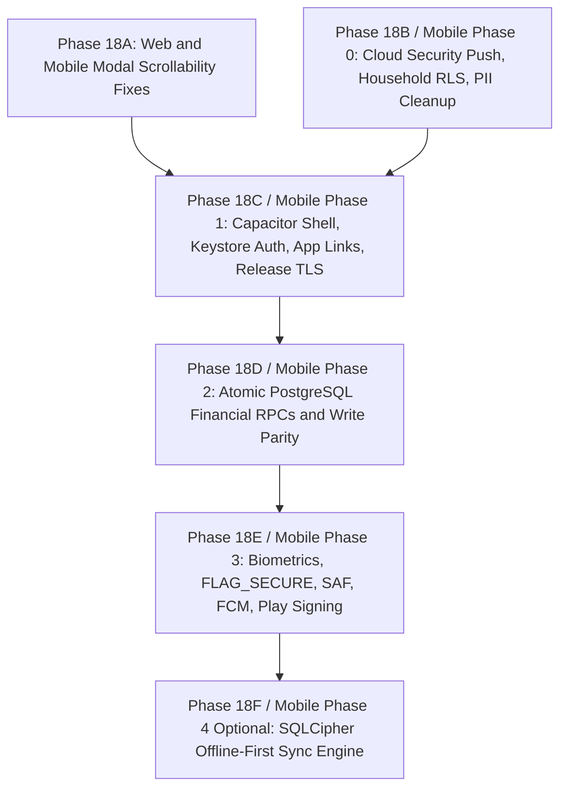

# WealthNest — Next-Phase Development Plan (UX Modal Hardening & Android Direct-Supabase Roadmap)

**Status:** Pending Review (Proposed Continuation After Phase 17 in [ongoing.md](file:///home/ketan/projects/Krisha/wealthNest/docs/progress/ongoing.md))  
**Scope:** Web/Mobile Modal Scrollability Remediation + Phase 0–4 Android Direct-Supabase Engineering Execution  
**Baseline State:** Phases 0–17 complete in repo; Security Remediation P0–P3 repo fixes committed ([security-remediation-checklist.md](file:///home/ketan/projects/Krisha/wealthNest/docs/security/security-remediation-checklist.md)) with live DB push & pgTAP verification pending.

---

## 1. Executive Decisions & Reference Index

This document consolidates the two completed post-Phase-17 audits into an actionable, sequenced implementation plan for review before code, schema, or build-pipeline changes begin:

1. **Modal & Mobile Scrollability Remediation (`Phase 18A`)**: Immediately resolves clipped action footers (starting with the CAS Import wizard's blocked `Confirm & Import (...)` button) and standardizes responsive modal scrolling across all dialogs and sheets before mobile testing.
2. **Android Target Stack (`Capacitor` + `apps/web` + `@wealthnest/*`)**: Adopt Capacitor (`in.wealthnest.app`) wrapping the existing React + TypeScript + Vite web bundle and shared packages, retaining `src-tauri/` exclusively for Desktop builds and rejecting React Native / Native Kotlin rewrites.
3. **Direct-to-Supabase Backend Posture**: Connect Android directly to Supabase using authenticated RLS policies and atomic PostgreSQL `SECURITY DEFINER` RPCs—without introducing a separate middleware backend.

| Reference Document | Purpose |
|---|---|
| [android-architecture-assessment.md](file:///home/ketan/projects/Krisha/wealthNest/docs/mobile/android-architecture-assessment.md) | Stack recommendation, current-state audit, Keystore/PKCE/Biometric design, SQLCipher offline blueprint, risks |
| [supabase-mobile-security-checklist.md](file:///home/ketan/projects/Krisha/wealthNest/docs/mobile/supabase-mobile-security-checklist.md) | P0 mobile blockers, `CRED-*`, `AUTH-*`, `DATA-*`, `NET-*`, `LOG-*`, `FIN-*`, and `TC-MOB-ISO-01`..`10` |
| [mobile-api-operation-matrix.md](file:///home/ketan/projects/Krisha/wealthNest/docs/mobile/mobile-api-operation-matrix.md) | 14-domain operation classification, 24 existing RPCs, and 12 target atomic RPC specifications |
| [security-remediation-checklist.md](file:///home/ketan/projects/Krisha/wealthNest/docs/security/security-remediation-checklist.md) | Pre-existing P0–P3 security checklist and pending cloud deployment verification steps |
| [wealthnest-ux-audit.md](file:///home/ketan/projects/Krisha/wealthNest/docs/product/wealthnest-ux-audit.md) | Earlier Phase 10 product/UX audit baseline |
| [ongoing.md](file:///home/ketan/projects/Krisha/wealthNest/docs/progress/ongoing.md) | Completed Phases 0–17 execution history |

---

## 2. Sequenced Phase Dependency Graph

> [!NOTE]
> `Phase 18A` (UI/Modal CSS & layout fixes) and `Phase 18B` (SQL migrations, RLS, PII cleanup) have zero code conflicts and can run in parallel once reviewed, or land as two focused PRs before Capacitor wrapping (`Phase 18C`).

---

## 3. Phase 18A — Web & Mobile Modal Scrollability UX Remediation

### 3.1 Priority 0 Bug: CAS Import Wizard (`Confirm & Import` Button Unreachable)

Observed defect in NSDL / CDSL / CAMS CAS import preview on mobile viewports: the bottom action bar containing `Confirm & Import (...)` is pushed below the viewport fold inside a non-scrolling intermediate container, leaving only the preview table's internal scroll active.

**Root Causes Verified in Source:**
- [ImportCasModal.tsx](file:///home/ketan/projects/Krisha/wealthNest/apps/web/src/components/portfolio/ImportCasModal.tsx#L351-L353): Modal container sets `max-h-[90vh]` (`vh` instead of `dvh`, breaking under mobile browser chrome/soft keyboards), and Header at line 353 lacks `shrink-0`.
- [CasPreviewStep.tsx](file:///home/ketan/projects/Krisha/wealthNest/apps/web/src/components/portfolio/CasPreviewStep.tsx#L88-L286):
  - Line 88 uses `className="space-y-4 pt-4 flex-1 flex flex-col min-h-0 overflow-hidden"`, blocking outer vertical scroll for the step when viewport height is tight.
  - Lines 90–242 (metadata summary, warnings, legal-entity/broker dropdowns, and Equity/MF/History tabs) consume >400px vertically on mobile without collapsing or residing in an outer scroll region.
  - Lines 265–286 Actions footer (`flex items-center justify-between pt-3 border-t border-border/80`) lacks `shrink-0`, lacks responsive stacking/wrapping (`flex-col-reverse sm:flex-row`), and renders a long multi-count button label (`Confirm & Import (...)`) that overflows narrow widths.
- [CasPreviewTables.tsx](file:///home/ketan/projects/Krisha/wealthNest/apps/web/src/components/portfolio/CasPreviewTables.tsx#L87): Three preview table scroll containers (lines 87, 210, 331) enforce `min-h-[300px] max-h-[460px] flex-1 overflow-y-auto`, which combines with the uncollapsed upper metadata (~400px+) to overflow the `90vh` card and push the footer completely out of view. Right-hand columns also clip on portrait phones without responsive horizontal scrolling or compact mobile columns.
- [CasSummaryStep.tsx](file:///home/ketan/projects/Krisha/wealthNest/apps/web/src/components/portfolio/CasSummaryStep.tsx#L15): Step wrapper lacks `flex-1 min-h-0 overflow-y-auto`.
- [CasUploadStep.tsx](file:///home/ketan/projects/Krisha/wealthNest/apps/web/src/components/portfolio/CasUploadStep.tsx#L60): Step wrapper has `overflow-y-auto` but lacks `flex-1 min-h-0`.

**Phase 18A.1 Tasks:**
- [x] Update `ImportCasModal.tsx` shell to `max-h-[90dvh] flex flex-col overflow-hidden`, tighten mobile padding (`p-4 sm:p-6`), and mark the Header wrapper `shrink-0`.
- [x] Refactor `CasPreviewStep.tsx` layout so metadata/warnings/selectors + preview table share a single clean outer vertical scroll region (`flex-1 min-h-0 overflow-y-auto overscroll-contain`) on compact/mobile viewports (or make upper metadata compact/collapsible), and pin the Actions footer outside the scrollable region with `shrink-0`.
- [x] Make the `CasPreviewStep.tsx` footer responsive (`flex-wrap`, single DOM nodes ordered with `order-1 sm:order-3` full-width primary CTA on mobile + `sm:ml-auto` alignment on desktop) so the primary submit label wraps cleanly on `< 640px` screens.
- [x] Replace `min-h-[300px]` in `CasPreviewTables.tsx` with `min-h-[160px] max-h-[50dvh] sm:max-h-[420px] overflow-auto overscroll-contain`, and set `min-w-[600px]` on wide preview tables so columns scroll horizontally instead of collapsing.
- [x] Add `flex-1 min-h-0 overflow-y-auto overscroll-contain` + pinned `shrink-0` footers in `CasSummaryStep.tsx` and `CasUploadStep.tsx`.

---

### 3.2 Group A — High-Risk Modals & Sheets Missing Outer Height Clamps

| Target File | Lines | Observed Defect | Planned Fix |
|---|---|---|---|
| [AdminAuditLogsPage.tsx](file:///home/ketan/projects/Krisha/wealthNest/apps/web/src/pages/admin/AdminAuditLogsPage.tsx#L203-L261) | 203–261 | Detail modal card has no `max-h-[90dvh]` or `flex-col`; only `<pre>` at line 246 clamps at `max-h-60`, overflowing shorter/split screens | Add `max-h-[90dvh] flex flex-col overflow-hidden`, `shrink-0` header/footer, and `flex-1 min-h-0 overflow-y-auto overscroll-contain` body |
| [ConfirmActionModal.tsx](file:///home/ketan/projects/Krisha/wealthNest/apps/web/src/components/ui/ConfirmActionModal.tsx#L39-L115) | 39–115 | Backdrop uses `height: '100vh'`; card at line 51 lacks `max-h-[90dvh] overflow-y-auto`, overflowing landscape phones or long prompts | Switch backdrop to `100dvh` (`inset-0 fixed`), add `max-h-[90dvh] flex flex-col overflow-hidden` card with scrollable body and `shrink-0` action row |
| [CommandPaletteModal.tsx](file:///home/ketan/projects/Krisha/wealthNest/apps/web/src/components/layout/CommandPaletteModal.tsx#L191-L258) | 191–258 | Top offset `pt-[15vh]` plus inner `max-h-80` lacks outer `max-h-[90dvh] flex-col`; Android soft keyboard pushes list off-screen | Constrain card to `max-h-[85dvh] flex flex-col overflow-hidden` with `mt-6 sm:mt-[12dvh]`, `shrink-0` search input/footer, and `flex-1 min-h-0 overflow-y-auto` results |
| [BottomNavigationBar.tsx](file:///home/ketan/projects/Krisha/wealthNest/apps/web/src/components/layout/BottomNavigationBar.tsx#L237-L283) | 237–283 | "More Modules" mobile drawer lacks `max-h-[85dvh] overflow-y-auto` and safe-area bottom inset | Add `max-h-[85dvh] flex flex-col overflow-hidden pb-[env(safe-area-inset-bottom)]`, `shrink-0` handle/header, and `flex-1 min-h-0 overflow-y-auto` menu list |

---

### 3.3 Group B — Medium-Risk Modals (`vh` Units & Missing Flex Boundaries)

| Target File | Lines | Observed Defect | Planned Fix |
|---|---|---|---|
| [ManageFamilyModal.tsx](file:///home/ketan/projects/Krisha/wealthNest/apps/web/src/components/family/ManageFamilyModal.tsx#L57-L305) | 57–305 | Uses `max-h-[90vh]`; Header (59), Tabs (82), Footer (296) lack `shrink-0`; body (110) lacks `min-h-0` | Switch to `max-h-[90dvh]`, mark Header/Tabs/Footer `shrink-0`, set body to `flex-1 min-h-0 overflow-y-auto overscroll-contain` |
| [GlobalQuickAddModal.tsx](file:///home/ketan/projects/Krisha/wealthNest/apps/web/src/components/layout/GlobalQuickAddModal.tsx#L130-L192) | 130–192 | Uses `max-h-[90vh]`; Header (133) & Footer (189) lack `shrink-0`; body (155) lacks `flex-1 min-h-0` | Switch to `max-h-[90dvh]`, add `shrink-0` to Header/Footer and `flex-1 min-h-0 overscroll-contain` to body |
| [TermsPrivacyModal.tsx](file:///home/ketan/projects/Krisha/wealthNest/apps/web/src/components/auth/TermsPrivacyModal.tsx#L14-L67) | 14–67 | Uses `max-h-[80vh]`; Header (15) & Footer (57) lack `shrink-0`; body (28) lacks `flex-1 min-h-0` | Switch to `max-h-[85dvh]`, add `shrink-0` to Header/Footer and `flex-1 min-h-0 overscroll-contain` to body |

---

### 3.4 Group C — Shared Pattern Standardization (`<ResponsiveModalShell>`)

All 15 Group C modals already enforce `max-h-[90dvh] flex flex-col overflow-hidden`, but duplicate raw wrapper boilerplate and often omit `min-h-0`, `overscroll-contain`, or dedicated sticky action footers for small screens / soft keyboards:
- **Portfolio / Holdings**: `AddHoldingModal.tsx` (#L196, #L229), `EditHoldingModal.tsx` (#L103, #L127)
- **Transactions**: `RecordTransactionModal.tsx` (#L192, #L215)
- **Liabilities & Real Estate**: `AddLiabilityModal.tsx` (#L216, #L240), `UpdateBalanceModal.tsx` (#L100, #L124, nested `max-h-36` #L221), `UpdateValuationModal.tsx` (#L88, #L110), `RecordEmiPaymentModal.tsx` (#L105, #L128), `PropertyMetricsModal.tsx` (#L87, #L111)
- **Goals & Vault**: `AddGoalModal.tsx` (#L186, #L209), `UploadDocumentModal.tsx` (#L138, #L164)
- **Auth & Connection**: `BackendConnectionModal.tsx` (#L152, #L170), `ForgotPasswordModal.tsx` (#L60, #L75)
- **Admin**: `AdminUserProvisionModal.tsx` (#L167, #L203), `AdminUserStatusModal.tsx` (#L79, #L92), `ViewAsUserModal.tsx` (#L61, #L84)

**Phase 18A.4 Tasks:**
- [x] Introduce a shared UI wrapper ([`ResponsiveModalShell.tsx`](file:///home/ketan/projects/Krisha/wealthNest/apps/web/src/components/ui/ResponsiveModalShell.tsx)) enforcing:
  - Backdrop with `fixed inset-0 z-50 flex justify-center overscroll-contain` (`center`, `sheet`, and `top` presets with `env(safe-area-inset-bottom)` clearance)
  - Panel with `max-h-[90dvh] w-full flex flex-col overflow-hidden` (`82dvh` for `top`)
  - Slots for `header`/`subHeader` (`shrink-0`), `children` body (`flex-1 min-h-0 overflow-y-auto overscroll-contain` or flex `scrollableBody={false}`), `formProps` wrapper spanning body + footer, and optional `footer` (`shrink-0`) so primary CTAs remain anchored and tappable on short viewports and when Android keyboards open.
- [x] Migrate all 23 Group A, Group B, Group C, and CAS overlays onto `<ResponsiveModalShell>` and verify via automated JSDOM regression suite (`ResponsiveModalScrollability.test.tsx`).

### 3.5 Phase 18A Verification Gate
- **Automated JSDOM Gate**: Verified in [`ResponsiveModalScrollability.test.tsx`](file:///home/ketan/projects/Krisha/wealthNest/apps/web/src/__tests__/ResponsiveModalScrollability.test.tsx).
- **Manual Browser / Device QA Checklist**: Documented in [`phase-18a-modal-scrollability-verification.md`](file:///home/ketan/projects/Krisha/wealthNest/docs/QA/phase-18a-modal-scrollability-verification.md) for testing across:
  - **Mobile portrait (`360x780`, `390x844`)**: `ImportCasModal` reaches and clicks `Confirm & Import (...)` with 50+ equities; all Group A/B/C primary buttons stay visible without horizontal page overflow.
  - **Mobile short / soft-keyboard height (`360x480`)**: Body scrolls independently while sticky header and footer stay within `90dvh`.
  - **Desktop (`1280x800`)**: No visual regressions in centered dialog alignment or table ergonomics.

---

## 4. Phase 18B (Mobile Phase 0) — Database, RLS & Client Integrity Prerequisites

Addresses every P0 database, household isolation, and plaintext storage blocker before compiling or distributing an Android client.

### 4.1 Complete Pending Security Checklist Cloud Actions
- [ ] Apply migrations `20260101000017`, `20260101000018`, and `20260101000019` to QA/Production via `supabase db push` ([security-remediation-checklist.md](file:///home/ketan/projects/Krisha/wealthNest/docs/security/security-remediation-checklist.md)).
- [ ] Deploy Edge Function `admin-create-user` with verified `ALLOWED_ORIGINS`.
- [ ] Execute `supabase start && supabase test db` (or trigger `.github/workflows/security-checks.yml`) to pass all existing pgTAP assertions (`P2-4`, `P3-3`).
- [ ] Verify live Supabase Cloud Auth settings: HIBP breached-password check, `[auth.rate_limit]`, SMTP confirmation delivery (`P1-4`, `P3-4`), and TLS termination (`P1-5`).

### 4.2 Household Collaboration & RLS Fixes
- [ ] Add household RLS policies for `loan_payments`, `asset_liability_links`, and `import_batches` (currently lacking household-scoped policies matching `20260101000014`).
- [ ] Add a SQL cross-household validation check/trigger on `asset_liability_links` preventing linking an asset from Household A to a liability in Household B.
- [ ] Remove redundant client `.eq('user_id', userId)` query filters across the **6 Supabase adapter modules** where `20260101000014` already permits household-shared reads, so non-owner household members see shared holdings/assets/transactions cleanly.
- [ ] Replace local `useState` demo state in `HouseholdSharingCard.tsx` with persistent database-backed invite/member flows (`create_household_invite`, `accept_household_invite` RPCs / tables).
- [ ] Move `wealthnest_family_privacy_rules` out of browser `localStorage` into server-enforced household privacy scope tables/policies so field/record privacy holds across devices and direct REST calls.

### 4.3 Plaintext Token / PII Cleanup & Auth Hygiene
- [ ] Strip unencrypted defaults and PII storage in `localStorage` across:
  - `ConnectionManager` (stop storing live Supabase auth tokens in WebView `localStorage` once native adapter lands; isolate connection metadata cleanly)
  - `SupabaseUserAdapter`
  - `SupabaseFamilyAdapter` (`panMasked` stored in plaintext)
  - `PreferencesContext`
  - `TauriSqliteAdapter` (`LOCAL_SQLITE_STORAGE_KEY`)
- [ ] Remove silent `DEMO_ADMIN_USERS` `catch` fallbacks from `SupabaseAdminAdapter` (`admin.adapter.ts`) and `support-session.adapter.ts` outside explicit mock/test environments so authorization/RPC failures fail closed with explicit re-auth or error UI (`AUTH-08`).
- [ ] Update [ForgotPasswordModal.tsx](file:///home/ketan/projects/Krisha/wealthNest/apps/web/src/components/auth/ForgotPasswordModal.tsx#L55-L149) and `HouseholdSharingCard.tsx` to resolve verified Android App Link HTTPS `redirectTo` targets (`https://app.wealthnest.in/auth/reset-password`, `/auth/callback`, `/invite/...`) rather than relying on `${window.location.origin}` inside WebView (`capacitor://localhost` / `https://tauri.localhost` / `http://localhost`), avoiding unverified custom-scheme hijacking (`AUTH-04`).

### 4.4 Pre-RPC Financial & Adapter Bug Fixes
- [ ] Fix `DeleteTransactionUseCase`: remove direct `.delete()` against `transactions` (which fails because `transactions` has no `DELETE` RLS policy) and route corrections through an immutable offsetting/reversal flow (completed atomically via `correct_transaction_atomic` in Phase 18D, `FIN-03`).
- [ ] Fix `SupabaseBackupAdapter`: replace queries/writes against non-existent `financial_goals` with `goals`, and fix holding restore conflict resolution (`idx_holdings_user_asset_account`) for multi-folio mutual funds (`FIN-05`).

### 4.5 Cross-Household & Role-Escalation Test Suite (`TC-MOB-ISO-01`..`10`)
- [ ] Implement pgTAP + API integration tests covering all 10 scenarios defined in [supabase-mobile-security-checklist.md](file:///home/ketan/projects/Krisha/wealthNest/docs/mobile/supabase-mobile-security-checklist.md):
  - `TC-MOB-ISO-01`: Cross-household data read IDOR (`holdings`, `goals`, `transactions`, `liabilities`, `family_members`, `portfolio_accounts`).
  - `TC-MOB-ISO-02`: Cross-household FK injection (`record_transaction_atomic`, `asset_liability_links`, `goal_holding_allocations`).
  - `TC-MOB-ISO-03`: Household `viewer` write escalation & Storage upload rejection.
  - `TC-MOB-ISO-04`: Household `member` role self-promotion to `primary_owner`.
  - `TC-MOB-ISO-05`: Household bootstrap & `created_by` ownership hijack.
  - `TC-MOB-ISO-06`: Vault Storage path traversal (`createSignedUrl`) & MIME/signature spoofing.
  - `TC-MOB-ISO-07`: Multi-device household sharing consistency (after `.eq('user_id', userId)` removal & `loan_payments` RLS).
  - `TC-MOB-ISO-08`: Support session hijack & read-only escape (`support_get_user_portfolio` / 15-min TTL).
  - `TC-MOB-ISO-09`: Post-revocation stale mobile cache & offline outbox rejection + local purge.
  - `TC-MOB-ISO-10`: `anon` key abuse against financial tables & `admin_*` RPCs without authenticated bearer JWT.

---

## 5. Phase 18C (Mobile Phase 1) — Capacitor Shell, Keystore Auth & App Links

- [ ] **Capacitor Project Setup (`in.wealthnest.app`)**: Initialize Android Capacitor project consuming built `apps/web` (`dist/`) and `@wealthnest/*`, keeping `src-tauri/` scoped strictly to Desktop targets.
- [ ] **Hardware-Backed Token Persistence (`CRED-01`–`CRED-05`)**: Implement Capacitor `SupportedStorage` backed by Android Keystore / `EncryptedSharedPreferences` for Supabase session/refresh tokens; zero plaintext tokens or PII in WebView `localStorage`, `SharedPreferences`, or unencrypted files.
- [ ] **Auth Lifecycle & Single-Flight Refresh (`AUTH-01`–`AUTH-08`)**:
  - Implement a single-flight refresh-token mutex across concurrent API calls and app resume transitions.
  - Handle expired sessions gracefully (`SIGNED_OUT` / re-auth modal without infinite refresh loops).
  - Ensure logout revokes Supabase refresh sessions globally/locally and purges Keystore + in-memory TanStack/React state + local caches.
- [ ] **Verified App Links & Chrome Custom Tabs PKCE OAuth**:
  - Publish `/.well-known/assetlinks.json` on the production web domain matching Play App Signing SHA-256 fingerprint.
  - Configure Android `intent-filter` with `android:autoVerify="true"` for email verification, password reset (`ForgotPasswordModal`), and household invite acceptance links.
  - Route Google/OAuth flows through Chrome Custom Tabs with PKCE (disallowing embedded WebView OAuth).
- [ ] **Network & Transport Security (`NET-01`–`NET-06`)**:
  - Ship Android `network_security_config.xml` enforcing `cleartextTrafficPermitted="false"` and TLS 1.2+ in release builds (`NET-01`, `NET-02`).
  - Lock down runtime endpoint switching (`server-config.ts` / `ConnectionManager` LAN HTTP overrides) in production release builds (`!import.meta.env.DEV` / release build flag) and harden WebView settings (`allowFileAccess = false`, release CSP `connect-src` limited to `*.supabase.co`, `WebView.setWebContentsDebuggingEnabled(false)`) (`NET-03`).
  - Disable `/admin` mutation flows on consumer APK builds or explicitly approve WebView origins in `admin-create-user` `ALLOWED_ORIGINS` (`NET-04`).

---

## 6. Phase 18D (Mobile Phase 2) — Atomic PostgreSQL Financial RPCs & Write Parity

Replace multi-step client writes with transactional `SECURITY DEFINER` PostgreSQL RPCs (`SET search_path = public`), enforcing `auth.uid()` household checks, `idempotency_key` deduplication, row locks, and integer `bigint` paise strings/BigInts end-to-end (`FIN-01`–`FIN-07`). Full payload schemas live in [mobile-api-operation-matrix.md](file:///home/ketan/projects/Krisha/wealthNest/docs/mobile/mobile-api-operation-matrix.md).

- [ ] **`record_emi_payment_atomic`**: Fix `RecordEmiPaymentModal` defect (`FIN-01`: currently writing only to `liability_balances`, skipping `loan_payments`, and overwriting same-date entries) by atomically inserting `loan_payments` ledger rows and updating `liability_balances` with row locks (`FOR UPDATE`) & idempotency.
- [ ] **`record_transaction_atomic`, `transfer_between_accounts_atomic` & `correct_transaction_atomic`**: Replace non-atomic `RecordTransactionUseCase` (`FIN-02` with `expected_version` optimistic concurrency) and broken `DeleteTransactionUseCase` `.delete()` (`FIN-03` compensating reversal + corrected entry).
- [ ] **`record_loan_prepayment_atomic` & `create_liability_atomic`**: Replace `CreateLiabilityUseCase` and add transactional prepayment principal reduction + schedule recalculation trigger.
- [ ] **`record_asset_valuation_atomic` & `create_holding_with_asset_atomic`**: Replace `RecordAssetValuationUseCase` (enforcing `p_as_of_date >= latest_valuation_date` per `FIN-06` so backdated entries do not overwrite `holdings.current_value_cents`) and `SupabaseHoldingAdapter.createHoldingWithAsset`.
- [ ] **`confirm_cas_import_batch_atomic`**: Replace `SupabaseCasImportAdapter` N+1 sequential loop (`FIN-04`) with single-transaction batch confirmation (`import_batches`, holdings/assets upserts, and historical transactions) guarded by batch lock + SHA-256/`idempotency_key`.
- [ ] **`restore_portfolio_atomic`**: Replace `SupabaseBackupAdapter` multi-table client restore (`FIN-05`: targeting `goals` and `idx_holdings_user_asset_account` with strict `auth.uid()` scoping).
- [ ] **`create_household_invite` & `accept_household_invite`**: Back `HouseholdSharingCard.tsx` with hashed single-use token invites, expiry, and atomic `household_members` enrollment.
- [ ] **`upsert_device_push_token` & `revoke_device_push_token`**: Secure per-user FCM registration lifecycle.
- [ ] **Verification**: Add pgTAP transaction-rollback & idempotency tests (confirming partial failure leaves zero orphaned rows and duplicate retries return the original result).

---

## 7. Phase 18E (Mobile Phase 3) — Native Security, Device Integrations & Play Release Hardening

- [ ] **Biometric App Lock**: Integrate Android `BiometricPrompt` (strong biometrics with device-credential fallback option) to lock portfolio screens on cold start/background resume and gate sensitive actions (vault viewing, exports, security changes).
- [ ] **Window, Backup & Session State Protections (`DATA-04`–`DATA-06`)**:
  - Enable `WindowManager.LayoutParams.FLAG_SECURE` on authenticated financial/vault views to mask sensitive screens and Android task-switcher thumbnails (`DATA-04`).
  - Set `android:allowBackup="false"` and `android:fullBackupContent="false"` in `AndroidManifest.xml` so cloud/ADB backups cannot extract Keystore wrappers, SQLite files, or WebView state (`DATA-05`).
  - Clear ephemeral `SupportSessionContext` IDs across Android cold kills and enforce 15-min server expiry cleanly in UI (`DATA-06`).
- [ ] **Android SAF / Photo Picker for CAS & Document Vault (`SupabaseDocumentVaultAdapter`)**: Use Android Storage Access Framework / Photo Picker with least-privilege permissions (`NET-05` — no broad storage permissions), validate magic headers (`validateVaultFileBlobSignature` / caps from `P2-6`), process in app-private `cacheDir`, use `FileProvider` only for explicit user shares, and immediately delete temp preview/parse copies (`DATA-03`).
- [ ] **FCM Push Notifications**: Create `user_device_tokens` table + RLS, wire Android FCM token registration via `upsert_device_push_token`, and implement Supabase Edge Function `dispatch-push-notification` for EMI reminders, CAS completion, and household alerts (never putting balances/PII in unencrypted notification payloads).
- [ ] **Release Signing, Shrinking & Crash Reporting (`NET-06`, `LOG-01`)**:
  - Remove hardcoded local keystore credentials (`wealthnest123`) from `scripts/build-android.sh`; migrate CI to encrypted GitHub secrets + **Google Play App Signing**.
  - Enable R8/ProGuard (`minifyEnabled true`, `shrinkResources true`) and release mapping upload (`NET-06`).
  - Integrate crash/error telemetry with a redaction layer modeled on `sanitizeAuditMetadata()` scrubbing JWTs, refresh tokens, `apikey`, PAN, Aadhaar, email, net worth numbers, holding names, and signed Storage URLs before Crashlytics/Sentry emission or `console.*` output (`LOG-01`).

---

## 8. Phase 18F (Mobile Phase 4, Optional Future) — SQLCipher Offline-First Sync Engine

Only initiate after Phases 18B–18E pass production stability gates:
- [ ] Align `@capacitor-community/sqlite` (SQLCipher encrypted with Android Keystore key, `DATA-02`) schema with existing `sqlite-schema.ts`.
- [ ] Build read-model cache layer for Portfolio, Liabilities, Transactions, and Goals.
- [ ] Implement persistent `sync_outbox` queue with client-generated UUIDv4/v7 IDs and server-enforced idempotency keys mapped to Phase 18D atomic RPCs.
- [ ] Enforce tiered conflict resolution (append-only immutable ledger + reversal for financial rows; optimistic concurrency/version check for edits).
- [ ] Handle re-authentication pauses (retain encrypted queue across session expiry until user re-authenticates) and **membership/role revocation wipe** (`TC-MOB-ISO-09`: mark non-retryable, refresh role, immediately purge unauthorized household records from SQLCipher cache & TanStack Query).
- [ ] Schedule reliable background flush via Android `WorkManager` under `CONNECTED` network constraints, plus sync-status UI badges/retry diagnostics.

---

## 9. Review Checklist & Go/No-Go Sign-Off Decisions

Before implementation begins, confirm the following decisions during review:

| # | Decision / External Dependency | Default Plan | Sign-Off Needed |
|---|---|---|---|
| 1 | Split **Phase 18A** (CAS + Group A/B/C modal scroll fixes) as the immediate first PR? | Yes — unblocks CAS import testing on web & mobile immediately | Reviewer approval |
| 2 | Production domain for HTTPS App Links (`assetlinks.json`) & OAuth/reset redirects? | Verify canonical production hostname (`https://app.wealthnest.in`) before Phase 18C | Confirm exact domain |
| 3 | Retain `src-tauri/` for Desktop only while adopting Capacitor for Android? | Yes ([android-architecture-assessment.md](file:///home/ketan/projects/Krisha/wealthNest/docs/mobile/android-architecture-assessment.md)) | Architecture approval |
| 4 | Google Play Console (`in.wealthnest.app` + Play App Signing SHA-256) & Firebase project (FCM)? | Play Console SHA-256 required before **Phase 18C** (`assetlinks.json`); Firebase FCM required before **Phase 18E** | Confirm package ID & accounts |
| 5 | Keep Phase 18F (SQLCipher offline writes) deferred behind online + read-cache Phases 18B–18E? | Yes — reduces conflict/audit risk on initial launch | Scope approval |
