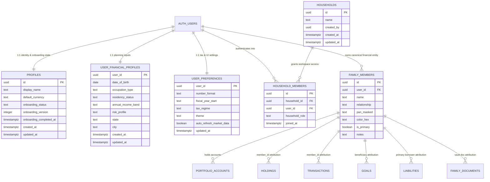
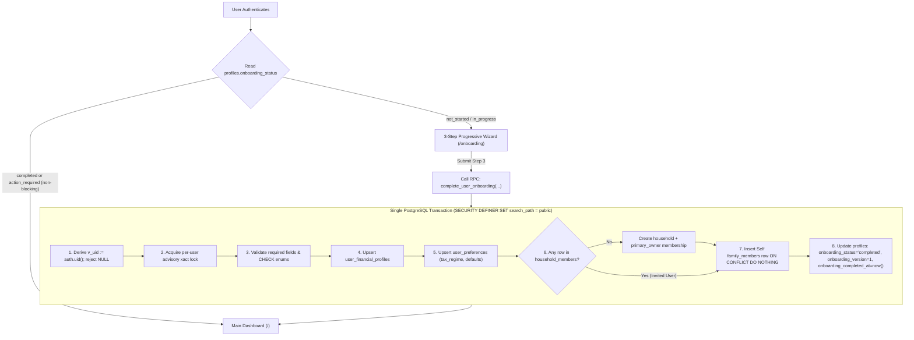

# WealthNest — Progressive Onboarding, Financial Profile & Atomic Household Provisioning (Future Scope)

**Document Type:** Future-Scope Product, Database & Security Architecture Specification  
**Target Phase:** Phase 19 (Planned Future Scope following Phase 18A/18B groundwork)  
**Status:** Proposed for Review (Zero Code, Schemas, Dependencies, or RLS Policies Modified)  
**Umbrella Plan:** [next-phase-development-plan.md](file:///home/ketan/projects/Krisha/wealthNest/docs/next-phase-development-plan.md)

---

## 1. Guiding Principle

Collect only what WealthNest needs to provide meaningful financial insights, keep sensitive identity information optional, and structure onboarding as a versioned, progressive profile-completion flow rather than a permanent access barrier or rigid sign-up gate.

### Key Architectural Corrections Applied to Current Codebase Baseline
1. **Keep `/signup` Minimal:** Retain Name, Email, Password, and Terms acceptance at sign-up ([SignUpPage.tsx](file:///home/ketan/projects/Krisha/wealthNest/apps/web/src/pages/SignUpPage.tsx)); collect planning attributes only after email verification and authentication.
2. **Do Not Duplicate `taxRegime`:** Keep [UserPreferences](file:///home/ketan/projects/Krisha/wealthNest/packages/domain/src/models/user.ts#L6-L22) as the single source of truth for `taxRegime` (`'new' | 'old'`), `numberFormat`, `fiscalYearStart`, `theme`, and `autoRefreshMarketData`, and promote it from browser `localStorage` into PostgreSQL (`public.user_preferences`).
3. **Never Treat Income Bands as Exact Tax Inputs:** Use `annual_income_band` solely for broad planning nudges and educational guidance, never as exact marginal-tax or taxable-income math.
4. **Versioned Onboarding & Feature-Scoped Eligibility:** Track `onboarding_version` and `onboarding_status` explicitly so adding future required fields or optional features (e.g., tax harvesting or PAN matching) never breaks existing or legacy accounts.
5. **Preserve Canonical `family_members` Entity:** Today `public.family_members` ([20260101000007](file:///home/ketan/projects/Krisha/wealthNest/supabase/migrations/20260101000007_family_entities_and_accounts.sql#L6-L19)) is already the canonical financial-person table referenced via `member_id` across `portfolio_accounts`, `holdings`, `transactions`, `goals`, `liabilities`, and `family_documents`. Do **not** introduce a competing person table or prematurely migrate `family_members` off `user_id` ownership before multi-tenant household refactors settle.
6. **Atomic Server-Side Provisioning & True DB Enforcement:** Provision `user_financial_profiles`, `user_preferences`, `households`, `household_members`, `family_members` (`self`), and `profiles.onboarding_*` state in one transactional PostgreSQL `SECURITY DEFINER` RPC — never via independent frontend inserts — and guard `onboarding_*` columns at the database layer so `ProtectedRoute` is never the sole boundary.

---

## 2. Field Classification & Data Minimization

### 2.1 Core Onboarding Fields (Required Before Personalized Insights)

| Field | Status | Planning Purpose & Safeguard |
|---|---|---|
| `date_of_birth` | **Required** | Age-based retirement/goal horizons and timeline modeling. Do **not** hard-code senior-citizen tax slab assumptions universally across regimes or financial years; do **not** require account-owner age >= 18 to track minors as `family_members` (`'child'`). |
| `occupation_type` | **Required** | Emergency fund runway heuristics (`3–6` vs `6–12+` months) and cashflow stability context. |
| `residency_status` | **Required** | Tax & repatriation reporting context (`resident_indian`, `nri`, `rnor`) with plain-language definitions and a disclaimer that users may confirm status with a tax advisor. |
| `taxRegime` (`UserPreferences`) | **Required (Configurable)** | Updated via existing [UserPreferences](file:///home/ketan/projects/Krisha/wealthNest/packages/domain/src/models/user.ts#L10) (`'new' | 'old'`), editable anytime under Settings without duplicating a column on `profiles`. |
| `risk_profile` | **Required (Guided)** | Initial planning input (`conservative`, `moderate`, `aggressive`) collected alongside horizon/loss-tolerance/liquidity context — treated as a planning baseline, **not** as an automatic portfolio suitability mandate overriding actual holdings and liquidity needs. |

### 2.2 Optional Progressive Profile Fields (Deferred / Feature-Gated Only)

| Field | Recommendation | Justification & Safeguard |
|---|---|---|
| `annual_income_band` | **Optional initially** | Broad savings/emergency-fund nudges (`below_7l`, `7l_15l`, `15l_30l`, `30l_50l`, `above_50l`, `prefer_not_to_say`); excluded from exact tax calculation formulas. |
| `state` & `city` | **Optional** | Coarse cost-of-living / regional planning estimates. |
| `gender` | **Optional** | Collected only if optional demographic reporting justifies it. |
| `phone` | **Optional** | Deferred until phone/SMS/WhatsApp alert features exist and are explicitly enabled. |
| `pan` | **Optional (Strictly Justified)** | Continue using `family_members.pan_masked` for display only. If reliable duplicate detection is genuinely needed later, compute a server-side keyed HMAC using tightly restricted secret storage — **never** a plain unsalted hash or plaintext raw PAN column. |
| `professional_details` | **Optional** | Future executive/tax-pack report customization. |

### 2.3 Strictly Never Collect / Store
- **Aadhaar numbers** (full or masked biometric IDs).
- **Bank account login / net-banking credentials**.
- **Broker login credentials / passwords / API secrets**.
- **CAS PDF passwords:** Maintain current in-memory client-side decryption (`pdfjs-dist` in `ImportCasModal`); **never** persist CAS passwords or automatically combine/log `DOB + PAN` in DB rows, analytics, error reports, or `localStorage`.

---

## 3. Codebase Database & Security Audit (Verified Baseline Deltas)

Before implementing Phase 19 migrations, every schema assumption must align with the repository's verified state across migrations `20260101000001`–`20260101000019`:

| Domain | Verified Repo State | Audit Gap / Migration Risk | Mitigation in Phase 19 |
|---|---|---|---|
| **User Profile (`public.profiles`)** | Columns: `id`, `display_name`, `default_currency` (default `'INR'` via [000013](file:///home/ketan/projects/Krisha/wealthNest/supabase/migrations/20260101000013_profiles_insert_policy_and_inr_default.sql#L13-L25)), `created_at`, `updated_at`. RLS allows blanket `UPDATE` where `auth.uid() = id` ([000001](file:///home/ketan/projects/Krisha/wealthNest/supabase/migrations/20260101000001_core_schema.sql#L94-L96)). | Adding `onboarding_status` / `onboarding_version` / `onboarding_completed_at` with blanket self-`UPDATE` RLS lets any authenticated client bypass onboarding via REST `PATCH` on `profiles`. | Protect `onboarding_*` columns with a `BEFORE UPDATE` trigger rejecting client changes unless executed by the `complete_user_onboarding` RPC / privileged DB context. |
| **Preferences (`UserPreferences`)** | Stored **only** in browser `localStorage` (`wealthnest_user_preferences`) inside [user.adapter.ts](file:///home/ketan/projects/Krisha/wealthNest/apps/web/src/lib/supabase/user.adapter.ts#L91-L177), and `preferences_json` in [sqlite-schema.ts](file:///home/ketan/projects/Krisha/wealthNest/packages/application/src/persistence/sqlite/sqlite-schema.ts#L7-L14). Zero `user_preferences` table in Supabase today. | `complete_user_onboarding()` cannot update `user_preferences.tax_regime` inside a Postgres transaction until `public.user_preferences` exists in Supabase and adapters read/write it. | Create `public.user_preferences` (paired with Phase 18B `localStorage` cleanup), keeping `profiles.default_currency` as the single currency column to avoid drift. |
| **Households (`households`, `household_members`)** | [000009](file:///home/ketan/projects/Krisha/wealthNest/supabase/migrations/20260101000009_admin_portal_and_access_control.sql#L154-L172) defines `households(id, name, created_by, created_at, updated_at)` and `household_members(id, household_id, user_id, household_role, joined_at)` with `'primary_owner' \| 'member' \| 'viewer'`. Write policies hardened in [000019](file:///home/ketan/projects/Krisha/wealthNest/supabase/migrations/20260101000019_household_membership_write_rls.sql#L101-L180). | `UNIQUE (household_id, user_id)` prevents duplicate membership in the *same* household, not duplicate initial households on concurrent calls; invited users joining someone else's household already hold a row in `household_members`. | Lock per-user via `pg_advisory_xact_lock`, check `EXISTS (SELECT 1 FROM household_members WHERE user_id = v_uid)` before creating a new household, and preserve `household_role`. |
| **Canonical Financial Member (`family_members`)** | Referenced via `member_id` in `portfolio_accounts` (`NOT NULL`), `holdings`, `transactions`, `goals`, `liabilities` (+ `co_borrower_ids`), `family_documents`. Keyed by `user_id` with household sharing via [000014](file:///home/ketan/projects/Krisha/wealthNest/supabase/migrations/20260101000014_household_collaboration_rls.sql#L139-L150). | Only a non-unique index (`idx_family_members_user_rel`) exists ([000007](file:///home/ketan/projects/Krisha/wealthNest/supabase/migrations/20260101000007_family_entities_and_accounts.sql#L21-L22)); multiple `'self'` or `is_primary` rows can be inserted. | Deduplicate safely if present, add partial unique indexes (`UNIQUE (user_id) WHERE relationship = 'self'`, `UNIQUE (user_id) WHERE is_primary = true`), and use `ON CONFLICT DO NOTHING`. |
| **Signup Trigger & Existing Users** | `handle_new_user()` creates only `profiles`. Admin-created users enter via [admin-create-user](file:///home/ketan/projects/Krisha/wealthNest/supabase/functions/admin-create-user/index.ts#L140-L151). Seeded / existing QA accounts (`investor@wealthnest.local`) already own holdings without onboarding fields. | Enforcing RLS / route blocks on `onboarding_status = 'completed'` without backfill would immediately lock out existing seeded, QA, and admin-created accounts. | Backfill pre-cutover active accounts / users with existing holdings to `onboarding_status = 'completed', onboarding_version = 0` (legacy grandfathered) and allow soft profile review banners without blocking access. |

---

## 4. Target Database Architecture & Schema Specification

### 4.1 Logical Entity Relationship Diagram

### 4.2 Enumerated Check Constraints (Prefer `CHECK` over Rigid Postgres `ENUM`)

- **`profiles.onboarding_status`:** `'not_started' | 'in_progress' | 'completed' | 'action_required'` (default `'not_started'`).
- **`user_financial_profiles.occupation_type`:** `'salaried' | 'freelancer_consultant' | 'business_owner' | 'government_retired' | 'homemaker' | 'student' | 'nri_overseas' | 'other'`.
- **`user_financial_profiles.residency_status`:** `'resident_indian' | 'nri' | 'rnor'`.
- **`user_financial_profiles.annual_income_band`:** `'below_7l' | '7l_15l' | '15l_30l' | '30l_50l' | 'above_50l' | 'prefer_not_to_say'` (nullable / optional).
- **`user_financial_profiles.risk_profile`:** `'conservative' | 'moderate' | 'aggressive'`.
- **`user_preferences`:** Aligns strictly with `@wealthnest/domain` `UserPreferences`:
  - `number_format`: `'en-IN' | 'en-US'` (default `'en-IN'`)
  - `fiscal_year_start`: `'04-01' | '01-01'` (default `'04-01'`)
  - `tax_regime`: `'new' | 'old'` (default `'new'`)
  - `theme`: `'dark' | 'light' | 'system'` (default `'dark'`)
  - `auto_refresh_market_data`: `boolean` (default `true`)

---

## 5. End-to-End Progressive Onboarding & Atomic Provisioning Flow

### 5.1 User Journey (3 Progressive Screens — Never 10–15 Inputs on One Form)

1. **Minimal Sign-Up (`/signup`)** -> Email verification -> Authenticated login (`/login` / `/auth/callback`).
2. **Onboarding Redirect (`onboarding_status IN ('not_started', 'in_progress')`)** -> Route to `/onboarding`:
   - **Welcome Context Banner:** Concise explanation of why planning details personalize calculations (and that sensitive IDs are not required).
   - **Step 1 of 3 — About You (Required):** `date_of_birth`, `occupation_type`, `residency_status` (with clear Indian tax-residency tooltips + optional `state`/`city`/`annual_income_band`).
   - **Step 2 of 3 — Financial Preferences (Required):** `tax_regime` (`New` vs `Old`, updating `UserPreferences`) and guided `risk_profile` prompt incorporating horizon & liquidity framing rather than an unexplained label.
   - **Step 3 of 3 — Household & Self Profile Setup:** Confirm Household Name (e.g., `"<Name>'s Household"`) or recognize an already-accepted household invitation, then submit.
3. **Atomic Server Completion -> Dashboard (`/`):** Immediately show Net Worth dashboard with empty-state guidance to add assets, import CAS/broker statements, or add additional `family_members`.

### 5.2 Transactional Provisioning Contract: `complete_user_onboarding(...)`

#### Security & Idempotency Rules for `complete_user_onboarding(...)`
- **No Arbitrary `p_user_id`:** Strictly read `auth.uid()` internally; `REVOKE ALL` from `PUBLIC, anon`; `GRANT EXECUTE TO authenticated`.
- **Save-as-You-Go Draft Support (Optional):** Saving Step 1 alone can write allowed fields to `user_financial_profiles` and advance `onboarding_status` from `'not_started'` -> `'in_progress'` via a dedicated RPC (so closing a browser mid-wizard preserves progress without marking `'completed'`).
- **Profile Edits After Completion:** Users updating settings under `/settings` later modify `user_financial_profiles` / `user_preferences` directly under RLS without falsely resetting `onboarding_status`. If future required onboarding rules change (`version = 2`), show non-destructive `'action_required'` prompts targeting only newly added features/fields.

---

## 6. Access Control, RLS Gating & Privacy Boundaries

| Layer | Enforced Responsibility |
|---|---|
| **React Router (`ProtectedRoute`)** | Navigational UX only: redirect `not_started` / `in_progress` users from `/`, `/portfolio`, `/goals`, etc. to `/onboarding`; keep `/settings/profile` and logout accessible. |
| **PostgreSQL Column / Trigger Guard** | Block direct client REST writes to `profiles.onboarding_status`, `onboarding_version`, and `onboarding_completed_at`. |
| **Supabase RLS & Write RPCs** | Prevent direct PostgREST inserts/mutations to financial tables (`holdings`, `transactions`, `liabilities`, `goals`, `portfolio_accounts`, `family_documents`) until user belongs to a household and has `onboarding_status IN ('completed', 'action_required')` (with grandfathered `version = 0` users remaining `completed`). |
| **SQLite / Mobile Parity** | Mirror `user_preferences` and onboarding flags in [sqlite-schema.ts](file:///home/ketan/projects/Krisha/wealthNest/packages/application/src/persistence/sqlite/sqlite-schema.ts); follow Phase 18B rules against caching DOB/PAN or financial numbers in unencrypted WebView `localStorage`. |
| **DPDP & Audit Hygiene** | Display field-level purpose & consent copy during onboarding; support edit/export/deletion flows; never record DOB, PAN, or income values inside `admin_audit_logs` or crash telemetry. |

---

## 7. Phased Future Execution Plan (Phase 19A–19E)

| Sub-Phase | Deliverables & Scope | Dependencies / Alignment |
|---|---|---|
| **19A: Schema, Constraints & Backfill** | Add `profiles.onboarding_*` columns + update-guard trigger; create `user_financial_profiles` and `user_preferences` tables + RLS; add partial unique indexes on `family_members` (`'self'`, `is_primary`); grandfather existing pre-cutover users (`onboarding_version = 0`). | Aligns directly with **Phase 18B** Postgres preference migration & `localStorage` cleanup. |
| **19B: Atomic RPC & Domain/Adapter Parity** | Implement `complete_user_onboarding(...)` (plus optional `save_onboarding_draft(...)`); update `@wealthnest/domain`, `ManageUserSettingsUseCase`, `SupabaseUserAdapter`, and SQLite schema parity. | Requires **19A**. |
| **19C: Progressive 3-Step Onboarding UI (`/onboarding`)** | Build minimal step-by-step UI (About You, Financial Preferences with India-first residency/risk context, Household confirmation), integrate `PreferencesProvider` & `FamilyProvider` cache invalidation on completion. | Requires **19B**; follows [ResponsiveModalShell](file:///home/ketan/projects/Krisha/wealthNest/apps/web/src/components/ui/ResponsiveModalShell.tsx) mobile responsiveness standards. |
| **19D: Route Gating, RLS Write Gate & pgTAP Suite** | Wire React route redirect guards (`not_started` / `in_progress`), enforce DB write gates + `profiles.onboarding_*` tamper tests in pgTAP, verify invited household member + admin-provisioned + legacy user flows. | Requires **19B** & **19C**. |
| **19E: Deferred Progressive Profile & Admin Tools (Later)** | Feature-scoped optional `phone` / `professional_details` / `pan` (masked or keyed server HMAC if deduplication required), admin onboarding version visibility, and soft profile-completion nudges. | Future iteration after **19A–19D** & Mobile Phases 18C–18E stabilize. |
