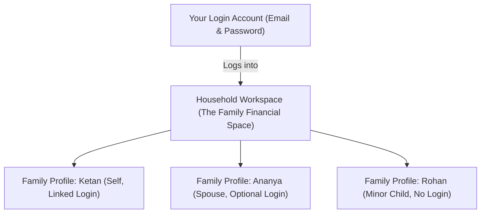

# WealthNest End-User User Manual

**Document:** WealthNest User Manual  
**Audience:** End Users, Household Owners, Administrators, and Family Members  
**Version:** 0.1 – Initial Draft  
**Status:** Draft – Pending Product Review  
**Last Updated:** 2026-11-17  

> **Note on Evolving Software:** WealthNest is actively developed. As the platform evolves, specific button placements, styling, or screen flows may change slightly. This manual reflects the verified functionality of the platform.

---

## Table of Contents
1. [Introduction](#1-introduction)
2. [Getting Started](#2-getting-started)
3. [Understanding Households and Family Members](#3-understanding-households-and-family-members)
4. [Understanding User Roles and Permissions](#4-understanding-user-roles-and-permissions)
5. [Dashboard and Home Screen (System Overview)](#5-dashboard-and-home-screen-system-overview)
6. [Managing Family Members and Profiles](#6-managing-family-members-and-profiles)
7. [Managing Assets and Investments (Portfolio)](#7-managing-assets-and-investments-portfolio)
8. [Managing Real Estate and Properties](#8-managing-real-estate-and-properties)
9. [Managing Loans and Liabilities](#9-managing-loans-and-liabilities)
10. [Mutual Funds and CAS Statement Import](#10-mutual-funds-and-cas-statement-import)
11. [Transactions: Income, Expenses, and Transfers](#11-transactions-income-expenses-and-transfers)
12. [Reports, Analytics, and Tax Insights](#12-reports-analytics-and-tax-insights)
13. [Financial Goals and Targets](#13-financial-goals-and-targets)
14. [Documents Vault](#14-documents-vault)
15. [Settings and Profile Management](#15-settings-and-profile-management)
16. [Mobile Usage and Touch Experience](#16-mobile-usage-and-touch-experience)
17. [Common Tasks: Step-by-Step Guides](#17-common-tasks-step-by-step-guides)
18. [Frequently Asked Questions](#18-frequently-asked-questions)
19. [Troubleshooting](#19-troubleshooting)
20. [Financial Data Accuracy and Best Practices](#20-financial-data-accuracy-and-best-practices)
21. [Glossary of Terms](#21-glossary-of-terms)

---

## 1. Introduction

### What is WealthNest?
**WealthNest** is a comprehensive **Family Financial Management Platform**. Unlike traditional personal finance applications designed only for a single individual, WealthNest is built from the ground up for **Households** and **Families**.

It gives you a complete, consolidated picture of your family's financial position, bringing together your investments, real estate properties, bank accounts, home loans, transactions, and critical financial documents into one clear, private workspace.

### Why Use WealthNest?
- **Unified Family Wealth:** View your total household net worth in one place, or drill down into what is owned by individual family members.
- **Accurate Joint Ownership:** Handle real estate, bank accounts, and investments owned jointly by multiple family members with mathematically exact percentage splits.
- **Privacy You Can Trust:** Keep sensitive personal accounts private. Family members can choose to share collective assets with the household while keeping personal salary or discretionary investments completely private from others.
- **India-First Wealth Tracking:** Built with full support for Indian financial realities—including Demat folios, CAMS/KFintech Consolidated Account Statements (CAS), HUF (Hindu Undivided Family) entities, and Section 112A capital gains tax harvesting.
- **Debt & Amortization Intelligence:** Track home loans and EMIs with exact mathematical breakdown between principal repayment and interest expense.

### Who Should Use WealthNest?
- **Individuals** who want a clean, institutional-grade view of their personal investments, loans, and net worth.
- **Family Caretakers / Heads of Households** who manage finances for their spouse, children, or elderly parents from a single login.
- **Collaborative Families** where multiple adult family members have separate accounts and work together on joint wealth goals.

---

## 2. Getting Started

### 2.1 Accessing WealthNest
WealthNest is accessible via any modern desktop or mobile web browser (Chrome, Edge, Safari, Firefox, Brave) at your organization's designated address, or through the WealthNest desktop application.

### 2.2 Registering a New Account
1. Open WealthNest and click **Create an account** on the login page (or go directly to `/signup`).
2. Fill in the required fields:
   - **Full Name:** Enter your full legal name (e.g., `Ketan Vaghela`).
   - **Email Address:** Enter a valid email address you control.
   - **Password:** Choose a strong password. It must be at least **12 characters long** and contain at least one uppercase letter, one lowercase letter, one number, and one symbol (e.g., `@`, `#`, `$`, `%`).
3. Click **Create Secure Account**.
4. *(If email confirmation is enabled)* Check your inbox for a verification email and click the confirmation link.

<!-- Screenshot Placeholder: login-screen.png -->
> **[Screenshot: Login & Registration Screen]**  
> *Path: `docs/user-manual/assets/login-screen.png`*  
> *Shows the clean authentication screen with Full Name, Email, Password complexity indicators, and the "Create Secure Account" button.*

### 2.3 Logging In & Logging Out
- **To Log In:** Visit `/login`, enter your registered email and password, and click **Sign In**.
- **To Log Out:** Click your user profile icon in the top-right header, or click **Sign Out** at the bottom of the left sidebar.

### 2.4 Account Recovery (Forgot Password)
If you forget your password:
1. On the login screen, click **Forgot password?**.
2. Enter your registered email address in the recovery modal.
3. Click **Send Reset Link**.
4. Open the email you receive and click the recovery link.
5. You will arrive at the **Reset Password** screen (`/reset-password`). Enter and confirm your new 12+ character password, then click **Update Password**.

### 2.5 Your First Login & Default Household
When you register, WealthNest automatically creates your personal **Household Workspace** and designates you as the **Primary Owner**. You will arrive at the **System Overview** (Dashboard) ready to begin adding your family profiles and assets!

---

## 3. Understanding Households and Family Members

To get the most out of WealthNest, it helps to understand three distinct concepts:

1. **Login Account:** A person's credentials (email and password) used to sign into the software.
2. **Household:** A shared financial container representing your family. All assets, loans, and documents belong to a household.
3. **Family Member Profile:** A financial identity within the household (e.g., "Ketan", "Ananya", "Rohan (Minor)"). Financial assets are owned by family member profiles, **not** directly by login accounts.

### Practical Real-World Scenarios

#### Scenario A: One Person Manages the Entire Family
*Example:* Ketan manages the household finances. He creates profiles for himself, his wife Ananya, and his son Rohan. He enters all properties, bank accounts, and mutual funds under their respective profiles. Neither Ananya nor Rohan needs to create a login account. Ketan has a complete view of the family's wealth.

#### Scenario B: Family Members Have Separate Logins
*Example:* Ananya wants to log in from her own laptop to view the family portfolio and manage her personal savings. Ketan invites Ananya's email address from **Settings** > **Family & Demats**. Ananya accepts the invitation, creates her login, and is linked to her existing profile.

#### Scenario C: A Family Member Keeps Personal Accounts Private
*Example:* Ananya adds her personal discretionary investment account. She marks it as **`Owner Only`**. Ketan can see the shared family house and joint funds, but Ananya's personal account is visible **only to her**. Even though Ketan created the household, the system strictly protects Ananya's privacy.

---

## 4. Understanding User Roles and Permissions

WealthNest enforces clear governance roles within each household:

| Role | Who It Is For | What They Can Do | What They Cannot Do |
|---|---|---|---|
| **Primary Owner** | The creator of the household (or the person ownership was transferred to). | Full administrative control: rename household, manage billing, invite members, appoint/remove Administrators, transfer ownership, manage all shared assets. | **Cannot** view `Owner Only` or `Restricted` records belonging to other linked members. |
| **Administrator** | A trusted family member (e.g. spouse or co-head) appointed by the Owner. | Day-to-day management: add/edit shared assets, manage unlinked member profiles (children/HUF), upload family documents, invite members. | **Cannot** appoint other Admins, cannot transfer ownership, cannot view private records of other linked members. |
| **Member** | An adult family member with their own login account. | Manage their own personal profile, add and edit their own assets, participate in joint assets, upload private or shared documents. | **Cannot** modify other members' personal records, cannot manage unlinked profiles unless granted permission, cannot alter household settings. |
| **Viewer** | An auditor, accountant, or family member who only needs to review information. | View household-shared net worth, asset allocation charts, financial goals, and shared documents. | **Strictly read-only**: Cannot add, edit, or delete any financial records, loans, or settings. |
| **Managed Profile** | A family member without a login account (minors, elderly parents, HUFs). | Represents a legal owner of assets, bank accounts, and loans. | Has no login capability. Managed directly by Household Admins and Owners. |

### The Three Privacy Levels
Whenever you add or edit a holding, property, loan, goal, or document, you choose its **Visibility**:

- **`Household Shared` (Default):** Visible to everyone in the household. Use this for the family home, shared savings, joint mutual funds, and emergency funds.
- **`Owner Only`:** Visible **strictly to the owner(s)** of that record. Hidden from all other members, including the Household Owner and Administrators.
- **`Restricted`:** Visible to the owner plus specific household members you choose via delegation.

---

## 5. Dashboard and Home Screen (System Overview)

The **System Overview** screen (`/`) is your financial control center.

<!-- Screenshot Placeholder: dashboard-overview.png -->
> **[Screenshot: System Overview Dashboard]**  
> *Path: `docs/user-manual/assets/dashboard-overview.png`*  
> *Shows the top KPI cards (Total Net Worth, Total Assets, Total Liabilities, Liquid Assets), asset allocation donut chart, family wealth breakdown widget, and recent transaction activity.*

### Understanding the Key Metrics
1. **Total Net Worth:** The true bottom line of your family's wealth:
   $$\text{Net Worth} = \text{Total Assets} - \text{Total Liabilities}$$
2. **Total Assets:** The combined market value of all investments, properties, bank balances, and physical assets.
3. **Total Liabilities:** The total outstanding principal owed across all home loans, vehicle loans, personal loans, and credit cards.
4. **Liquid Assets:** Funds accessible quickly in an emergency (cash, savings accounts, liquid mutual funds).

### Illustrative Example
| Category | Example Value | Description |
|---|---:|---|
| **Total Assets** | ₹1,25,00,000 | Family home (₹80L) + Mutual Funds & Stocks (₹35L) + Bank & Gold (₹10L) |
| **Total Liabilities** | ₹35,00,000 | Outstanding Home Loan principal balance |
| **Net Worth** | **₹90,00,000** | What the family truly owns free and clear |

*(Note: These figures are illustrative examples to show how calculations work.)*

### Privacy Mode (Eye Icon)
In the top-right header, click the **Eye icon** (or press `Ctrl+K` and type "privacy"). This instantly masks all monetary values across every screen with `••••••`. Use this whenever reviewing your finances in public or near others!

---

## 6. Managing Family Members and Profiles

### How to Access Family Management
1. In the sidebar, click **Settings**.
2. Select the **Family & Demats** tab.
3. Click **Manage Family Profiles**.

<!-- Screenshot Placeholder: add-family-member.png -->
> **[Screenshot: Manage Family Profiles Modal]**  
> *Path: `docs/user-manual/assets/add-family-member.png`*  
> *Shows the member list, "Add Family Member" button, Entity Type selector (Individual, Minor, HUF), and relationship dropdown.*

### Adding a New Family Profile
1. In the modal, click **Add Family Member**.
2. Enter their **Full Name** (e.g., `Ananya Vaghela` or `Rohan Vaghela`).
3. Select their **Relationship** (`Self`, `Spouse`, `Child`, `Parent`, `Sibling`, or `Other`).
4. Select the **Entity Type**:
   - `Individual`: Standard adult individual.
   - `Minor`: Dependent child under legal age.
   - `HUF`: Hindu Undivided Family tax entity.
5. *(Optional)* Enter their **PAN Number** and **Date of Birth**.
6. Click **Add Member**.

### Inviting a Family Member to Log In
If a family member wants to access WealthNest with their own login:
1. Under **Settings** > **Family & Demats**, locate the **Household Members & Sharing** section.
2. Under **Invite Family Member**, enter their **Email Address**.
3. Choose their **Role** (`Member`, `Viewer`, or `Administrator`).
4. *(Optional)* Link the invite to their existing Family Member Profile.
5. Click **Generate Invite Link**.
6. Copy the one-time link and share it with them. When they open the link, they can sign up or log in to join your household!

---

## 7. Managing Assets and Investments (Portfolio)

The **Portfolio** page (`/portfolio`) tracks your liquid and market investments.

<!-- Screenshot Placeholder: asset-list.png -->
> **[Screenshot: Portfolio Holdings View]**  
> *Path: `docs/user-manual/assets/asset-list.png`*  
> *Shows grouped investment asset classes, holding cards with current market value, gain/loss badges, and the "+ Add Holding" button.*

### Supported Asset Classes
- **Indian Equities:** Stocks listed on NSE and BSE.
- **Mutual Funds:** Direct and Regular mutual funds across Equity, Debt, and Hybrid categories.
- **Fixed Deposits:** Bank and corporate term deposits.
- **Gold & Precious Metals:** Sovereign Gold Bonds (SGB), digital gold, and physical gold.
- **Cash & Bank Accounts:** Savings and current account balances.
- **Other Investments:** PPF, EPF, NPS, or alternative assets.

### Adding an Investment Holding
1. Go to **Portfolio** and click **+ Add Holding** in the upper right.
2. Select the **Asset Class** (e.g., *Mutual Funds* or *Indian Equities*).
3. Enter the **Asset Name** (e.g., `Parag Parikh Flexi Cap Fund`).
4. *(Optional)* Enter the **Ticker / Symbol** or **ISIN**.
5. Enter your **Quantity / Units** and your **Average Unit Cost (₹)**.
6. Enter the **Current Market Value (₹)**.
7. **Assign Ownership:** Select the family member who owns this asset.
   - For joint holdings, click **Add Co-Owner** and specify percentage shares (e.g. 50% / 50%).
8. **Set Visibility:** Choose `Household Shared` or `Owner Only`.
9. Click **Save Holding**.

---

## 8. Managing Real Estate and Properties

The **Real Estate** page (`/real-estate`) tracks residential, commercial, land, and rental properties.

<!-- Screenshot Placeholder: property-details.png -->
> **[Screenshot: Real Estate Property Details]**  
> *Path: `docs/user-manual/assets/property-details.png`*  
> *Shows property cards with purchase cost, latest valuation, outstanding linked mortgage, net equity, and the "+ Add Property" button.*

### Adding a Property
1. Navigate to **Real Estate** and click **+ Add Property**.
2. Enter the **Property Name** (e.g., `Bandra 2BHK Residence` or `Pune Commercial Office`).
3. Select the **Property Type** (`Residential`, `Commercial`, `Plot / Land`, or `Other`).
4. Enter the **Purchase Price (₹)** and **Purchase Date**.
5. Enter the **Current Market Valuation (₹)** and the date of the valuation.
6. Enter the **Location / City**.
7. *(Optional)* If the property is rented out, enter the **Gross Monthly Rent (₹)**.
8. Assign the **Owner(s)** and **Visibility**.
9. Click **Save Property**.

### Understanding Property Equity
$$\text{Property Equity} = \text{Current Market Value} - \text{Outstanding Home Loan}$$

*Example:*
- **Current Market Value:** ₹90,00,000
- **Outstanding Home Loan:** ₹35,00,000
- **Net Equity Owned by Family:** **₹55,00,000**

### Updating Property Valuation
To keep your net worth accurate, update your property's valuation periodically:
1. Locate the property card on the Real Estate page.
2. Click **Update Valuation**.
3. Enter the new estimated market value, the effective date, and notes (e.g., "Annual municipal guidance valuation").
4. Click **Record Valuation**.

---

## 9. Managing Loans and Liabilities

The **Loans & Liabilities** page (`/liabilities`) tracks what your family owes.

<!-- Screenshot Placeholder: loan-details.png -->
> **[Screenshot: Loans & Liabilities Overview]**  
> *Path: `docs/user-manual/assets/loan-details.png`*  
> *Shows active loans, interest rates, monthly EMI obligations, prepayment simulator, and the "+ Add Liability" button.*

### Adding a Loan or Liability
1. Go to **Loans & Liabilities** and click **+ Add Liability**.
2. Select the **Liability Type** (`Home Loan`, `Vehicle Loan`, `Personal Loan`, `Education Loan`, `Credit Card`, or `Other`).
3. Enter the **Lender / Bank Name** (e.g., `SBI Home Finance` or `HDFC Bank`).
4. Enter the **Original Loan Amount (₹)** and the **Current Outstanding Principal (₹)**.
5. Enter the **Annual Interest Rate (%)** (e.g., `8.50%`).
6. Enter the **Monthly EMI Amount (₹)** and the **Tenure in Months**.
7. *(Optional)* **Link to Asset:** Link a home loan directly to a property to track equity automatically!
8. Assign the **Primary Borrower** and any **Co-Borrowers**.
9. Click **Save Liability**.

### Recording an EMI Payment
WealthNest separates principal repayment from interest expense:
1. On the loan card, click **Record EMI**.
2. Enter the **Payment Date** and the **Total EMI Paid (₹)**.
3. The system calculates the interest charged and principal deducted.
4. Click **Confirm Payment**.

### Loan Prepayment Simulator
Want to know how much interest you can save by paying extra?
1. On the Loans page, scroll to the **Loan Prepayment Simulator**.
2. Select your loan and enter a planned lump-sum prepayment amount (e.g., ₹2,00,000).
3. The simulator immediately displays:
   - Total interest rupees saved over the remaining loan term.
   - Number of months shaved off your loan tenure!

---

## 10. Mutual Funds and CAS Statement Import

If you invest in Indian Mutual Funds, you do not need to type in dozens of funds by hand. WealthNest includes a built-in **CAS Statement Importer**.

<!-- Screenshot Placeholder: investment-overview.png -->
> **[Screenshot: CAS Import Modal]**  
> *Path: `docs/user-manual/assets/investment-overview.png`*  
> *Shows the drag-and-drop file upload zone for CAMS/KFintech CAS PDFs, password entry field, and folio preview table.*

### How to Import Your Portfolio
1. Go to **Portfolio** and click the **Import CAS** button.
2. **Upload File:** Drag and drop your official Consolidated Account Statement (CAS) PDF downloaded from CAMS (`camsonline.com`) or KFintech.
3. **Password:** Enter the password used to open your CAS PDF (typically your uppercase PAN or your registered email address).
4. Click **Parse Statement**.
5. **Preview Folios:** Review the detected mutual fund schemes, folio numbers, units, and valuation amounts.
6. **Assign Family Member:** Select which family member owns these folios.
7. Click **Confirm & Import Holdings**. All schemes will be added to your portfolio automatically!

---

## 11. Transactions: Income, Expenses, and Transfers

The **Transactions** page (`/transactions`) manages your financial activity.

### Recording a Transaction
1. Click **Transactions** in the sidebar and click **Record Transaction** (or use the green `+` button).
2. Select the **Transaction Type**:
   - `Income / Deposit`: Salary, business receipts, dividends, interest earned.
   - `Expense / Withdrawal`: Household spending, bills, fees.
   - `Buy / Sell`: Purchasing or liquidating investment assets.
   - `Transfer`: Moving money between your own accounts.
3. Enter the **Amount (₹)** and **Date**.
4. Select the **Account** or **Family Member**.
5. Select a **Category** (e.g., Groceries, Utilities, Healthcare, Investment).
6. Click **Save Transaction**.

### Crucial Principle: Internal Transfers
When you transfer ₹25,000 from your State Bank of India savings account to your ICICI Demat trading account, select **Transfer**. Because the money never leaves the family, WealthNest treats it as a balance sheet movement and **does not count it as new income or living expense**, keeping your cashflow reports accurate!

---

## 12. Reports, Analytics, and Tax Insights

The **Analytics** page (`/analytics`) gives you institutional-level financial intelligence.

<!-- Screenshot Placeholder: reports-overview.png -->
> **[Screenshot: Analytics & Reports View]**  
> *Path: `docs/user-manual/assets/reports-overview.png`*  
> *Shows net worth progression charts, asset class allocation donuts, debt-to-assets gauge, and LTCG tax harvesting summaries.*

### Key Reports Available
1. **Net Worth Evolution:** Visual timeline showing how your family's net worth has grown across months and years.
2. **Asset Allocation Breakdown:** Donut chart illustrating your portfolio diversification across Equities, Mutual Funds, Real Estate, Gold, and Cash.
3. **Debt-to-Assets Ratio:** Measures financial leverage. A ratio under 30% indicates a conservative, low-risk debt profile.
4. **Section 112A LTCG Tax Harvesting:** In India, Long-Term Capital Gains on listed equities and equity mutual funds enjoy an annual tax exemption (up to ₹1.25 Lakh per financial year). This report analyzes your unrealized gains to help you identify tax-loss and tax-gain harvesting opportunities before March 31!

---

## 13. Financial Goals and Targets

The **Goals & Targets** page (`/goals`) helps your family plan for future milestones.

### Creating a Goal
1. Go to **Goals & Targets** and click **+ Add Goal**.
2. Select the **Goal Category**:
   - `Retirement`
   - `Child Education`
   - `Home Purchase`
   - `Emergency Fund`
   - `Vehicle Purchase`
   - `Vacation / Other`
3. Enter the **Goal Name** (e.g., `Rohan's College Education Fund`).
4. Enter the **Target Amount (₹)** and your **Target Date**.
5. Enter your **Initial Saved Amount** and planned **Monthly Contribution (₹)**.
6. Set your **Expected Annual Return (%)** (e.g., `12.0%` for equity funds) and **Expected Inflation Rate (%)** (e.g., `6.0%`).
7. Click **Create Goal**.

The goal card will project whether your current savings rate is on track to achieve your target by the deadline!

---

## 14. Documents Vault

The **Documents Vault** (`/documents`) provides secure storage for critical family papers.

### Uploading a Document
1. Navigate to **Documents Vault** and click **Upload Document**.
2. Select your file (PDF, PNG, or JPG up to 20 MiB).
3. Select the **Category** (`Property Deeds`, `Tax & PAN`, `Identity & KYC`, `Insurance Policies`, `Wills & Estate`, `Loan Agreements`, or `General`).
4. Assign the document to a specific **Family Member** or link it to an **Asset/Property**.
5. Choose the **Privacy Level** (`Household Shared` or `Owner Only`).
6. Click **Upload to Vault**.

All vault files are stored in a private bucket and are only downloaded through secure, short-lived links when requested by an authorized family member.

---

## 15. Settings and Profile Management

Click **Settings** (`/settings`) in the sidebar to configure your workspace:

- **Profile & Security Tab:** Update your display name, change your password, and review security recommendations.
- **Family & Demats Tab:** Manage family member profiles, register Demat accounts, and dispatch household invitation links.
- **Localization & Tax Tab:** Confirm your base currency (INR / ₹) and default financial year calendar (April–March).
- **Data Portability Tab:** Download an offline **JSON Backup** or **CSV Spreadsheet** of your entire household portfolio. You can also restore your data from an existing backup file.
- **Server Connection Tab:** Advanced diagnostics showing server connectivity status.

---

## 16. Mobile Usage and Touch Experience

WealthNest is designed to work smoothly on mobile browsers (smartphones and tablets):

<!-- Screenshot Placeholder: mobile-dashboard.png -->
> **[Screenshot: Mobile Navigation & Bottom Bar]**  
> *Path: `docs/user-manual/assets/mobile-dashboard.png`*  
> *Shows the mobile view with compact KPI cards, the floating green "+" Quick-Add action button, and the persistent bottom navigation bar.*

### Key Mobile Features
- **Bottom Navigation Bar:** Fast access to *Overview*, *Portfolio*, *Liabilities*, and *Settings*.
- **Elevated Quick-Add Button (`+`):** Located in the center of the bottom navigation bar. Tap it from any screen to quickly add a holding, liability, transaction, or property.
- **More Modules Sheet:** Tap **More** on the bottom bar to open a slide-up menu accessing *Real Estate*, *Analytics*, *Goals*, and the *Documents Vault*.
- **Responsive Tables:** Financial tables scroll smoothly horizontally on narrow screens without breaking the page layout.

---

## 17. Common Tasks: Step-by-Step Guides

### Guide 1: How to Add a Jointly Owned Property
1. Go to **Real Estate** > Click **+ Add Property**.
2. Enter property details (Name, Purchase Cost, Current Valuation).
3. Under **Ownership**, select the primary owner. Click **Add Co-Owner** and select the second family member.
4. Set the ownership percentage (e.g., `50%` and `50%`).
5. Click **Save Property**.

### Guide 2: How to Connect a Home Loan to a Property
1. Go to **Loans & Liabilities** > Click **+ Add Liability**.
2. Select `Home Loan` and enter bank name, outstanding balance, rate, and EMI.
3. Under **Linked Asset / Property**, choose your property from the dropdown list.
4. Click **Save Liability**.
5. Return to **Real Estate**—your property card now displays your exact **Property Equity**!

### Guide 3: How to Export Your Data for Backup
1. Go to **Settings** > Click the **Data Portability** tab.
2. Under **Export Financial Data**, click **Export JSON Backup**.
3. A `.json` file containing your complete portfolio is saved to your computer or phone downloads folder. Keep this file in a safe place!

---

## 18. Frequently Asked Questions

*For a standalone copy of these questions, see the [WealthNest User FAQ](file:///home/ketan/projects/Krisha/wealthNest/docs/user-manual/wealthnest-faq.md).*

1. **Can I manage my family's finances alone without inviting them?**  
   Yes! You can create profiles for every family member and record everything yourself.
2. **Can my spouse have a separate login?**  
   Yes. Send them an invite link from **Settings** > **Family & Demats**.
3. **Can household administrators see my private investments?**  
   No. Any holding, property, or document marked **`Owner Only`** is visible strictly to you.
4. **How do I hide my numbers in public?**  
   Click the **Eye icon** in the top navigation bar to turn on Privacy Mode.
5. **Does an internal bank transfer affect my monthly expenses?**  
   No. Select **Transfer** as the transaction type so your cash flow totals remain clean and accurate.

---

## 19. Troubleshooting

| Problem | Possible Reason | What to Do |
|---|---|---|
| **Unable to sign up** | Password does not meet complexity rules. | Ensure password has 12+ characters, with uppercase, lowercase, numbers, and symbols. |
| **Password reset link not arriving** | Email entered incorrectly or in spam folder. | Check your spam/junk folder. Verify email spelling on the recovery screen. |
| **Numbers showing as `••••••`** | Privacy Mode is active. | Click the **Eye icon** in the top navigation bar to unmask your financial figures. |
| **CAS PDF upload fails** | Incorrect password or wrong file format. | Ensure the file is a PDF statement from CAMS/KFintech. Enter your PAN in uppercase as the password. |
| **Co-owner percentages rejected** | Percentages do not add up to 100%. | Adjust the shares so the sum across all co-owners equals exactly `100.00%`. |
| **Session expired / Logged out** | Security timeout or token refresh. | Log back in using your email and password. Your data is safely saved on the server. |

---

## 20. Financial Data Accuracy and Best Practices

- **Keep Valuations Current:** Update property and asset valuations periodically so your net worth reflects current market reality.
- **Record Loan Balances Accurately:** Check your annual loan statement from your bank and use **Update Balance** if interest rate changes have altered your principal amortization.
- **Double-Check CAS Imports:** Always review the folio preview table before confirming an import to ensure no duplicate entries are created.
- **Keep Critical Documents Attached:** Attach sale deeds to properties and sanction letters to loans for quick retrieval during tax season or emergencies.

> **Important Advisory:** WealthNest is a financial record-keeping and visibility platform. It is designed to assist individuals and families in tracking their financial position. WealthNest does not provide certified legal, investment, or tax advice. For specific tax filings or estate planning, consult a qualified Chartered Accountant (CA) or certified financial planner.

---

## 21. Glossary of Terms

- **Asset:** Any item of economic value owned by an individual or family (investments, cash, property, gold).
- **Liability:** Financial debt or borrowing owed to a lender or creditor (home loans, car loans, credit cards).
- **Net Worth:** Total Assets minus Total Liabilities.
- **Household:** A shared financial workspace grouping family members together.
- **Family Member Profile:** An individual financial record representing a person or entity within a household.
- **Primary Owner:** The single designated head of a household with full governance authority.
- **Administrator:** A trusted household member with permissions to manage shared records and family profiles.
- **Joint Ownership:** Legal ownership of an asset divided between two or more family members by specific percentage shares.
- **Property Equity:** The market value of a property minus the outstanding balance of any loan secured against it.
- **EMI (Equated Monthly Installment):** A fixed monthly payment made by a borrower to a lender, composed of principal repayment and interest expense.
- **CAS (Consolidated Account Statement):** A standardized statement generated by CAMS or KFintech detailing all mutual fund investments held under an investor's PAN across India.
- **LTCG (Long-Term Capital Gains):** Profits earned on the sale of listed assets held past the statutory long-term threshold, eligible for tax exemptions under Section 112A of the Indian Income Tax Act.
- **HUF (Hindu Undivided Family):** A distinct legal and tax entity recognized under Indian law for family wealth management.
